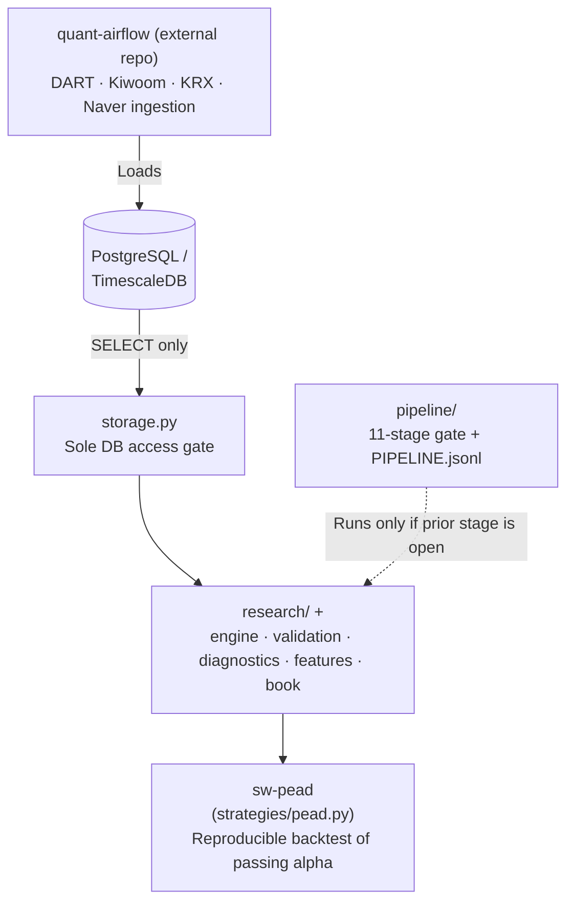

<picture>
  <source media="(prefers-color-scheme: dark)" srcset="docs/images/brand/wordmark-dark.svg">
  
</picture>

[한국어](README.md) | **English**

**Korean equity (KOSPI · KOSDAQ) research repository — a statistical validation framework that evaluates alpha hypotheses on whether they beat their own randomized versions.** The output is a verdict, not a strategy.

[](https://github.com/younghwan91/swing-it/actions/workflows/ci.yml)
[](LICENSE)
[](https://www.python.org/)
[](https://www.linkedin.com/in/younghwan-chae/)

<picture>
  <source media="(prefers-color-scheme: dark)" srcset="docs/images/hero-dark.png">
  
</picture>

- **Pure noise passes "5 of 6 positive folds" roughly half the time.** Across 5,000 synthetic strategies with zero signal, 55% clear that bar (above chart, reproducible via `scripts/make_hero.py`). Fold count is not a valid criterion.
- **The bar is the 95th percentile of the strategy's own randomized version.** Random negative controls, purge/embargo, and Deflated Sharpe are not recommendations—they are enforced in the shared harness, and a CI lint breaks the build for any gate that bypasses it.
- **Rejection is the deliverable.** Whether passed or rejected, every hypothesis leaves a verdict with supporting numbers in `research/logs/*/VERDICT.md`.

Sector-flow observation views and daily reports are not in this repository (see separate repo [`sector-flow`](https://github.com/younghwan91/sector-flow)).

This branch (`main`) contains only the screening framework. Active research such as swing/Minervini pattern search, evolutionary (GA) studies, and paper-trading ledgers live on the public branch [`feature-combined-strategy`](https://github.com/younghwan91/swing-it/tree/feature-combined-strategy) (not merged into `main`).

## Quick start

```bash
git clone https://github.com/younghwan91/swing-it && cd swing-it
uv venv && uv pip install -e ".[viz,dev]"     # Add pg extra if using TimescaleDB
cp .env.example .env                          # KR_QUANT_DB connection info (leave blank for local SQLite)

uv run python research/experiments/prop_gate.py   # Screening battery + random negative control — 1s, no DB or API keys
```

> **Data collection is not in this repository.** DART, Kiwoom, KRX, and Naver connectors and TimescaleDB ingestion belong to
> [quant-airflow](https://github.com/younghwan91/quant-airflow); this repo only reads from that DB.

## Contents

1. [What It Does](#1-what-it-does)
2. [Why It's Built This Way — Alpha Screening Framework](#2-why-its-built-this-way--alpha-screening-framework)
3. [Architecture](#3-architecture)
4. [Development](#4-development)
5. [Documentation](#5-documentation)

---

## 1. What It Does

| Command | Role | DB |
|---|---|---|
| `sw-pead` | Reproducible backtest of the gate-passing alpha | Read-only |
| `research/` + `swing_it.validation` · `diagnostics` | Screening battery that evaluates alpha hypotheses on per-trade distributions; writes verdicts and trial ledgers | Read-only (battery itself needs none) |
| `python -m swing_it.pipeline status` | Reads the ledger for each study and shows progress across the 11 stages | None |

## 2. Why It's Built This Way — Alpha Screening Framework

Backtests almost always slope upward. What this repository aims to preserve is not strategies, but **discriminating power**. Candidate alphas are evaluated on per-trade distributions, and whether passed or rejected, the verdict and supporting numbers are recorded.

The evidence in the hero chart reproduces in 1 second with no DB or API keys:

```bash
uv run python research/experiments/prop_gate.py
```

```text
  랜덤 음성대조 — 50 draws × 600 trades (게이트 위양성률 보정)
  raw ≥5/6 폴드 도달: 46.0% of draws
```

**A strategy built on pure zero-signal synthetic data achieves 5+ positive folds out of 6 with 46% probability**
(scaling to 5,000 draws with the same `seed 7` yields 55%—the first 50 draws are the exact same sequence as the hero chart, `scripts/make_hero.py`). Rather than judging by fold count, we test whether a strategy beats its own randomized version.

The gate consists of 8 checks: walk-forward reproducibility, random negative control, untouched holdout period, 2× transaction costs, fragility, Deflated Sharpe (auto-tallied from the trial ledger), purge/embargo, and universe integrity. This discipline is enforced not by convention, but by a CI lint ([`scripts/check_guardrails.py`](scripts/check_guardrails.py)). If a gate skips the shared harness or fails to log trials to the ledger, the build fails.

**Screening outcome: only PEAD passed the gate; all other alpha hypotheses and risk overlays were rejected.**
Rejected hypotheses are preserved in the exact same verdict format to prevent p-hacking the same idea with tweaked parameters.
Two follow-up studies beyond PEAD were also closed: the risk-model/optimizer book was **inconclusive** (signal was not strong enough to compare, [`research/logs/pead_optimizer/B_verified.md`](research/logs/pead_optimizer/B_verified.md)), and ML return forecasting showed **no net gain after costs** ([`research/logs/ml_forecast/S2_verified.md`](research/logs/ml_forecast/S2_verified.md)).

> Full verdict records, gate structure, edge anatomy, guardrail lints, and data schema:
> [`docs/alpha-research.md`](docs/alpha-research.md). Canonical rules are in [`docs/GUARDRAILS.md`](docs/GUARDRAILS.md),
> and the sole passing alpha is documented in [`docs/pead-strategy.md`](docs/pead-strategy.md) (reproducible CLI `sw-pead`).

**Research proceeds strictly through 11 ordered stages** — Universe → Data → Alpha Discovery → Alpha Validation (IC/ICIR) → ML Forecast → Risk Model → Portfolio → Transaction Costs → Backtest → Order Execution → Attribution & Monitoring. Each study records stage verdicts and evidence file hashes in `research/logs/<study>/PIPELINE.jsonl`; runners only execute when prior stages are open (`require_stage`), and CI verifies those declarations. This guards against mistakes and omissions, not adversarial tampering. Stage 10 (execution) and forward monitoring in Stage 11 are not implemented on `main`, and the gate only blocks code that calls them—see [`docs/PIPELINE.md`](docs/PIPELINE.md) for full limitations.

## 3. Architecture



```
src/swing_it/
├── storage.py           # Read-only DB access — sole entry point
├── pipeline/            # 11-stage gates · ledger · stage input checks
├── book/                # Portfolio book — rank/optimizer construction, risk-model inputs, costs, accounting, null
├── price_adjust.py      # Adjusted price generation (executed by *_price_adjust DAG in quant-airflow)
├── news/                # Article LLM judgment (Batch API)
└── engine/ validation/ diagnostics/ features/ strategies/   # Alpha screening library
scripts/                 # check_guardrails · make_hero
research/                # Signal definitions · experiment runners · VERDICT/TRIALS ledgers
docs/                    # alpha-research.md · GUARDRAILS.md · strategy docs
```

## 4. Development

```bash
uv run --extra dev pytest -q                  # No network or DB required
uv run --extra dev ruff check src/ tests/ research/ scripts/ examples/
uv run python scripts/check_guardrails.py     # Boundary, verdict, gate, harness, identity checks (CI step)
uv run python scripts/make_hero.py            # Regenerate hero charts → docs/images/hero-{light,dark}.png
```

`src` must not import `research` (lint rule (a)). Experiment pipeline conventions are in [`research/TEMPLATE.md`](research/TEMPLATE.md).

## 5. Documentation

| Document | Contents |
|---|---|
| [`docs/alpha-research.md`](docs/alpha-research.md) | Full verdict logs, gate architecture, edge anatomy, guardrail lints, data schema |
| [`docs/GUARDRAILS.md`](docs/GUARDRAILS.md) | Canonical research discipline — pre-registration template & definition of done |
| [`docs/PIPELINE.md`](docs/PIPELINE.md) | 11 stages — stage functions, gate rules, adding a new study, what it cannot prevent |
| [`docs/execution/DESIGN.md`](docs/execution/DESIGN.md) | Order execution design (unimplemented) |
| [`docs/pead-strategy.md`](docs/pead-strategy.md) | Sole gate-passing alpha (reproducible CLI `sw-pead`) |
| `research/logs/*/VERDICT.md` | Per-hypothesis verdicts; rejections are logged in the same format as passes |

## License

MIT — [LICENSE](LICENSE).

## Author

**Younghwan Chae (채영환)** · [GitHub @younghwan91](https://github.com/younghwan91) · [LinkedIn](https://www.linkedin.com/in/younghwan-chae/)

View the full open-source quant stack on my [profile](https://github.com/younghwan91).

## Contributing & Issues

- 🐛 Bug reports, questions, feature requests: [GitHub Issues](https://github.com/younghwan91/swing-it/issues)
- 📈 Updates: [Follow @younghwan91](https://github.com/younghwan91)
