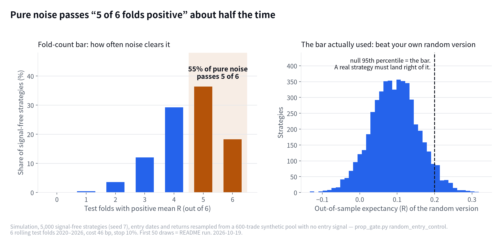

<div align="center">

<picture>
  <source media="(prefers-color-scheme: dark)" srcset="docs/images/brand/wordmark-dark.svg">
  
</picture>

# swing-it

**Korean equity (KOSPI · KOSDAQ) research repository — a statistical validation framework that evaluates alpha hypotheses on whether they beat their own randomized versions.** The output is a verdict, not a strategy.

Sector-flow observation views and daily reports live in [`sector-flow`](https://github.com/younghwan91/sector-flow); active swing, Minervini, and GA studies live on the [`feature-combined-strategy`](https://github.com/younghwan91/swing-it/tree/feature-combined-strategy) branch.

[](https://github.com/younghwan91/swing-it/actions/workflows/ci.yml)
[](LICENSE)
[](https://www.python.org/)
[](https://www.linkedin.com/in/younghwan-chae/)

[Guide](docs/guide.md) · [Alpha Research](docs/alpha-research.md) · [Guardrails](docs/GUARDRAILS.md) · [한국어](README.md)

</div>

<picture>
  <source media="(prefers-color-scheme: dark)" srcset="docs/images/hero-dark.png">
  
</picture>

<p align="center"><sub>Across 5,000 simulations, 55% of zero-signal random strategies pass 5 of 6 positive folds. The bar is the 95th percentile of the strategy's own randomized version, not fold count.</sub></p>

## Key results

Of six hypotheses judged, one passed (PEAD); the rest were rejected. Rejections get the same verdict format as passes.

- **Passed: PEAD (earnings drift).** About +8%p/yr excess return over the universe, t ~ 2.16, net-of-cost Sharpe 0.65. Adding delisted names makes the benchmark more conservative. [Verdict](research/logs/survivorship_bias/VERDICT.md)
- **Rejected: Minervini-style breakout.** Portfolio performance was leverage and compounding; per-trade expectancy of -0.029R sits below the random null (+0.078R). [Verdict](research/logs/minervini_prop/VERDICT.md)
- **Rejected: pullback mean reversion.** The premise (high win rate) did not hold (35%); -0.329R is below the null (-0.267R). [Verdict](research/logs/pullback_prop/VERDICT.md)
- **Rejected: institutional flow acceleration.** Indistinguishable from zero whether mass is market cap or traded value (+0.005R, CI [-0.095, +0.108]). The first run was VOID for lack of data; after backfill it was rerun on the unchanged preregistration and rejected. [Verdict](research/logs/inst_flow_accel/VERDICT.md)
- **Rejected: regime off-switch (200-day MA).** The +0.3%p drawdown gain sits at the 53rd percentile of a rotation null: it is time spent out of the market, not timing. [Verdict](research/logs/regime_switch/VERDICT.md)

The other rejections (retail-capitulation contrarian, earnings-surprise concentration) and their numbers are in the [verdict record](docs/alpha-research.md).

## Quick start

```bash
git clone https://github.com/younghwan91/swing-it && cd swing-it
uv venv && uv pip install -e ".[viz,dev]"     # Add pg extra if using TimescaleDB
cp .env.example .env                          # KR_QUANT_DB connection info (leave blank for local SQLite)

uv run python research/experiments/prop_gate.py   # Screening battery + random negative control — 1s, no DB or API keys
```

Running this shows pure zero-signal draws passing 5 of 6 positive folds 46% of the time across 50 random negative controls.

> **Data collection is not in this repository.** DART, Kiwoom, KRX, and Naver connectors and TimescaleDB ingestion belong to [quant-airflow](https://github.com/younghwan91/quant-airflow); this repo only reads from that DB.

## What It Does

| Command | Role | DB |
|---|---|---|
| `sw-pead` | Reproducible backtest of the gate-passing alpha | Read-only |
| `research/` + `swing_it.validation` · `diagnostics` | Screening battery that evaluates alpha hypotheses on per-trade distributions; writes verdicts and trial ledgers | Read-only (battery itself needs none) |
| `python -m swing_it.pipeline status` | Reads the ledger for each study and shows progress across the 11 stages | None |

## Why It's Built This Way

- **Pure noise passes 5 of 6 positive folds roughly half the time.** Across 5,000 synthetic strategies with zero signal, 55% clear that bar (reproducible via `scripts/make_hero.py`). Fold count is not a valid criterion.
- **The bar is the 95th percentile of the strategy's own randomized version.** Random negative controls, purge/embargo, and Deflated Sharpe are enforced in the shared harness, and a CI lint breaks the build for any gate that bypasses it.
- **Rejection is the deliverable.** Every hypothesis leaves a verdict with supporting numbers in `research/logs/*/VERDICT.md`. So far, only PEAD has passed the gate.

The 8-check gate, 11-stage pipeline, repository layout, and development commands are in the [Guide](docs/guide.md).

## Docs

| Document | Contents |
|---|---|
| [`docs/guide.md`](docs/guide.md) | Alpha screening framework, repository architecture, and development commands |
| [`docs/alpha-research.md`](docs/alpha-research.md) | Full verdict logs, gate architecture, edge anatomy, guardrail lints, data schema |
| [`docs/GUARDRAILS.md`](docs/GUARDRAILS.md) | Canonical research discipline — pre-registration template & definition of done |
| [`docs/PIPELINE.md`](docs/PIPELINE.md) | 11 stages — stage functions, gate rules, adding a new study, what it cannot prevent |
| [`docs/execution/DESIGN.md`](docs/execution/DESIGN.md) | Order execution design (unimplemented) |
| [`docs/pead-strategy.md`](docs/pead-strategy.md) | Sole gate-passing alpha (reproducible CLI `sw-pead`) |
| `research/logs/*/VERDICT.md` | Per-hypothesis verdicts; rejections are logged in the same format as passes |

## Tools by the same author

- [kiwoom-client](https://github.com/younghwan91/kiwoom-client): Kiwoom REST API Python client (with MCP server)
- [fin-checkup](https://github.com/younghwan91/fin-checkup): listed-company financial traffic lights from DART filings (measurements only, not advice)
- [krx-quant-core](https://github.com/younghwan91/krx-quant-core): shared KRX quant core (costs, risk, portfolio) used by this repo
- [portfolio-research](https://github.com/younghwan91/portfolio-research): US equity factor research that charges for its own search; rejections ship too

## Contributing & Contact

- **Author**: Younghwan Chae (채영환) · [GitHub](https://github.com/younghwan91) · [LinkedIn](https://www.linkedin.com/in/younghwan-chae/)
- **Quant stack**: View the full open-source quant stack on my [GitHub profile](https://github.com/younghwan91).
- **Issues & feedback**: Report bugs, ask questions, or suggest features in [GitHub Issues](https://github.com/younghwan91/swing-it/issues).

## License

MIT — [LICENSE](LICENSE).
