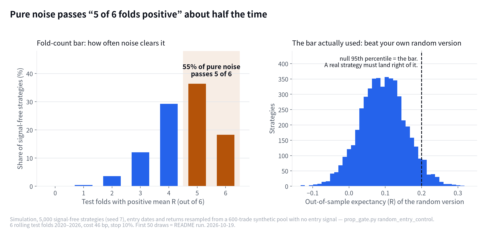

<div align="center">

<picture>
  <source media="(prefers-color-scheme: dark)" srcset="docs/images/brand/wordmark-dark.svg">
  
</picture>

# swing-it

**한국 주식(KOSPI·KOSDAQ) 리서치 저장소 — 알파 가설을 "자기 자신의 랜덤 버전을 이기는가"로 심사하는 통계적 검증 프레임워크.** 산출물은 전략이 아니라 판정문입니다.

섹터 수급 관측 화면과 일일 리포트는 [`sector-flow`](https://github.com/younghwan91/sector-flow)에서 관리하며, 스윙·미너비니·GA 연구는 [`feature-combined-strategy`](https://github.com/younghwan91/swing-it/tree/feature-combined-strategy) 브랜치에 있습니다.

[](https://github.com/younghwan91/swing-it/actions/workflows/ci.yml)
[](LICENSE)
[](https://www.python.org/)
[](https://www.linkedin.com/in/younghwan-chae/)

[가이드](docs/guide.md) · [알파 연구](docs/alpha-research.md) · [가드레일](docs/GUARDRAILS.md) · [English](README.en.md)

</div>

<picture>
  <source media="(prefers-color-scheme: dark)" srcset="docs/images/hero-dark.png">
  
</picture>

<p align="center"><sub>시뮬레이션 5,000개 중 신호 없는 랜덤 전략의 55%가 6폴드 중 5폴드 양수를 통과합니다. 그래서 폴드 수가 아니라 자기 랜덤 버전의 95 백분위를 기준으로 삼습니다.</sub></p>

## Quick start

```bash
git clone https://github.com/younghwan91/swing-it && cd swing-it
uv venv && uv pip install -e ".[viz,dev]"     # TimescaleDB 를 쓰면 pg extra 를 더합니다
cp .env.example .env                          # KR_QUANT_DB 접속정보 (비우면 로컬 SQLite 를 씁니다)

uv run python research/experiments/prop_gate.py   # 심사 배터리 + 랜덤 음성대조 — DB·API 키 없이 1초
```

실행하면 50회 랜덤 음성대조에서 신호 없는 전략이 6폴드 중 5폴드 양수를 46% 확률로 통과하는 결과를 바로 확인합니다.

> **데이터 수집은 이 저장소에 없습니다.** DART·키움·KRX·네이버 커넥터와 TimescaleDB 적재는 [quant-airflow](https://github.com/younghwan91/quant-airflow)가 맡고, 이 저장소는 그 DB를 읽기만 합니다.

## 무엇을 하나

| 명령 | 하는 일 | DB |
|---|---|---|
| `sw-pead` | 게이트를 통과한 알파의 재현 백테스트를 실행합니다 | 읽기 전용 |
| `research/` + `swing_it.validation`·`diagnostics` | 알파 가설을 개별 트레이드 분포로 심사해 판정문과 시행 원장을 남깁니다 | 읽기 전용(배터리 자체는 불요) |
| `python -m swing_it.pipeline status` | 연구마다 11단계 중 어디까지 왔는지 원장에서 읽어 보여 줍니다 | 불요 |

## 왜 이렇게 만들었나

- **순수 노이즈도 6폴드 중 5폴드를 절반가량 통과합니다.** 신호가 전혀 없는 합성 전략 5,000개 중 55%가 그 기준을 넘습니다(`scripts/make_hero.py`로 재현). 폴드 수만으로는 신호를 가릴 수 없습니다.
- **자기 랜덤 버전의 95 백분위를 넘어야 통과합니다.** 랜덤 음성대조·purge/embargo·Deflated Sharpe를 공용 하버스에 고정했고, 이를 건너뛰면 CI 린트가 빌드를 멈춥니다.
- **기각도 통과와 같은 산출물입니다.** 모든 가설은 근거 숫자와 함께 `research/logs/*/VERDICT.md`에 남습니다. 지금까지 게이트를 통과한 알파는 PEAD 하나뿐입니다.

게이트 8개 관문, 11단계 파이프라인, 저장소 구조와 개발 명령은 [가이드](docs/guide.md)에서 자세히 볼 수 있습니다.

## 문서

| 문서 | 내용 |
|---|---|
| [`docs/guide.md`](docs/guide.md) | 알파 심사 프레임워크 · 저장소 구조 · 개발 및 테스트 명령 |
| [`docs/alpha-research.md`](docs/alpha-research.md) | 판정 기록 전문 · 게이트의 구조 · 엣지의 해부 · 가드레일 린트 · 데이터 스키마 |
| [`docs/GUARDRAILS.md`](docs/GUARDRAILS.md) | 연구 규율 원본 — 사전등록 템플릿·완료 정의 |
| [`docs/PIPELINE.md`](docs/PIPELINE.md) | 11단계 — 단계별 함수, 게이트 규칙, 새 연구를 더하는 법, 막지 못하는 것 |
| [`docs/execution/DESIGN.md`](docs/execution/DESIGN.md) | 주문 실행 설계(미구현) |
| [`docs/pead-strategy.md`](docs/pead-strategy.md) | 게이트를 통과한 유일한 알파 (재현 CLI `sw-pead`) |
| `research/logs/*/VERDICT.md` | 가설별 판정문 전문. 기각도 통과와 같은 형식으로 남습니다 |

## 기여 및 문의

- **만든 사람**: 채영환 (Younghwan Chae) · [GitHub](https://github.com/younghwan91) · [LinkedIn](https://www.linkedin.com/in/younghwan-chae/)
- **퀀트 스택**: 전체 오픈소스 퀀트 스택은 [프로필](https://github.com/younghwan91)에서 볼 수 있습니다.
- **이슈 및 제안**: 버그 제보, 질문, 기능 제안은 [GitHub Issues](https://github.com/younghwan91/swing-it/issues)에 남겨 주세요.

## 라이선스

MIT — [LICENSE](LICENSE).
