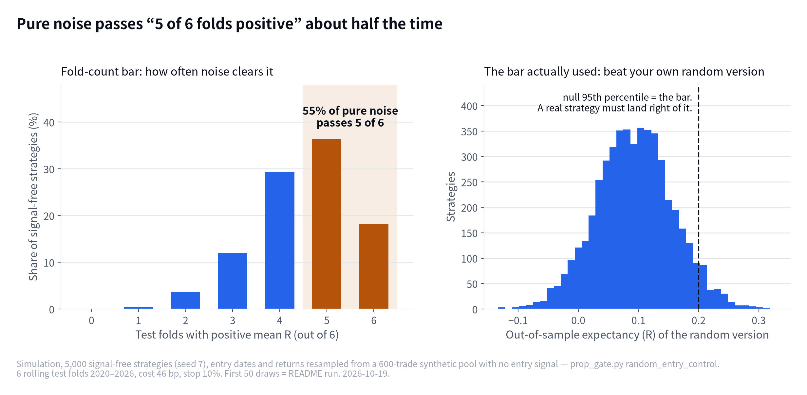
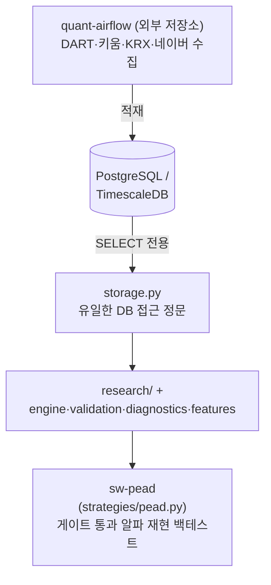

# swing-it

**한국 주식(KOSPI·KOSDAQ) 리서치 저장소.** 알파 가설을 "자기 자신의 랜덤 버전을 이기는가"로
심사한다. 산출물은 전략이 아니라 판정문이다.

[](https://github.com/younghwan91/swing-it/actions/workflows/ci.yml)
[](LICENSE)
[](https://www.python.org/)
[](https://www.linkedin.com/in/younghwan-chae/)

<picture>
  <source media="(prefers-color-scheme: dark)" srcset="docs/images/hero-dark.png">
  
</picture>

- **순수 노이즈도 "6폴드 중 5폴드 양수"를 절반가량 통과한다.** 신호가 전혀 없는 합성 전략
  5,000개 중 55% 가 그 바를 넘는다(위 그림, `scripts/make_hero.py` 로 재현). 폴드 수는 기준이 못 된다.
- **기준은 자기 랜덤 버전의 95 백분위다.** 랜덤 음성대조·purge/embargo·Deflated Sharpe 는 권고가
  아니라 공용 하버스에 박혀 있고, 그 하버스를 안 쓰는 게이트는 CI 린트가 빌드를 깨뜨린다.
- **기각이 산출물이다.** 통과든 기각이든 근거 숫자와 함께 `research/logs/*/VERDICT.md` 에 남는다.

섹터 수급 관측 화면과 일일 리포트는 2026-11 별도 저장소로 분리했다.

## Quick start

```bash
git clone https://github.com/younghwan91/swing-it && cd swing-it
uv venv && uv pip install -e ".[viz,dev]"     # TimescaleDB 를 쓰면 pg extra 를 더한다
cp .env.example .env                          # KR_QUANT_DB 접속정보 (비우면 로컬 SQLite)

uv run python research/experiments/prop_gate.py   # 심사 배터리 + 랜덤 음성대조 — DB·API 키 없이 1초
```

> **데이터 수집은 이 저장소에 없다.** DART·키움·KRX·네이버 커넥터와 TimescaleDB 적재는
> [quant-airflow](https://github.com/younghwan91/quant-airflow) 의 몫이고, 여기서는 그 DB 를 읽기만 한다.

## 목차

1. [무엇을 하나](#1-무엇을-하나)
2. [왜 이렇게 만들었나 — 알파 심사 프레임워크](#2-왜-이렇게-만들었나--알파-심사-프레임워크)
3. [구조](#3-구조)
4. [개발](#4-개발)
5. [문서](#5-문서)
6. [관련 프로젝트](#6-관련-프로젝트--오픈소스-퀀트-스택)

---

## 1. 무엇을 하나

| 명령 | 하는 일 | DB |
|---|---|---|
| `sw-pead` | 게이트를 통과한 알파의 재현 백테스트 | 읽기 전용 |
| `research/` + `swing_it.validation`·`diagnostics` | 알파 가설을 개별 트레이드 분포로 심사하는 배터리. 판정문과 시행 원장을 남긴다 | 읽기 전용(배터리 자체는 불요) |

## 2. 왜 이렇게 만들었나 — 알파 심사 프레임워크

백테스트는 거의 언제나 우상향 곡선을 그린다. 그래서 이 저장소가 남기려는 것은 전략이 아니라
**판별 능력**이다. 후보 알파를 개별 트레이드 분포로 심사하고, 통과든 기각이든 근거 숫자와 함께
판정문에 남긴다.

DB 도 API 키도 없이 1초 만에 재현되는 근거가 첫 화면의 그림이다.

```bash
uv run python research/experiments/prop_gate.py
```

```text
  랜덤 음성대조 — 50 draws × 600 trades (게이트 위양성률 보정)
  raw ≥5/6 폴드 도달: 46.0% of draws
```

**신호가 아예 없는 합성 데이터로 만든 전략이 6폴드 중 5폴드 양수를 46% 확률로 달성한다**
(같은 seed 7 로 5,000 draw 까지 늘리면 55% — 첫 50 draw 가 같은 수열이라 첫 화면 그림과 같은 실험이다, `scripts/make_hero.py`). 그래서 판별 기준을 폴드 수에 두지 않고
전략이 자기 자신의 랜덤 버전을 이기는가를 본다.

게이트는 8개 관문이다 — walk-forward 재현성 · 랜덤 음성대조 · 손 안 댄 최종 구간 · 비용 2배 ·
취약성 · Deflated Sharpe(시행 원장 자동 집계) · purge/embargo · 유니버스 무결성. 이 규율은
부탁이 아니라 CI 린트([`scripts/check_guardrails.py`](scripts/check_guardrails.py))로 강제된다.
게이트가 공용 하버스를 안 쓰거나 시행 수를 원장에 안 남기면 빌드가 깨진다.

**심사 결과: 통과한 것은 PEAD 하나, 나머지 알파 가설과 위험 오버레이는 전부 기각.**
기각된 가설도 같은 형식의 판정문으로 남아 있어, 같은 가설을 파라미터만 바꿔 다시 돌리는 낚시를 막는다.

> 판정 기록 전문 · 게이트의 구조 · 엣지의 해부 · 가드레일 린트 · 데이터 스키마:
> [`docs/alpha-research.md`](docs/alpha-research.md). 규칙 원본은 [`docs/GUARDRAILS.md`](docs/GUARDRAILS.md),
> 통과한 유일한 알파는 [`docs/pead-strategy.md`](docs/pead-strategy.md)(재현 CLI `sw-pead`).

## 3. 구조



```
src/swing_it/
├── storage.py           # 읽기 전용 DB 접근 — 유일한 정문
└── engine/ validation/ diagnostics/ features/ strategies/   # 알파 심사 라이브러리
scripts/                 # check_guardrails · make_hero
research/                # 신호 정의 · 실험 러너 · VERDICT/TRIALS 원장
docs/                    # alpha-research.md · GUARDRAILS.md · 전략 문서
```

## 4. 개발

```bash
uv run --extra dev pytest -q                  # 네트워크·DB 불요
uv run --extra dev ruff check src/ tests/ research/ scripts/ examples/
uv run python scripts/check_guardrails.py     # 경계·판정·정문·하버스·신원 규율 검사 (CI 단계)
uv run python scripts/make_hero.py            # 첫 화면 그림 재생성 → docs/images/hero-{light,dark}.png
```

`src` 는 `research` 를 import 하지 않는다(린트 (a)). 실험 파이프라인 규약은 [`research/TEMPLATE.md`](research/TEMPLATE.md).

## 5. 문서

| 문서 | 내용 |
|---|---|
| [`docs/alpha-research.md`](docs/alpha-research.md) | 판정 기록 전문 · 게이트의 구조 · 엣지의 해부 · 가드레일 린트 · 데이터 스키마 |
| [`docs/GUARDRAILS.md`](docs/GUARDRAILS.md) | 연구 규율 원본 — 사전등록 템플릿·완료 정의 |
| [`docs/pead-strategy.md`](docs/pead-strategy.md) | 게이트를 통과한 유일한 알파 (재현 CLI `sw-pead`) |
| `research/logs/*/VERDICT.md` | 가설별 판정문 전문. 기각도 통과와 같은 형식으로 남는다 |

## 6. 관련 프로젝트 — 오픈소스 퀀트 스택

한국·미국 주식과 암호화폐를 아우르는 오픈소스 스택입니다. 각 저장소는 독립적으로 쓸 수 있습니다.

| 축 | 프로젝트 | 설명 |
|---|---|---|
| 🇰🇷 한국 주식 | **[kiwoom-client](https://github.com/younghwan91/kiwoom-client)** | 키움증권 REST API Python 라이브러리 — 국내주식 엔드포인트 전수·실시간 WebSocket, sync + async (`pip install kiwoom-client`) |
| 🇰🇷 한국 주식 | **[krx-fundamentals-client](https://github.com/younghwan91/krx-fundamentals-client)** | 국내 기업 펀더멘탈 Python 클라이언트 라이브러리 — 재무제표·투자지표·배당·종목 스크리닝 (DART + KRX + 네이버) |
| 🇰🇷 한국 주식 | **[krx-news-client](https://github.com/younghwan91/krx-news-client)** | 한국 주식 뉴스·공시를 한 스키마로 내주는 Python 클라이언트 라이브러리 (DART + 토스증권) |
| 🇰🇷 한국 주식 | **[krx-quant-core](https://github.com/younghwan91/krx-quant-core)** | 한국 주식 퀀트 시스템 공통 Python 코어 — KRX 호가·가격제한폭·세션 규칙, 시행일별 거래세 비용모델, 키움 주문 가드, DART 중대공시 위험 분류, 체결 시뮬레이션, Deflated Sharpe·purged CV 통계 |
| 🇰🇷 한국 주식 | **[fin-checkup](https://github.com/younghwan91/fin-checkup)** | 관심종목 위험 공시 텔레그램 알림 + DART·SEC 재무 건강검진 — 측정값과 사실만 전달한다 |
| 🇰🇷 한국 주식 | **[quant-airflow](https://github.com/younghwan91/quant-airflow)** | 시세·수급·실적을 TimescaleDB 로 수집하는 Airflow 파이프라인 — 상장폐지 종목까지 담아 생존편향을 막는다 |
| 🇺🇸 미국 주식 | **[portfolio-research](https://github.com/younghwan91/portfolio-research)** | 미국주식 팩터 엔진 — point-in-time·생존편향 보정 데이터 위에서 walk-forward 를 Deflated Sharpe·PBO 로 게이팅하고 ETF 전술배분도 같은 관문을 지난다 |
| 🇺🇸 미국 주식 | **[macro-sector-agent](https://github.com/younghwan91/macro-sector-agent)** | 하향식 미국 산업 사이클 리서치 — \"어느 산업이 잊혔나\"를 묻고 기계는 제외만 한다 |
| 🇺🇸 미국 주식 | **[automated-stock-trading-systems](https://github.com/younghwan91/automated-stock-trading-systems)** | Bensdorp 의 7개 비상관 트레이딩 시스템 백테스터 (교육용 재구현) |
| ₿ 암호화폐 | **[binance-quant-engine](https://github.com/younghwan91/binance-quant-engine)** | 암호화폐 선물 백테스트·실행 엔진 — 룩어헤드 0, 백테스트↔실거래 일체화 |
| ₿ 암호화폐 | **[crypto-quant-insights](https://github.com/younghwan91/crypto-quant-insights)** | 실거래 선물 시스템을 검증하며 나온 차트 연구 노트 — 폭락 스트레스 테스트·Kelly 레버리지·체결 간극 |

## 라이선스

MIT

## 만든 사람

**채영환 (Younghwan Chae)** · [GitHub @younghwan91](https://github.com/younghwan91) · [LinkedIn](https://www.linkedin.com/in/younghwan-chae/)

전체 오픈소스 퀀트 스택은 [프로필](https://github.com/younghwan91)에서 볼 수 있습니다.

## 기여 및 이슈 제보

- 🐛 버그 제보, 질문, 기능 제안: [GitHub Issues](https://github.com/younghwan91/swing-it/issues)
- 📈 업데이트 소식: [팔로우 @younghwan91](https://github.com/younghwan91)

