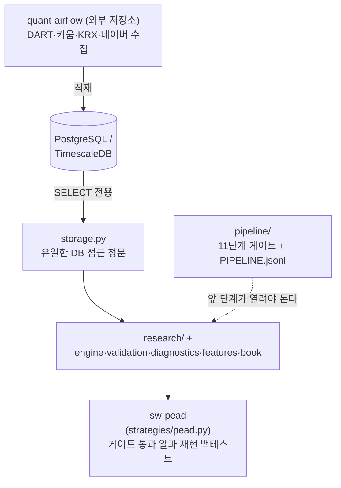

# swing-it 가이드

처음이라면 [README](../README.md) 부터.

<!-- toc -->
- [2. 왜 이렇게 만들었나 — 알파 심사 프레임워크](#2-왜-이렇게-만들었나--알파-심사-프레임워크)
- [3. 구조](#3-구조)
- [4. 개발](#4-개발)
<!-- /toc -->

## 2. 왜 이렇게 만들었나 — 알파 심사 프레임워크

백테스트는 거의 언제나 우상향 곡선을 그린다. 그래서 이 저장소가 남기려는 것은 전략이 아니라
**판별 능력**이다. 후보 알파를 개별 트레이드 분포로 심사하고, 통과든 기각이든 근거 숫자와 함께
판정문에 남긴다.

DB 도 API 키도 없이 1초 만에 재현되는 근거가 첫 화면의 그림이다.

```bash
uv run python research/experiments/prop_gate.py
```

```text
  랜덤 음성대조 — 50 draws × 600 trades (게이트 위양성률 보정)
  raw ≥5/6 폴드 도달: 46.0% of draws
```

**신호가 아예 없는 합성 데이터로 만든 전략이 6폴드 중 5폴드 양수를 46% 확률로 달성한다**
(같은 seed 7 로 5,000 draw 까지 늘리면 55% — 첫 50 draw 가 같은 수열이라 첫 화면 그림과 같은 실험이다, `scripts/make_hero.py`). 그래서 판별 기준을 폴드 수에 두지 않고
전략이 자기 자신의 랜덤 버전을 이기는가를 본다.

게이트는 8개 관문이다 — walk-forward 재현성 · 랜덤 음성대조 · 손 안 댄 최종 구간 · 비용 2배 ·
취약성 · Deflated Sharpe(시행 원장 자동 집계) · purge/embargo · 유니버스 무결성. 이 규율은
부탁이 아니라 CI 린트([`scripts/check_guardrails.py`](../scripts/check_guardrails.py))로 강제된다.
게이트가 공용 하버스를 안 쓰거나 시행 수를 원장에 안 남기면 빌드가 깨진다.

**심사 결과: 게이트를 통과한 것은 PEAD 하나, 나머지 알파 가설과 위험 오버레이는 전부 기각.**
기각된 가설도 같은 형식의 판정문으로 남아 있어, 같은 가설을 파라미터만 바꿔 다시 돌리는 낚시를 막는다.
PEAD 를 넘어선 두 후속 연구도 닫혔다. 위험모델·최적화 북은 **판단 불가**(비교할 만큼 신호가 강하지 않았다,
[`research/logs/pead_optimizer/B_verified.md`](../research/logs/pead_optimizer/B_verified.md)), ML 수익률 예측은
**비용 뒤 이득 없음**([`research/logs/ml_forecast/S2_verified.md`](../research/logs/ml_forecast/S2_verified.md)).

> 판정 기록 전문 · 게이트의 구조 · 엣지의 해부 · 가드레일 린트 · 데이터 스키마:
> [`docs/alpha-research.md`](alpha-research.md). 규칙 원본은 [`docs/GUARDRAILS.md`](GUARDRAILS.md),
> 통과한 유일한 알파는 [`docs/pead-strategy.md`](pead-strategy.md)(재현 CLI `sw-pead`).

**연구는 11단계를 순서대로만 지난다** — 유니버스 → 데이터 → 알파 발굴 → 알파 검증(IC/ICIR) → ML 예측 →
위험모델 → 포트폴리오 → 거래비용 → 백테스트 → 주문 실행 → 성과 기여·모니터링. 연구마다
`research/logs/<연구>/PIPELINE.jsonl` 원장에 단계별 판정과 증거 파일 해시를 적고, 러너는 앞 단계가 열려 있어야
돌며(`require_stage`), CI 가 그 선언을 검사한다. 실수와 망각을 막는 장치이지 위조를 막는 보안 장치는 아니다.
10단계(주문)와 11단계의 전진 모니터링은 main 에 구현이 없고, 게이트는 그것을 부른 코드만 막는다 — 자세한 한계는
[`docs/PIPELINE.md`](PIPELINE.md).

## 3. 구조



```
src/swing_it/
├── storage.py           # 읽기 전용 DB 접근 — 유일한 정문
├── pipeline/            # 11단계 게이트 · 원장 · 단계 입력 검사
├── book/                # 포트폴리오 북 — 순위·최적화 구성, 위험모델 입력, 비용, 회계, 널
├── price_adjust.py      # 조정주가 생성 (quant-airflow 의 *_price_adjust DAG 가 실행)
├── news/                # 기사 LLM 판정 (Batch API)
└── engine/ validation/ diagnostics/ features/ strategies/   # 알파 심사 라이브러리
scripts/                 # check_guardrails · make_hero
research/                # 신호 정의 · 실험 러너 · VERDICT/TRIALS 원장
docs/                    # alpha-research.md · GUARDRAILS.md · 전략 문서
```

## 4. 개발

```bash
uv run --extra dev pytest -q                  # 네트워크·DB 불요
uv run --extra dev ruff check src/ tests/ research/ scripts/ examples/
uv run python scripts/check_guardrails.py     # 경계·판정·정문·하버스·신원 규율 검사 (CI 단계)
uv run python scripts/make_hero.py            # 첫 화면 그림 재생성 → docs/images/hero-{light,dark}.png
```

`src` 는 `research` 를 import 하지 않는다(린트 (a)). 실험 파이프라인 규약은 [`research/TEMPLATE.md`](../research/TEMPLATE.md).
