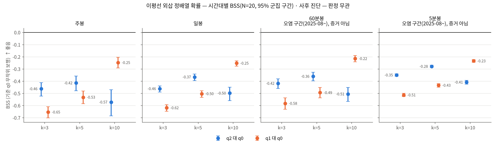
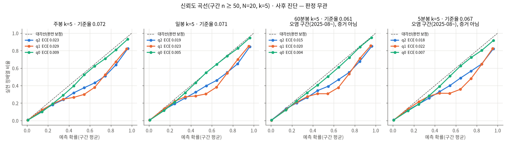
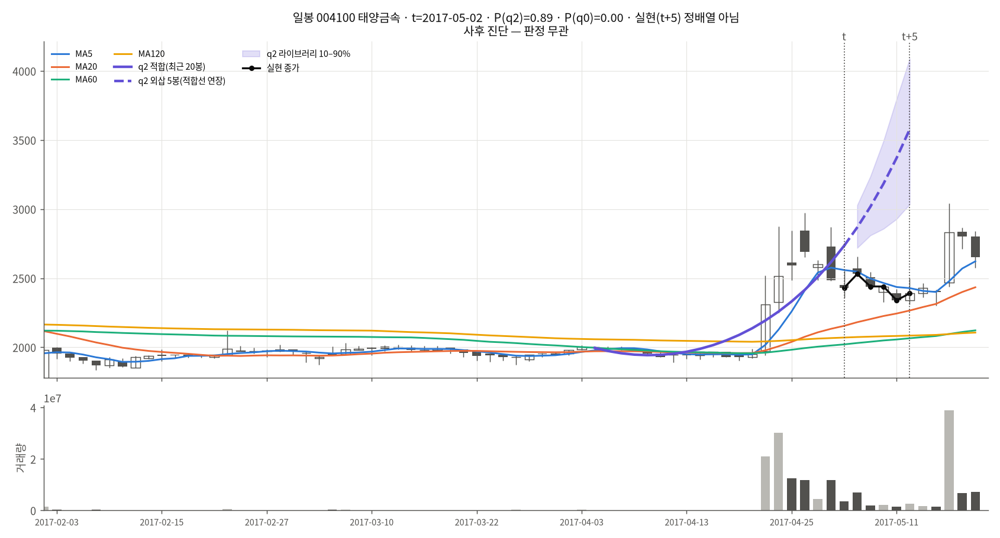
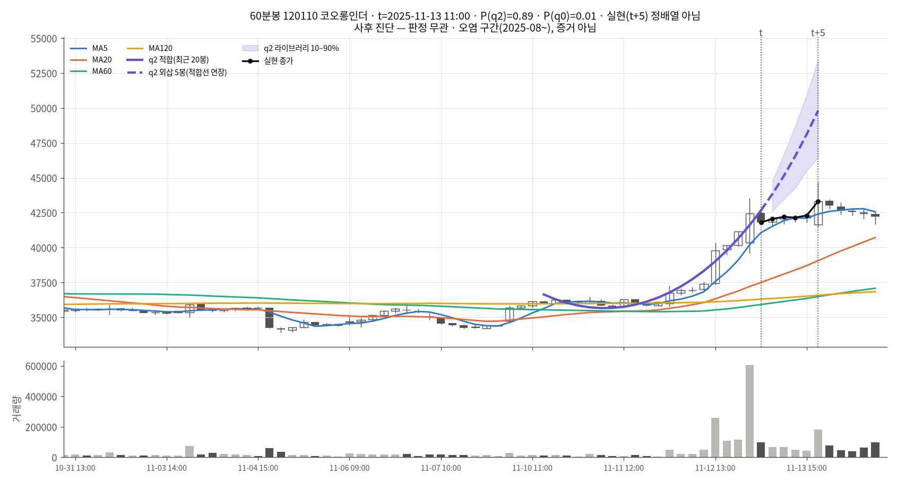
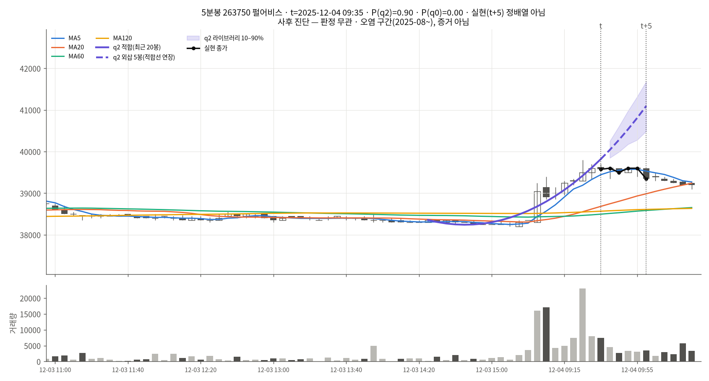

# 이평선 외삽 — 시간대별 보정 사후 진단

**사후 진단 — 판정 무관.** 관문 0(일봉, 20칸 불합격 — `../RESULTS.md`)을 다시 여는 것이 아니다. 같은 부품(`research/signals/ma_quad.py`·`ma_quad_calib.py`·`maquad_calib.cell_probs`)으로 봉 단위만 바꿔 그린 기술 진단이다. 60분·5분봉은 **오염 구간(2025-08~), 증거 아님** — 봉인 구간(2024-01~)이 이미 소모됐다.

공통: 사건 = 정배열 아님(봉 단위 MA5>MA20>MA60>MA120 아님) ∧ 네 이평선 정의 ∧ 유니버스, EPS·200일선·d 거름 없음. N=20, M=200, q=2·1·0 같은 사건 집합. BSS 기준 = q0(무작위 보행). 구간 = 군집 복원추출 95%(주·일 = 달력 월, 분봉 = 거래일). 높은 구간 = P ≥ 0.5 사건의 평균 예측 → 실현율.

## 자료

- 주봉: `maquad_calib.load`(2013-06-03 ~ 2024-01-31, 정지일 NaN 210,991 칸), 유니버스 ADV20 ≥ 10억의 ISO 주 마지막 거래일(끝난 주만). 사건 2017-05-04 ~ 2023-11-24, 군집 79.
- 일봉: `maquad_calib.load`(2013-06-03 ~ 2024-01-31, 정지일 NaN 210,991 칸), 유니버스 ADV20 ≥ 10억. 사건 2017-01-02 ~ 2023-12-20, 군집 84.
- 60분봉: `minute_bars` 09:00 ≤ ts < 15:33, 2025-08-01 ~ 2026-11-13, 300 종목 × 2,189 봉(거래일 313, 하루 봉 중앙 7), 봉 NaN 9.81%, 가격제한폭 밖 변화로 뺀 종목 12(채운 순위 끝 312). 사건 2025-10-01 09:00 ~ 2026-11-13 10:00, 군집 271.
- 5분봉: `minute_bars` 09:00 ≤ ts < 15:33, 2025-08-01 ~ 2026-11-13, 300 종목 × 24,077 봉(거래일 313, 하루 봉 중앙 77), 봉 NaN 11.00%, 가격제한폭 밖 변화로 뺀 종목 2(채운 순위 끝 302). 사건 2025-09-01 09:00 ~ 2026-11-13 14:55, 군집 289.

## 표

| 시간대 | k | n 사건 | 기준율 | BSS q2v0 [95%] | BSS q1v0 [95%] | ECE q0 / q2 | P≥0.5 q2: 예측→실현 (n) | P≥0.5 q0: 예측→실현 (n) |
|---|---|---|---|---|---|---|---|---|
| 주봉 | 3 | 255,065 | 0.049 | -0.463 [-0.523, -0.412] | -0.654 [-0.702, -0.611] | 0.005 / 0.010 | 0.774→0.686 (10,880) | 0.823→0.806 (11,073) |
| 주봉 | 5 | 252,982 | 0.072 | -0.415 [-0.480, -0.359] | -0.532 [-0.586, -0.482] | 0.009 / 0.023 | 0.744→0.556 (16,844) | 0.764→0.735 (14,855) |
| 주봉 | 10 | 245,653 | 0.105 | -0.572 [-0.686, -0.471] | -0.248 [-0.293, -0.204] | 0.018 / 0.082 | 0.723→0.358 (33,388) | 0.659→0.571 (18,691) |
| 일봉 | 3 | 1,417,650 | 0.047 | -0.462 [-0.489, -0.440] | -0.619 [-0.648, -0.594] | 0.003 / 0.009 | 0.766→0.690 (58,548) | 0.824→0.824 (57,146) |
| 일봉 | 5 | 1,415,128 | 0.071 | -0.366 [-0.395, -0.341] | -0.504 [-0.533, -0.478] | 0.005 / 0.019 | 0.737→0.574 (90,382) | 0.759→0.750 (76,148) |
| 일봉 | 10 | 1,408,888 | 0.107 | -0.499 [-0.560, -0.450] | -0.253 [-0.277, -0.233] | 0.008 / 0.062 | 0.722→0.406 (173,966) | 0.653→0.613 (100,582) |
| 60분봉 | 3 | 409,726 | 0.040 | -0.419 [-0.460, -0.382] | -0.583 [-0.630, -0.537] | 0.002 / 0.007 | 0.771→0.692 (14,165) | 0.843→0.830 (13,701) |
| 60분봉 | 5 | 409,084 | 0.061 | -0.361 [-0.399, -0.328] | -0.495 [-0.538, -0.452] | 0.004 / 0.015 | 0.742→0.584 (21,987) | 0.774→0.752 (19,351) |
| 60분봉 | 10 | 407,426 | 0.097 | -0.506 [-0.567, -0.453] | -0.215 [-0.242, -0.190] | 0.010 / 0.050 | 0.725→0.419 (44,681) | 0.654→0.620 (30,574) |
| 5분봉 | 3 | 4,492,973 | 0.044 | -0.350 [-0.361, -0.339] | -0.514 [-0.528, -0.500] | 0.006 / 0.012 | 0.759→0.675 (178,684) | 0.803→0.782 (177,496) |
| 5분봉 | 5 | 4,485,203 | 0.067 | -0.279 [-0.288, -0.270] | -0.434 [-0.450, -0.420] | 0.007 / 0.018 | 0.738→0.579 (267,380) | 0.751→0.717 (239,071) |
| 5분봉 | 10 | 4,465,844 | 0.103 | -0.409 [-0.424, -0.395] | -0.235 [-0.246, -0.223] | 0.007 / 0.048 | 0.731→0.434 (489,848) | 0.669→0.615 (329,185) |

교차 확인(일봉): 관문 0 R3 과 같은 20% 표본(`blake2b(code|date) % 5 == 0`)으로 자르면 BSS q2v0 = k=3 -0.4588(n=283,508), k=5 -0.3693(n=283,030), k=10 -0.5025(n=281,826) — `../RESULTS.md` R3 N=20 행(−0.4583, −0.3691, −0.5019)과 비교.

## 그림

일봉 예시 — 004100 태양금속 t=2017-05-02 00:00: P(q2) 0.890, P(q1) 0.080, P(q0) 0.000, 실현 정배열 아님. 고른 규칙: P(q2) ∈ [0.5, 0.9] 중 P(q2) − P(q0) 최대(대표 표본이 아니라 외삽이 가장 앞서 나간 장면). 띠 = 그 달 q2 라이브러리 200 경로의 10–90%.

60분봉 예시 — 120110 코오롱인더 t=2025-11-13 11:00: P(q2) 0.890, P(q1) 0.010, P(q0) 0.015, 실현 정배열 아님. 고른 규칙: P(q2) ∈ [0.5, 0.9] 중 P(q2) − P(q0) 최대(대표 표본이 아니라 외삽이 가장 앞서 나간 장면). 띠 = 그 달 q2 라이브러리 200 경로의 10–90%.

5분봉 예시 — 263750 펄어비스 t=2025-12-04 09:35: P(q2) 0.900, P(q1) 0.030, P(q0) 0.000, 실현 정배열 아님. 고른 규칙: P(q2) ∈ [0.5, 0.9] 중 P(q2) − P(q0) 최대(대표 표본이 아니라 외삽이 가장 앞서 나간 장면). 띠 = 그 달 q2 라이브러리 200 경로의 10–90%.

## 읽기(사실만)

- q2 가 q0 를 이긴 칸(BSS 95% 하한 > 0): 없음. 점추정만 > 0: 없음.
- 사후 진단 — 판정 무관. 분봉 숫자는 오염 구간(2025-08~), 증거 아님. 매매 권고 없음.

## 주의

- 주봉 사건은 2017-05 부터다 — 풀이 3년 창 안 원점 날짜 ≥ 120(주봉이면 120 주)을 요구해 그 전 달은 풀이 없다(q 별 `nopool`).
- 분봉 종목은 구간 전체의 일 거래대금 중앙값으로 고른다(구간 뒤 정보 — 진단용). 중앙값은 거래한 날로만 잡혀 구간 중 상장·수집 시작 종목이 들어온다. 봉 NaN 의 대부분(후보 340 종목 5분봉 실측 91%)이 그런 종목의 첫 봉 이전 칸이다. 분봉은 원 가격(분할 미조정)이다 — 가격제한폭 밖 변화가 있는 종목은 뺐지만 배당락 같은 작은 조정은 남는다. 수능일·새해 첫날처럼 장 시간이 바뀐 날도 09:00~15:32 만 쓴다.
- 분봉 BSS 구간은 거래일 군집이라 날 사이 계열상관을 다 담지 못한다(구간이 좁게 나온다). 일·주봉은 달력 월 군집.
- 예시 세 장은 고른 규칙상 극단 장면이다(대표 표본 아님). 그림의 q2 적합선은 종가가 아니라 적합값이라 t 에서 종가와 떨어질 수 있다.
