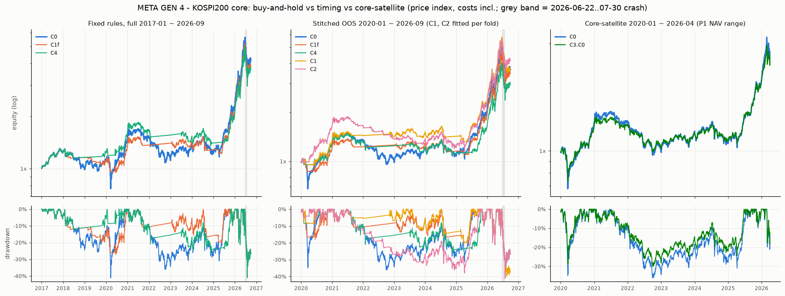

# 메타 세대 4 — 개인 코어 운용: KOSPI200 타이밍 × 코어-위성 — 실행 결과 2026-10-10 (러너 자동 생성, 판정 아님)

설계 `META_GEN4.md`(2cb127b + 정정 412b012, 둘 다 결과 보기 전)를 계산한 숫자다. ✓/✗ 는 미리 적은 문턱과의 **산술 비교**이고 판정은 사람이 한다. 고정 규칙(C1f·C4)은 전 구간이 표본 내다 — MA200·12개월 듀얼 모멘텀은 문헌에서 온 규칙이라 이 자료로 고른 것은 아니지만 이 자료로 '다시 본' 것이다.

재현: `uv run python research/experiments/meta_gen4_run.py --workers 10` · 실행 14초 · 무작위 타이밍 널 1000벌 × 2종/규칙 · C2 순열 널 300벌 · 부트스트랩 2000벌 · DB 접속 없음.

## 먼저 읽을 것 — 해석 한계(정정에 미리 적은 문장)

**2026-06-22 ~ 07-30 KOSPI200 −40.9%(27거래일)가 전 구간 MDD 를 결정한다.** 이 표본의 큰 하락은 느린 약세 둘(2018·2022)과 빠른 급락 둘(2020-03·2026-07)이다. 판정 (2)(4)(5)의 Calmar·MDD 는 사실상 사건 넷 남짓으로 정해진다. **기각이면 문구는 "이 표본에서 매수보유를 버릴 근거 없음" 이지 "타이밍이 안 된다" 가 아니다.** 2025-01 ~ 2026-09 분리 창은 21개월 · 한 국면(CAGR +100% 안팎, 연 변동성 65% 안팎)이라 Calmar 비교에 짧다(리뷰 M6). 아래 사건표와 '급락 전' 기술 줄을 함께 본다.

## 판정 산술 (META_GEN4.md '판정 — 개인에게 맞는 코어 운용' + 정정)

C0(KOSPI200 매수보유, 가격 지수) 대비 **모두**: (1) 짝지은 달 블록 부트스트랩(일별 경로를 3개월 블록으로 재표본, 2000벌)에서 P(초과 Sharpe > C0 **그리고** Calmar > C0) ≥ 0.8 — 리뷰 M2 의 엄격한 읽기(동시); '각각 ≥ 0.8' 읽기는 참고 열 · (2) MDD 가 10%p 이상 얕음 · (3) CAGR_C0 − CAGR(**배당 고정 보정 줄**) ≤ 2%p · (4) Calmar > 무작위 타이밍 널(마르코프) Calmar p95 · (5) 분리 창 둘 다 Calmar ≥ C0.  
**창:** 고정 규칙(C1f·C4) = 전체 2017-01 ~ 2026-09, 분리 = 2017~2024 · 2025-01 ~ 2026-09. 적합 규칙(C1·C2) = 이어 붙인 OOS 2020-01 ~ 2026-09, 분리 = **OOS 2020~2024** · 2025-01 ~ 2026-09(리뷰 M5 — OOS 가 2020 부터). C0 는 같은 창.

| 절차 | 파라미터 | 창 | (1) P(SR) · P(Calmar) · **P(둘 다)** | (2) ΔMDD | (3) CAGR_C0 − CAGR(고정 보정) | (4) Calmar · 마르코프 p95 (백분위) | (5) Calmar 분리 창 · C0 | **통과(1–5)** | 참고: (1) 각각 · (1) 12개월 블록 · (4) 원형 이동 · 배당 가산 줄로 전부 |
|---|---|---|---|---|---|---|---|---|---|
| **C1f** | 0 | 전체 2017-01 ~ 2026-09 | 0.47 · 0.55 · **0.44** ✗ | +0.3%p (-40.94% vs -41.25%) ✗ | +1.8%p (+16.20% − +14.35%) ✓ | 0.37 · 0.60 (78%) ✗ | 0.12 · 0.06 / 2.23 · 2.61 ✗ | **✗** | ✗ · ✗ · ✗ · ✗ |
| **C4** | 0 | 전체 2017-01 ~ 2026-09 | 0.44 · 0.53 · **0.40** ✗ | +0.3%p (-40.94% vs -41.25%) ✗ | +2.3%p (+16.20% − +13.93%) ✗ | 0.36 · 0.55 (71%) ✗ | 0.17 · 0.06 / 1.89 · 2.61 ✗ | **✗** | ✗ · ✗ · ✗ · ✗ |
| **C1** | 1 | OOS 2020-01 ~ 2026-09 | 0.54 · 0.62 · **0.52** ✗ | +1.2%p (-39.79% vs -40.94%) ✗ | +1.1%p (+21.90% − +20.78%) ✓ | 0.54 · 0.78 (79%) ✗ | 0.45 · 0.04 / 1.85 · 2.61 ✗ | **✗** | ✗ · ✗ · ✗ · ✗ |
| **C2** | 1 | OOS 2020-01 ~ 2026-09 | 0.69 · 0.69 · **0.64** ✗ | -0.0%p (-40.94% vs -40.94%) ✗ | -1.7%p (+21.90% − +23.59%) ✓ | 0.59 · 0.76 (84%) ✗ | 0.11 · 0.04 / 2.61 · 2.61 ✓ | **✗** | ✗ · ✗ · ✗ · ✗ |

**산술 결과:** 통과(1–5) = 없음. 통과가 없으므로 설계 문장대로 코어 = **C0(매수보유)**, 위험은 비중으로 조절.

(3) 배당 민감도(참고, 일별 가산 줄의 CAGR 차): C1f 1.5% +1.7%p ✓ / 2.2% +2.1%p ✗ / 1.8% +1.9%p ✓ · C4 1.5% +2.2%p ✗ / 2.2% +2.5%p ✗ / 1.8% +2.3%p ✗ · C1 1.5% +1.0%p ✓ / 2.2% +1.3%p ✓ / 1.8% +1.1%p ✓ · C2 1.5% -1.8%p ✓ / 2.2% -1.6%p ✓ / 1.8% -1.7%p ✓.

C2 국면 점수 월 블록 순열 널 300벌(설계 '널' 절, 판정 조건 목록 밖): C2 OOS Calmar 0.59 vs 순열 널 p50 0.32 · p95 0.60 (백분위 95%) ✗; 초과 Sharpe 0.76 vs p95 0.77 (백분위 94%).

## 낙폭 사건표 (C0 낙폭 > 15%, 리뷰 C1 요구 — 기술)

규칙 칸 = 고점일 보유(1 = 안) / 고점일 종가 → 저점일 종가 구간 안 규칙 자신의 최대 낙폭 / 그 구간(고점 다음 날 ~ 저점일) 평균 보유. C1·C2 는 2020-01 OOS 부터.

| 고점 → 저점 | 거래일 | C0 | C1f | C4 | C1 | C2 |
|---|---|---|---|---|---|---|
| 2017-11-03 → 2020-03-19 | 582 | -41.25% | 1 / -26.03% / 36% | 1 / -12.00% / 38% | — | — |
| 2021-06-25 → 2022-09-30 | 312 | -36.15% | 1 / -10.73% / 15% | 1 / -20.87% / 47% | 1 / -5.54% / 10% | 1 / -23.05% / 36% |
| 2026-02-26 → 2026-03-31 | 22 | -21.13% | 1 / -21.13% / 100% | 1 / -21.13% / 100% | 1 / -21.13% / 100% | 1 / -21.13% / 100% |
| 2026-06-02 → 2026-06-08 | 3 | -15.68% | 1 / -15.68% / 100% | 1 / -15.68% / 100% | 1 / -15.68% / 100% | 1 / -15.68% / 100% |
| 2026-06-22 → 2026-07-30 | 27 | -40.94% | 1 / -40.94% / 100% | 1 / -40.94% / 100% | 1 / -35.99% / 93% | 1 / -40.94% / 100% |

**급락 전 기술 줄(2026-06-19 까지):** C0 [2017~] CAGR +20.58% · MDD -41.25% · Calmar 0.50 · C1f [2017~] CAGR +19.51% · MDD -27.20% · Calmar 0.72 · C4 [2017~] CAGR +19.02% · MDD -26.56% · Calmar 0.72 · C1 [OOS 2020~] CAGR +31.91% · MDD -21.13% · Calmar 1.51 · C2 [OOS 2020~] CAGR +31.40% · MDD -38.00% · Calmar 0.83 (같은 창 C0 [OOS 2020~] Calmar 0.80). 판정에 쓰지 않는다.

## 위성 (C3 = 코어 80% + P1 20%, 월 되돌림)

창 = **2020-01-02 ~ 2026-04-01**(메타 세대 1 P1 NAV 가 있는 구간 — 설계의 2017~ 창보다 짧다). 조건: P(초과 Sharpe C3·X > X) ≥ 0.8 이면 "위성 20% 가 코어에 더한다", 아니면 "위성은 취미 비중". 적용 행 = C0 와 고른 통과 코어. 나머지는 참고. 부트스트랩 = 같은 달 블록(3개월).

| 코어 X | 적용 | C3·X CAGR · MDD · Calmar · 초과 SR | X 같은 창 CAGR · MDD · Calmar · 초과 SR | P(SR > X) · P(Calmar > X) | ΔSR 5·50·95% | P(SR > C0) | 참고: 12개월 블록 · 배당 가산 P(SR > X) | 산술 |
|---|---|---|---|---|---|---|---|---|
| C0 | 적용 | +16.90% · -30.04% · 0.56 · 0.67 | +18.18% · -36.15% · 0.50 · 0.65 | 0.84 · 0.97 | -0.02 · 0.02 · 0.07 | 0.84 | 0.73 · 0.80 | 더한다 ✓ |
| C1f | 참고 | +15.76% · -18.34% · 0.86 · 0.68 | +16.93% · -21.13% · 0.80 · 0.66 | 0.79 · 0.94 | -0.02 · 0.02 · 0.07 | 0.57 | 0.69 · 0.74 | 취미 비중 ✗ |
| C4 | 참고 | +13.46% · -21.36% · 0.63 · 0.60 | +13.97% · -26.56% · 0.53 · 0.56 | 0.86 · 0.95 | -0.02 · 0.04 · 0.14 | 0.39 | 0.79 · 0.85 | 더한다 ✓ |
| C1 | 참고 | +18.95% · -18.34% · 1.03 · 0.82 | +20.98% · -21.13% · 0.99 · 0.81 | 0.64 · 0.87 | -0.04 · 0.01 · 0.05 | 0.81 | 0.56 · 0.58 | 취미 비중 ✗ |
| C2 | 참고 | +18.59% · -31.20% · 0.60 · 0.79 | +20.51% · -38.00% · 0.54 · 0.78 | 0.70 · 0.91 | -0.03 · 0.01 · 0.06 | 0.75 | 0.67 · 0.64 | 취미 비중 ✗ |

**대조(리뷰 C2-3): 80% C0 + 20% 현금**(같은 되돌림) CAGR +15.50% · MDD -29.48% · Calmar 0.53 · 초과 SR 0.65 (원시 SR 0.75 — C0 원시 0.73). P(C3·C0 초과 SR > 80/20 현금) = 0.85, P(Calmar) = 0.87.  
2025 제외 이어 붙인 초과 SR: C0 0.31 · C3·C0 0.30 · 80/20 현금 0.31.  
P1(+ 유휴 현금 금리) 단독 같은 창: CAGR +9.64% · MDD -11.84% · Calmar 0.81 · 초과 SR 0.58; 월 수익 상관(P1c, C0) = +0.52. 리뷰어 `indiv.csv` p1c 와 날별 최대 차 9.97e-17.

## 숫자 (비용·보수·현금 금리 포함)

CAGR = 날 수 기준(252/T — 저장소 `equity_stats`; 달력일 기준보다 약 0.4%p 높게 나온다), MDD = 일별 경로(초기 자산 1 을 첫 고점으로), Calmar = CAGR / |MDD|, 초과 SR = (월 복리 수익 − 같은 달 CD91 복리) 평균/표준편차 × √12, 원시 SR = 무위험 차감 없음(참고). 시장 안 = 평균 보유, 전환/년 = 보유가 바뀐 날 / 년. 배당 고정 = 날별 − 1.8%/252 × (1 − 보유)(C0 불변), 배당 가산 = 날별 + 1.8%/252 × 보유(C0 = **배당 포함 매수보유 근사**), 세후 = 배당 가산 줄에서 현금 이자·배당 15.4% 과세(ETF 매매차익 비과세).

### 전체 2017-01 ~ 2026-09

| 절차 | CAGR | MDD | Calmar | 초과 SR | 원시 SR | 시장 안 | 전환/년 | CAGR 배당 고정 | CAGR · Calmar 배당 가산 | CAGR · Calmar 세후 | 기간 |
|---|---|---|---|---|---|---|---|---|---|---|---|
| C0 | +16.20% | -41.25% | 0.39 | 0.58 | 0.65 | 100% | 0.0 | +16.20% | +18.31% · 0.45 | +17.98% · 0.44 | 2017-01-02 ~ 2026-09-30 |
| C1f | +15.20% | -40.94% | 0.37 | 0.57 | 0.66 | 59% | 6.8 | +14.35% | +16.43% · 0.40 | +16.08% · 0.39 | 2017-01-02 ~ 2026-09-30 |
| C4 | +14.74% | -40.94% | 0.36 | 0.57 | 0.65 | 61% | 1.3 | +13.93% | +16.00% · 0.39 | +15.64% · 0.38 | 2017-01-02 ~ 2026-09-30 |

### 2017~2024

| 절차 | CAGR | MDD | Calmar | 초과 SR | 원시 SR | 시장 안 | 전환/년 | CAGR 배당 고정 | CAGR · Calmar 배당 가산 | CAGR · Calmar 세후 | 기간 |
|---|---|---|---|---|---|---|---|---|---|---|---|
| C0 | +2.58% | -41.25% | 0.06 | 0.12 | 0.23 | 100% | 0.0 | +2.58% | +4.44% · 0.11 | +4.15% · 0.11 | 2017-01-02 ~ 2024-12-30 |
| C1f | +3.26% | -27.20% | 0.12 | 0.15 | 0.31 | 54% | 7.6 | +2.41% | +4.27% · 0.16 | +3.96% · 0.15 | 2017-01-02 ~ 2024-12-30 |
| C4 | +4.44% | -26.56% | 0.17 | 0.24 | 0.41 | 58% | 1.4 | +3.65% | +5.53% · 0.23 | +5.21% · 0.21 | 2017-01-02 ~ 2024-12-30 |

### 2025-01 ~ 2026-09

| 절차 | CAGR | MDD | Calmar | 초과 SR | 원시 SR | 시장 안 | 전환/년 | CAGR 배당 고정 | CAGR · Calmar 배당 가산 | CAGR · Calmar 세후 | 기간 |
|---|---|---|---|---|---|---|---|---|---|---|---|
| C0 | +106.99% | -40.94% | 2.61 | 1.61 | 1.66 | 100% | 0.0 | +106.99% | +110.74% · 2.71 | +110.16% · 2.70 | 2025-01-02 ~ 2026-09-30 |
| C1f | +91.24% | -40.94% | 2.23 | 1.43 | 1.48 | 82% | 3.0 | +90.62% | +94.07% · 2.30 | +93.48% · 2.29 | 2025-01-02 ~ 2026-09-30 |
| C4 | +77.42% | -40.94% | 1.89 | 1.29 | 1.35 | 72% | 0.6 | +76.54% | +79.74% · 1.95 | +79.17% · 1.94 | 2025-01-02 ~ 2026-09-30 |
| C1 | +73.63% | -39.79% | 1.85 | 1.21 | 1.26 | 85% | 7.7 | +73.15% | +76.29% · 1.92 | +75.76% · 1.91 | 2025-01-02 ~ 2026-09-30 |
| C2 | +106.99% | -40.94% | 2.61 | 1.61 | 1.66 | 100% | 0.0 | +106.99% | +110.74% · 2.71 | +110.16% · 2.70 | 2025-01-02 ~ 2026-09-30 |

### OOS 2020-01 ~ 2026-09

| 절차 | CAGR | MDD | Calmar | 초과 SR | 원시 SR | 시장 안 | 전환/년 | CAGR 배당 고정 | CAGR · Calmar 배당 가산 | CAGR · Calmar 세후 | 기간 |
|---|---|---|---|---|---|---|---|---|---|---|---|
| C0 | +21.90% | -40.94% | 0.53 | 0.68 | 0.75 | 100% | 0.0 | +21.90% | +24.11% · 0.59 | +23.76% · 0.58 | 2020-01-02 ~ 2026-09-30 |
| C1f | +20.71% | -40.94% | 0.51 | 0.67 | 0.75 | 63% | 5.8 | +19.91% | +22.08% · 0.54 | +21.70% · 0.53 | 2020-01-02 ~ 2026-09-30 |
| C4 | +17.87% | -40.94% | 0.44 | 0.60 | 0.68 | 63% | 1.5 | +17.09% | +19.21% · 0.47 | +18.83% · 0.46 | 2020-01-02 ~ 2026-09-30 |
| C1 | +21.58% | -39.79% | 0.54 | 0.69 | 0.77 | 63% | 7.9 | +20.78% | +22.97% · 0.58 | +22.59% · 0.57 | 2020-01-02 ~ 2026-09-30 |
| C2 | +24.12% | -40.94% | 0.59 | 0.76 | 0.84 | 76% | 12.8 | +23.59% | +25.84% · 0.63 | +25.46% · 0.62 | 2020-01-02 ~ 2026-09-30 |

### OOS 2020~2024

| 절차 | CAGR | MDD | Calmar | 초과 SR | 원시 SR | 시장 안 | 전환/년 | CAGR 배당 고정 | CAGR · Calmar 배당 가산 | CAGR · Calmar 세후 | 기간 |
|---|---|---|---|---|---|---|---|---|---|---|---|
| C0 | +1.57% | -36.15% | 0.04 | 0.07 | 0.18 | 100% | 0.0 | +1.57% | +3.42% · 0.10 | +3.13% · 0.09 | 2020-01-02 ~ 2024-12-30 |
| C1f | +3.01% | -17.90% | 0.17 | 0.11 | 0.28 | 57% | 6.8 | +2.21% | +4.07% · 0.23 | +3.74% · 0.21 | 2020-01-02 ~ 2024-12-30 |
| C4 | +2.38% | -26.56% | 0.09 | 0.07 | 0.23 | 60% | 1.8 | +1.64% | +3.49% · 0.14 | +3.15% · 0.13 | 2020-01-02 ~ 2024-12-30 |
| C1 | +7.54% | -16.73% | 0.45 | 0.43 | 0.61 | 56% | 8.0 | +6.69% | +8.62% · 0.52 | +8.28% · 0.50 | 2020-01-02 ~ 2024-12-30 |
| C2 | +4.08% | -36.12% | 0.11 | 0.18 | 0.34 | 68% | 17.2 | +3.48% | +5.36% · 0.16 | +5.04% · 0.15 | 2020-01-02 ~ 2024-12-30 |

### 기술: 2017-01 ~ 2026-06-19 (급락 전)

| 절차 | CAGR | MDD | Calmar | 초과 SR | 원시 SR | 시장 안 | 전환/년 | CAGR 배당 고정 | CAGR · Calmar 배당 가산 | CAGR · Calmar 세후 | 기간 |
|---|---|---|---|---|---|---|---|---|---|---|---|
| C0 | +20.58% | -41.25% | 0.50 | 0.71 | 0.79 | 100% | 0.0 | +20.58% | +22.77% · 0.59 | +22.43% · 0.57 | 2017-01-02 ~ 2026-06-19 |
| C1f | +19.51% | -27.20% | 0.72 | 0.73 | 0.81 | 58% | 7.0 | +18.61% | +20.76% · 0.79 | +20.40% · 0.77 | 2017-01-02 ~ 2026-06-19 |
| C4 | +19.02% | -26.56% | 0.72 | 0.72 | 0.81 | 59% | 1.3 | +18.16% | +20.30% · 0.84 | +19.93% · 0.80 | 2017-01-02 ~ 2026-06-19 |

### 기술: OOS 2020-01 ~ 2026-06-19 (급락 전)

| 절차 | CAGR | MDD | Calmar | 초과 SR | 원시 SR | 시장 안 | 전환/년 | CAGR 배당 고정 | CAGR · Calmar 배당 가산 | CAGR · Calmar 세후 | 기간 |
|---|---|---|---|---|---|---|---|---|---|---|---|
| C0 | +28.94% | -36.15% | 0.80 | 0.85 | 0.93 | 100% | 0.0 | +28.94% | +31.28% · 0.90 | +30.92% · 0.89 | 2020-01-02 ~ 2026-06-19 |
| C1f | +27.63% | -21.13% | 1.31 | 0.87 | 0.95 | 61% | 6.0 | +26.75% | +29.05% · 1.38 | +28.64% · 1.36 | 2020-01-02 ~ 2026-06-19 |
| C4 | +24.50% | -26.56% | 0.92 | 0.79 | 0.87 | 61% | 1.6 | +23.64% | +25.88% · 1.07 | +25.47% · 1.02 | 2020-01-02 ~ 2026-06-19 |
| C1 | +31.91% | -21.13% | 1.51 | 0.99 | 1.07 | 62% | 7.3 | +31.00% | +33.38% · 1.59 | +32.96% · 1.57 | 2020-01-02 ~ 2026-06-19 |
| C2 | +31.40% | -38.00% | 0.83 | 0.96 | 1.04 | 75% | 13.3 | +30.82% | +33.19% · 0.94 | +32.79% · 0.91 | 2020-01-02 ~ 2026-06-19 |

C1f·C4 의 OOS 행은 전체 창 계열을 자른 것(2020-01 이전부터 보유 중), C1·C2 는 2020-01-02 시가에 현금에서 시작(진입 비용 0.07% 한 번).

## 무작위 타이밍 널 (규칙마다 1,000벌 × 2종)

**마르코프**(설계): 판정 창 보유의 π·전환 빈도 s 에 맞춘 2-상태 체인, p10 = s/(2π), p01 = s/(2(1 − π)), 첫 상태 ~ Bernoulli(π) — C4 는 **달 단위 체인**(월말에만 전환, 정정). **원형 이동**(정정 추가): 실제 보유 열을 오프셋 ∈ [60, T − 60) 거래일만큼 돌림 — 체류 길이·휩쏘 군집 보존. 같은 엔진·비용·현금. p95 = '널 중 좋은 쪽' 끝(MDD 는 덜 깊은 쪽). π·전환 빈도는 날 기준으로 적는다(C4 체인은 달 단위로 맞추고 날로 펼침).

| 절차 | 널 | 단위 | π 목표 · 널 실현 | 전환 빈도 목표 · 널 실현(날) | Calmar · p50 · p95 (백분위) | 초과 SR · p50 · p95 (백분위) | MDD · p50 · p95 |
|---|---|---|---|---|---|---|---|
| C1f | 마르코프 | 날 | 0.592 · 0.594 | 0.0268 · 0.0267 | 0.37 · 0.25 · 0.60 (78%) | 0.57 · 0.43 · 0.72 (79%) | -40.94% · -40.73% · -25.65% |
| C1f | 원형 이동 | 날 | 0.592 · 0.592 | 0.0268 · 0.0268 | 0.37 · 0.23 · 0.49 (86%) | 0.57 · 0.40 · 0.70 (87%) | -40.94% · -40.94% · -28.18% |
| C4 | 마르코프 | 달 | 0.606 · 0.599 | 0.0050 · 0.0051 | 0.36 · 0.28 · 0.55 (71%) | 0.57 · 0.46 · 0.74 (71%) | -40.94% · -40.94% · -25.15% |
| C4 | 원형 이동 | 날 | 0.606 · 0.606 | 0.0050 · 0.0050 | 0.36 · 0.24 · 0.56 (82%) | 0.57 · 0.43 · 0.82 (83%) | -40.94% · -40.94% · -28.96% |
| C1 | 마르코프 | 날 | 0.631 · 0.630 | 0.0314 · 0.0315 | 0.54 · 0.36 · 0.78 (79%) | 0.69 · 0.51 · 0.85 (80%) | -39.79% · -38.11% · -26.28% |
| C1 | 원형 이동 | 날 | 0.631 · 0.631 | 0.0314 · 0.0314 | 0.54 · 0.30 · 0.87 (79%) | 0.69 · 0.46 · 0.90 (79%) | -39.79% · -40.90% · -23.74% |
| C2 | 마르코프 | 날 | 0.763 · 0.762 | 0.0508 · 0.0509 | 0.59 · 0.41 · 0.76 (84%) | 0.76 · 0.57 · 0.85 (88%) | -40.94% · -39.43% · -30.47% |
| C2 | 원형 이동 | 날 | 0.763 · 0.763 | 0.0508 · 0.0508 | 0.59 · 0.40 · 0.60 (94%) | 0.76 · 0.57 · 0.75 (96%) | -40.94% · -40.94% · -34.90% |

## 부트스트랩 상세 (C0 대비, 판정 창, 일별 경로 달 블록)

| 절차 | 블록 | 달 | P(초과 SR) | ΔSR 5·50·95% | P(Calmar) | ΔCalmar 5·50·95% | P(둘 다) |
|---|---|---|---|---|---|---|---|
| C1f | 3개월 | 117 | 0.472 | -0.23 · -0.01 · 0.21 | 0.547 | -0.19 · 0.01 · 0.37 | 0.437 |
| C1f | 12개월 | 117 | 0.405 | -0.37 · -0.04 · 0.25 | 0.624 | -0.17 · 0.04 · 0.49 | 0.396 |
| C1f | 3개월 · 배당 가산 줄 | 117 | 0.401 | -0.26 · -0.03 · 0.18 | 0.480 | -0.23 · -0.01 · 0.37 | 0.360 |
| C4 | 3개월 | 117 | 0.442 | -0.25 · -0.02 · 0.21 | 0.530 | -0.22 · 0.01 · 0.40 | 0.404 |
| C4 | 12개월 | 117 | 0.404 | -0.32 · -0.04 · 0.23 | 0.645 | -0.21 · 0.04 · 0.41 | 0.393 |
| C4 | 3개월 · 배당 가산 줄 | 117 | 0.392 | -0.27 · -0.04 · 0.19 | 0.480 | -0.25 · -0.01 · 0.41 | 0.351 |
| C1 | 3개월 | 81 | 0.541 | -0.25 · 0.02 · 0.34 | 0.619 | -0.25 · 0.06 · 0.92 | 0.515 |
| C1 | 12개월 | 81 | 0.664 | -0.21 · 0.09 · 0.52 | 0.786 | -0.23 · 0.26 · 1.15 | 0.650 |
| C1 | 3개월 · 배당 가산 줄 | 81 | 0.502 | -0.27 · 0.00 · 0.32 | 0.580 | -0.28 · 0.05 · 0.94 | 0.474 |
| C2 | 3개월 | 81 | 0.685 | -0.14 · 0.06 · 0.33 | 0.689 | -0.17 · 0.08 · 0.71 | 0.635 |
| C2 | 12개월 | 81 | 0.454 | -0.40 · -0.01 · 0.23 | 0.517 | -0.31 · 0.01 · 0.53 | 0.419 |
| C2 | 3개월 · 배당 가산 줄 | 81 | 0.664 | -0.15 · 0.05 · 0.32 | 0.663 | -0.19 · 0.07 · 0.73 | 0.607 |

## 폴드 선택 (적합 규칙)

학습창 적합도(정정) = 학습창(현금에서 시작) **일별 경로**를 3개월 블록으로 500회 재표본한 Calmar 의 5 백분위(MDD 하한 1%, 폴드마다 같은 표본 — 옵션·순열 널 공통). 동률이면 학습창 전환 수가 적은 쪽.

| 절차 | 시험 해 | 옵션별 적합도 [학습창 전환] | 고른 것 |
|---|---|---|---|
| C1 | 2020 | MA50 -0.36 [50] · MA100 -0.10 [14] · MA150 -0.22 [26] · MA200 -0.30 [26] | **MA100** |
| C1 | 2021 | MA50 -0.33 [57] · MA100 -0.09 [14] · MA150 -0.32 [32] · MA200 -0.36 [32] | **MA100** |
| C1 | 2022 | MA50 -0.15 [51] · MA100 0.12 [14] · MA150 -0.25 [24] · MA200 -0.32 [32] | **MA100** |
| C1 | 2023 | MA50 -0.16 [49] · MA100 0.18 [15] · MA150 -0.13 [13] · MA200 -0.24 [11] | **MA100** |
| C1 | 2024 | MA50 -0.33 [52] · MA100 -0.26 [30] · MA150 -0.09 [26] · MA200 -0.31 [20] | **MA150** |
| C1 | 2025 | MA50 -0.31 [45] · MA100 -0.31 [30] · MA150 -0.29 [30] · MA200 -0.34 [22] | **MA150** |
| C2 | 2020 | 없음 -0.30 [0] · q20 (-0.75) -0.26 [40] · q40 (-0.12) -0.20 [64] · q60 (+0.26) -0.24 [66] | **q40 (-0.12)** |
| C2 | 2021 | 없음 -0.31 [0] · q20 (-0.81) -0.20 [30] · q40 (-0.15) 0.09 [67] · q60 (+0.28) -0.04 [63] | **q40 (-0.15)** |
| C2 | 2022 | 없음 -0.19 [0] · q20 (-0.70) -0.14 [49] · q40 (-0.14) 0.33 [53] · q60 (+0.27) 0.09 [50] | **q40 (-0.14)** |
| C2 | 2023 | 없음 -0.34 [0] · q20 (-0.80) -0.32 [41] · q40 (-0.15) -0.12 [55] · q60 (+0.34) -0.18 [56] | **q40 (-0.15)** |
| C2 | 2024 | 없음 -0.38 [0] · q20 (-0.75) -0.39 [42] · q40 (-0.17) -0.39 [58] · q60 (+0.27) -0.38 [72] | **없음** |
| C2 | 2025 | 없음 -0.37 [0] · q20 (-0.66) -0.39 [52] · q40 (-0.22) -0.38 [81] · q60 (+0.24) -0.38 [85] | **없음** |

C2 순열 널에서 고른 문턱 분포(폴드 × 벌, 옵션 0 = 없음 · 1~3 = q20·q40·q60): 0: 492 · 1: 299 · 2: 330 · 3: 679. 순열 널 평균 시장 안 비율 66% (C2 실제 76%).

## 연도별 수익 (그 해 보유 비율)

| 해 | C0 | C1f | C4 | C1 | C2 | C3·C0 |
|---|---|---|---|---|---|---|
| 2017 | +25.04% (100%) | +25.04% (100%) | +25.04% (100%) |  |  |  |
| 2018 | -19.37% (100%) | -7.26% (16%) | -7.22% (50%) |  |  |  |
| 2019 | +12.08% (100%) | -4.25% (36%) | +7.77% (17%) |  |  |  |
| 2020 | +32.45% (100%) | +21.35% (75%) | +30.38% (58%) | +34.74% (74%) | +66.08% (81%) | +28.10% (80%) |
| 2021 | +1.21% (100%) | +1.22% (67%) | +1.21% (100%) | +6.87% (61%) | -1.32% (74%) | +1.13% (80%) |
| 2022 | -26.19% (100%) | +2.55% (0%) | -5.56% (8%) | -1.37% (9%) | -16.13% (28%) | -21.18% (80%) |
| 2023 | +22.92% (100%) | +2.50% (77%) | -2.03% (41%) | +5.94% (74%) | -0.35% (57%) | +18.07% (80%) |
| 2024 | -11.26% (100%) | -10.45% (63%) | -8.11% (92%) | -5.19% (59%) | -11.26% (100%) | -8.39% (80%) |
| 2025 | +90.58% (100%) | +66.81% (68%) | +47.04% (51%) | +66.35% (76%) | +90.58% (100%) | +82.51% (80%) |
| 2026 | +78.46% (100%) | +78.46% (100%) | +78.46% (100%) | +52.11% (96%) | +78.46% (100%) | +28.26% (80%) |

2026 = 01-02 ~ 09-30, C3·C0 의 2026 = 01-02 ~ 04-01(P1 NAV 끝, 보유 = 코어 다리 80%). C1·C2 는 2020 부터(OOS). 가격 지수(배당 제외).

## 자료 · 가정

- **지수:** `research/data/krx_index_daily_naver.csv` 의 `KPI200`(KOSPI200 가격 지수, 네이버 차트 일봉 시가·종가). 체결 = 지수 시가(ETF 시가 대용 — 괴리·호가 단위 무시). 2026 연 변동성이 2017~25 의 두세 배이고 2026-07-31 +20% 같은 날이 있다 — KOSPI·KOSDAQ 같은 날 같은 방향이고 리뷰어가 DB 종목 일봉으로 교차 확인했다.
- **현금:** CD91 연평균 근사 2017 1.44% · 2018 1.68% · 2019 1.69% · 2020 0.92% · 2021 0.85% · 2022 2.58% · 2023 3.72% · 2024 3.48% · 2025 2.75% · 2026 2.60% — 2017~19 = 메타 세대 3 러너 값, 2020~26 = 메타 세대 1 리뷰어 값(`review_meta1/indiv.py`). **원천은 기억값(DB 밖)**. 2015·16 은 2017 값(C4 의 2016 월말 12개월 현금 문턱에만 쓰인다). 날 금리 = 연 / 252, 전일 시장 밖 비율에. 초과 SR 의 무위험도 이 값.
- **비용:** 보유가 바뀐 날 시가에 편도 0.07%, 보수 연 0.05% / 252 × 그날 보유.
- **배당:** 고정 보정 줄(연 1.8% × 시장 밖 비율을 타이밍에서 뺌 — 판정 (3)) + 일별 가산 줄(연 1.8%/252 × 보유, C0 = 배당 포함 근사; '배당 가산 줄로 전부' 참고 열). 배당락 12월 쏠림·연도별 수익률 차는 무시(리뷰 M1: 효과 0.1%p 안팎).
- **세후 줄(기술):** 일반 계좌 가정 — 현금(MMF/CMA) 이자·ETF 분배금 15.4%, 국내 주식형 ETF 매매차익 비과세. ISA·연금계좌는 다르다.
- **C2 RA:** `regime_panel.npz` 재구축 판의 breadth_ma50·breakout_success20·nh_nl_ratio × KOSPI·KOSDAQ 6열(지수 대용 index_vs_ma200 제외), 폴드 학습창 평균·표준편차로 z → 있는 열 평균(`meta_gen1_run.zscore_mean`). 문턱 격자 = 학습창 {없음, 20, 40, 60} 백분위(메타 세대 1 게이트 격자 — 설계는 '문턱은 학습창에서' 만 적었다). 점수 NaN 날은 열림(코어). '없음' = 늘 코어 = C0 보유. C2 의 학습창 선택도 C1 과 같은 적합도·동률 규칙.
- **C4:** 매월 마지막 거래일 종가의 12개월 전 월말 종가 대비 수익 vs 같은 기간 현금 복리. 신호 다음날(다음 달 첫 거래일) 시가 매매.
- **위성 P1:** 메타 세대 1 `nav.csv` 의 `P1 ×1`(2020-01-02 ~ 2026-04-01) 날별 수익 + (1 − 그 해 평균 노출) × 현금 금리 — 세대 1 리뷰어 `indiv.py` 의 `p1c` 구성(연 평균 노출 근사). P1 은 뉴스 거부권이 없는 판이다. C3 되돌림 비용 = 0.07% × |표류 코어 비중 − 80%| × 코어 보유.
- **부트스트랩:** 판정 창 일별 수익을 달 블록(비원형 이동 블록, 3개월 · 참고 12개월)으로 재표본해 이어 붙인 일별 경로 → Calmar(일별 MDD, 하한 없음)·초과 SR(뽑힌 달들의 월 초과수익). 같은 창의 모든 비교에 같은 달 표본(공통 난수).
- **원장:** `meta_gen4/TRIALS.jsonl` 새 줄 10개. 산출: `meta_gen4/` summary·decision·folds·events·null_random·null_c2_perm·nav·peryear.csv, `equity.png`.

## 그림

왼쪽 = 고정 규칙 전체 창, 가운데 = 이어 붙인 OOS(C1·C2 는 2020-01 현금 시작), 오른쪽 = 코어-위성(P1 NAV 구간). 아래 = 낙폭. 회색 띠 = 2026-06-22 ~ 07-30.

