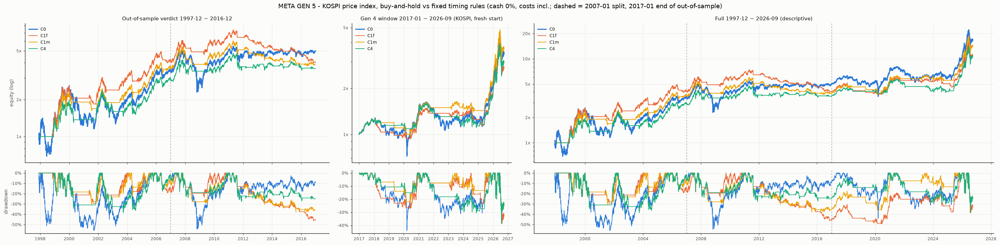

# 메타 세대 5 — 코어 규칙의 표본 밖 검증 1997~2016(코스피) — 실행 결과 2026-10-10 (러너 자동 생성, 판정 아님)

설계 `META_GEN5.md`(a071ad1, 결과 보기 전)를 계산한 숫자다. ✓/✗ 는 미리 적은 문턱과의 **산술 비교**이고 판정은 사람이 한다. 규칙 C0·C1f·C1m·C4 는 세대 4 에서 고정된 것이고 이 세대에서 고른 것은 없다.

재현: `uv run python research/experiments/meta_gen5_run.py` · 실행 7초 · 무작위 타이밍 널 1000벌 × 2종/규칙 · 부트스트랩 2000벌 · DB 접속 없음.

## 먼저 읽을 것

- **자산이 세대 4 와 다르다:** 코스피 가격 지수(Yahoo ^KS11, `research/data/krx_index_daily_yahoo.csv`), 코스피200 아님. 2017-01 ~ 2026-09 에서 두 지수 일 종가 수익 상관 **0.9935**(2384일, 네이버), 연 변동성 코스피 24.3% · 코스피200 26.0%, 코스피200 의 코스피 베타 1.062, 같은 기간 누적 코스피 +237.44% · 코스피200 +316.07%. Yahoo 코스피 vs 네이버 코스피 일 수익 상관 0.999935(최대 차 0.583%p).
- **현금 0%(판정):** 시장 밖 구간은 이자를 받지 않는다. C4 의 '현금 12개월 수익' 문턱도 0(= 12개월 가격 수익 > 0). 원 Sharpe = 초과 Sharpe. 기억값 CD91 줄은 아래 표의 기술 줄·참고 열이다(값은 '자료·가정' — **기억값, DB 밖**).
- **배당 제외 가격 지수:** 판정 (3)은 연 1.5% × 시장 밖 비율을 타이밍 CAGR 에서 깎은 줄로 본다(C0 는 그대로).
- **2000-12 까지 토요일 장(반일)이 Yahoo 자료에 없다** — 토요일 움직임은 다음 월요일 밤 수익에 들어간다(종가 계열은 이어짐). 그래서 해마다 거래일이 241~253일이고, CAGR(252/T 저장소 관례)은 달력 CAGR 과 조금 다르다(두 열 모두 적는다).
- **워밍업:** 자료 시작 1996-12-11. MA200 은 1997-10 부터 있고, C4 는 첫 12개월 비교가 1997-12-31 월말이라 **1997-12 한 달은 현금**(설계 창 그대로).
- 분리 창(1997-12 ~ 2006-12 · 2007-01 ~ 2016-12)은 판정 창 계열을 자른 것(규칙 상태 이어짐). 2017~2026 창은 세대 4 처럼 2017-01-02 시가에 현금에서 새로 시작.

## 판정 산술 (META_GEN5.md '판정 구간과 바', 현금 0%)

C0(코스피 매수보유) 대비 **모두**: (1) 짝지은 달 블록 부트스트랩(판정 창 일별 경로를 3개월 블록으로 재표본, 2000벌)에서 P(Sharpe > C0 **그리고** Calmar > C0) ≥ 0.8 — 세대 4 와 같은 엄격한 읽기(동시) · (2) MDD 가 10%p 이상 얕음 · (3) CAGR_C0 − CAGR(배당 1.5% 고정 보정 줄) ≤ 2%p · (4) Calmar > 무작위 타이밍 널 Calmar p95 — **마르코프(C1m·C4 는 월말 전환)와 원형 이동 둘 다** · (5) 1997-12 ~ 2006-12 · 2007-01 ~ 2016-12 **각각** Calmar ≥ C0.

| 규칙 | (1) P(SR) · P(Calmar) · **P(둘 다)** | (2) ΔMDD | (3) CAGR_C0 − CAGR(배당 1.5% 보정) | (4) Calmar · 마르코프 p95 (백분위) · 원형 p95 (백분위) | (5) Calmar 97-06 · C0 / 07-16 · C0 | **통과(1–5)** | 참고: (1) 각각 · (1) 12개월 블록 · CD91 줄로 전부 |
|---|---|---|---|---|---|---|---|
| **C1f** | 0.63 · 0.67 · **0.60** ✗ | +9.5%p (-46.29% vs -55.77%) ✗ | +1.8%p (+8.92% − +7.10%) ✓ | 0.17 · 0.23 (84%) ✗ · 0.22 (88%) ✗ → ✗ | 0.59 · 0.27 / -0.01 · 0.06 ✗ | **✗** | ✗ · ✗ · ✗ |
| **C1m** | 0.61 · 0.65 · **0.59** ✗ | +17.9%p (-37.84% vs -55.77%) ✓ | +2.0%p (+8.92% − +6.88%) ✗ | 0.20 · 0.23 (90%) ✗ · 0.22 (92%) ✗ → ✗ | 0.52 · 0.27 / 0.01 · 0.06 ✗ | **✗** | ✗ · ✗ · ✗ |
| **C4** | 0.52 · 0.57 · **0.50** ✗ | +17.2%p (-38.54% vs -55.77%) ✓ | +2.5%p (+8.92% − +6.45%) ✗ | 0.18 · 0.23 (84%) ✗ · 0.26 (86%) ✗ → ✗ | 0.34 · 0.27 / 0.06 · 0.06 ✓ | **✗** | ✗ · ✗ · ✗ |

**산술 결과:** 통과(1–5) = 없음. 

**적용되는 결론 규칙(설계 '결론 규칙' 둘째 줄):** 아무것도 통과 못 함 → **코어 = 매수보유가 1997~2026 30년 두 독립 구간(1997~2016 표본 밖 · 2017~2026 세대 4)에서 확인됨.** 문구는 '이 30년 자료에서 매수보유를 버릴 근거 없음'.

참고 — 기억값 CD91 줄(현금 이자·C4 문턱·초과 SR 모두 CD91)로 같은 산술: 통과 = 없음. 판정에 쓰지 않는다.

(3) 배당 민감도(참고): C1f 1.0% +1.6%p ✓ / 2.0% +2.0%p ✗ · C1m 1.0% +1.8%p ✓ / 2.0% +2.2%p ✗ · C4 1.0% +2.3%p ✗ / 2.0% +2.7%p ✗.

## 숫자 (비용·보수 포함, 가격 지수)

CAGR = 날 수 기준(252/T — 저장소 `equity_stats`, 세대 4 와 같은 관례), 달력 CAGR = (1 + 누적)^(365.25/일수) − 1(참고). MDD = 일별 경로(초기 자산 1 을 첫 고점으로), Calmar = CAGR / |MDD|, SR = 월 복리 (초과)수익 평균/표준편차 × √12(현금 0 이면 원 SR). 시장 안 = 평균 보유, 전환/년 = 보유가 바뀐 날 / 년. CAGR 배당 1.5% = 날별 − 1.5%/252 × (1 − 보유)(C0 불변).

### 현금 0%(판정)

**판정 창 1997-12 ~ 2016-12 (표본 밖)**

| 절차 | CAGR | 달력 CAGR | MDD | Calmar | SR | 원 SR | 시장 안 | 전환/년 (횟수) | CAGR 배당 1.5% | 기간 |
|---|---|---|---|---|---|---|---|---|---|---|
| C0 | +8.92% | +8.74% | -55.77% | 0.16 | 0.43 | 0.43 | 100% | 0.00 (0) | +8.92% | 1997-12-01 ~ 2016-12-29 |
| C1f | +7.74% | +7.58% | -46.29% | 0.17 | 0.49 | 0.49 | 61% | 8.18 (153) | +7.10% | 1997-12-01 ~ 2016-12-29 |
| C1m | +7.50% | +7.35% | -37.84% | 0.20 | 0.48 | 0.48 | 61% | 1.92 (36) | +6.88% | 1997-12-01 ~ 2016-12-29 |
| C4 | +7.05% | +6.91% | -38.54% | 0.18 | 0.45 | 0.45 | 62% | 1.50 (28) | +6.45% | 1997-12-01 ~ 2016-12-29 |

**분리 1997-12 ~ 2006-12**

| 절차 | CAGR | 달력 CAGR | MDD | Calmar | SR | 원 SR | 시장 안 | 전환/년 (횟수) | CAGR 배당 1.5% | 기간 |
|---|---|---|---|---|---|---|---|---|---|---|
| C0 | +15.24% | +14.87% | -55.77% | 0.27 | 0.55 | 0.55 | 100% | 0.00 (0) | +15.24% | 1997-12-01 ~ 2006-12-28 |
| C1f | +17.67% | +17.24% | -30.02% | 0.59 | 0.82 | 0.82 | 57% | 5.30 (47) | +16.92% | 1997-12-01 ~ 2006-12-28 |
| C1m | +16.04% | +15.66% | -30.58% | 0.52 | 0.78 | 0.78 | 56% | 1.24 (11) | +15.28% | 1997-12-01 ~ 2006-12-28 |
| C4 | +13.19% | +12.88% | -38.54% | 0.34 | 0.63 | 0.63 | 64% | 0.79 (7) | +12.59% | 1997-12-01 ~ 2006-12-28 |

**분리 2007-01 ~ 2016-12**

| 절차 | CAGR | 달력 CAGR | MDD | Calmar | SR | 원 SR | 시장 안 | 전환/년 (횟수) | CAGR 배당 1.5% | 기간 |
|---|---|---|---|---|---|---|---|---|---|---|
| C0 | +3.52% | +3.47% | -54.56% | 0.06 | 0.28 | 0.28 | 100% | 0.00 (0) | +3.52% | 2007-01-02 ~ 2016-12-29 |
| C1f | -0.50% | -0.49% | -46.29% | -0.01 | 0.02 | 0.02 | 63% | 10.78 (106) | -1.04% | 2007-01-02 ~ 2016-12-29 |
| C1m | +0.34% | +0.34% | -37.84% | 0.01 | 0.09 | 0.09 | 66% | 2.54 (25) | -0.17% | 2007-01-02 ~ 2016-12-29 |
| C4 | +1.79% | +1.76% | -27.70% | 0.06 | 0.20 | 0.20 | 61% | 2.14 (21) | +1.19% | 2007-01-02 ~ 2016-12-29 |

**기술: 2017-01 ~ 2026-09 (세대 4 창, 코스피 — 2017-01 현금 시작)**

| 절차 | CAGR | 달력 CAGR | MDD | Calmar | SR | 원 SR | 시장 안 | 전환/년 (횟수) | CAGR 배당 1.5% | 기간 |
|---|---|---|---|---|---|---|---|---|---|---|
| C0 | +13.68% | +13.26% | -43.96% | 0.31 | 0.60 | 0.60 | 100% | 0.00 (0) | +13.68% | 2017-01-02 ~ 2026-09-30 |
| C1f | +11.09% | +10.76% | -38.74% | 0.29 | 0.54 | 0.54 | 60% | 8.46 (80) | +10.43% | 2017-01-02 ~ 2026-09-30 |
| C1m | +14.60% | +14.15% | -38.63% | 0.38 | 0.69 | 0.69 | 58% | 1.48 (14) | +13.89% | 2017-01-02 ~ 2026-09-30 |
| C4 | +12.09% | +11.72% | -38.63% | 0.31 | 0.59 | 0.59 | 60% | 1.48 (14) | +11.43% | 2017-01-02 ~ 2026-09-30 |

**기술: 전체 1997-12 ~ 2026-09**

| 절차 | CAGR | 달력 CAGR | MDD | Calmar | SR | 원 SR | 시장 안 | 전환/년 (횟수) | CAGR 배당 1.5% | 기간 |
|---|---|---|---|---|---|---|---|---|---|---|
| C0 | +10.49% | +10.24% | -55.77% | 0.19 | 0.49 | 0.49 | 100% | 0.00 (0) | +10.49% | 1997-12-01 ~ 2026-09-30 |
| C1f | +8.85% | +8.64% | -49.32% | 0.18 | 0.50 | 0.50 | 60% | 8.27 (233) | +8.20% | 1997-12-01 ~ 2026-09-30 |
| C1m | +9.84% | +9.60% | -38.63% | 0.25 | 0.56 | 0.56 | 60% | 1.81 (51) | +9.19% | 1997-12-01 ~ 2026-09-30 |
| C4 | +8.72% | +8.51% | -38.63% | 0.23 | 0.50 | 0.50 | 62% | 1.53 (43) | +8.10% | 1997-12-01 ~ 2026-09-30 |

### 기억값 CD91(기술)

**판정 창 1997-12 ~ 2016-12 (표본 밖)**

| 절차 | CAGR | 달력 CAGR | MDD | Calmar | SR | 원 SR | 시장 안 | 전환/년 (횟수) | CAGR 배당 1.5% | 기간 |
|---|---|---|---|---|---|---|---|---|---|---|
| C0 | +8.93% | +8.74% | -55.77% | 0.16 | 0.27 | 0.43 | 100% | 0.00 (0) | +8.93% | 1997-12-01 ~ 2016-12-29 |
| C1f | +10.10% | +9.89% | -42.98% | 0.23 | 0.36 | 0.61 | 61% | 8.18 (153) | +9.45% | 1997-12-01 ~ 2016-12-29 |
| C1m | +9.89% | +9.69% | -34.98% | 0.28 | 0.35 | 0.60 | 61% | 1.92 (36) | +9.26% | 1997-12-01 ~ 2016-12-29 |
| C4 | +6.90% | +6.76% | -37.72% | 0.18 | 0.21 | 0.47 | 54% | 1.82 (34) | +6.17% | 1997-12-01 ~ 2016-12-29 |

**분리 1997-12 ~ 2006-12**

| 절차 | CAGR | 달력 CAGR | MDD | Calmar | SR | 원 SR | 시장 안 | 전환/년 (횟수) | CAGR 배당 1.5% | 기간 |
|---|---|---|---|---|---|---|---|---|---|---|
| C0 | +15.24% | +14.88% | -55.77% | 0.27 | 0.39 | 0.55 | 100% | 0.00 (0) | +15.24% | 1997-12-01 ~ 2006-12-28 |
| C1f | +21.55% | +21.02% | -25.15% | 0.86 | 0.70 | 0.96 | 57% | 5.30 (47) | +20.78% | 1997-12-01 ~ 2006-12-28 |
| C1m | +20.05% | +19.56% | -25.58% | 0.78 | 0.66 | 0.94 | 56% | 1.24 (11) | +19.26% | 1997-12-01 ~ 2006-12-28 |
| C4 | +12.80% | +12.50% | -37.72% | 0.34 | 0.38 | 0.67 | 60% | 1.01 (9) | +12.13% | 1997-12-01 ~ 2006-12-28 |

**분리 2007-01 ~ 2016-12**

| 절차 | CAGR | 달력 CAGR | MDD | Calmar | SR | 원 SR | 시장 안 | 전환/년 (횟수) | CAGR 배당 1.5% | 기간 |
|---|---|---|---|---|---|---|---|---|---|---|
| C0 | +3.52% | +3.47% | -54.56% | 0.06 | 0.11 | 0.28 | 100% | 0.00 (0) | +3.52% | 2007-01-02 ~ 2016-12-29 |
| C1f | +0.69% | +0.68% | -42.98% | 0.02 | -0.13 | 0.12 | 63% | 10.78 (106) | +0.14% | 2007-01-02 ~ 2016-12-29 |
| C1m | +1.47% | +1.44% | -34.98% | 0.04 | -0.05 | 0.17 | 66% | 2.54 (25) | +0.95% | 2007-01-02 ~ 2016-12-29 |
| C4 | +1.85% | +1.82% | -32.59% | 0.06 | -0.04 | 0.21 | 48% | 2.44 (24) | +1.06% | 2007-01-02 ~ 2016-12-29 |

**기술: 2017-01 ~ 2026-09 (세대 4 창, 코스피 — 2017-01 현금 시작)**

| 절차 | CAGR | 달력 CAGR | MDD | Calmar | SR | 원 SR | 시장 안 | 전환/년 (횟수) | CAGR 배당 1.5% | 기간 |
|---|---|---|---|---|---|---|---|---|---|---|
| C0 | +13.68% | +13.26% | -43.96% | 0.31 | 0.52 | 0.60 | 100% | 0.00 (0) | +13.68% | 2017-01-02 ~ 2026-09-30 |
| C1f | +12.09% | +11.71% | -38.73% | 0.31 | 0.49 | 0.57 | 60% | 8.46 (80) | +11.41% | 2017-01-02 ~ 2026-09-30 |
| C1m | +15.67% | +15.18% | -38.63% | 0.41 | 0.64 | 0.73 | 58% | 1.48 (14) | +14.95% | 2017-01-02 ~ 2026-09-30 |
| C4 | +9.41% | +9.13% | -38.63% | 0.24 | 0.40 | 0.49 | 56% | 1.69 (16) | +8.70% | 2017-01-02 ~ 2026-09-30 |

**기술: 전체 1997-12 ~ 2026-09**

| 절차 | CAGR | 달력 CAGR | MDD | Calmar | SR | 원 SR | 시장 안 | 전환/년 (횟수) | CAGR 배당 1.5% | 기간 |
|---|---|---|---|---|---|---|---|---|---|---|
| C0 | +10.49% | +10.24% | -55.77% | 0.19 | 0.35 | 0.49 | 100% | 0.00 (0) | +10.49% | 1997-12-01 ~ 2026-09-30 |
| C1f | +10.76% | +10.49% | -44.70% | 0.24 | 0.41 | 0.59 | 60% | 8.27 (233) | +10.10% | 1997-12-01 ~ 2026-09-30 |
| C1m | +11.80% | +11.51% | -38.63% | 0.31 | 0.46 | 0.65 | 60% | 1.81 (51) | +11.14% | 1997-12-01 ~ 2026-09-30 |
| C4 | +7.74% | +7.56% | -38.63% | 0.20 | 0.28 | 0.47 | 55% | 1.81 (51) | +7.01% | 1997-12-01 ~ 2026-09-30 |

**세대 4 숫자와 나란히(2017-01 ~ 2026-09, 기술):** 세대 4 = 코스피200 · CD91 현금 · 같은 엔진(`meta_gen4/summary.csv` 'full' 행), 여기 = 코스피 · 기억값 CD91 줄.

| 절차 | 세대 4 KOSPI200 CAGR · MDD · Calmar · 초과 SR | 이 러너 KOSPI CAGR · MDD · Calmar · 초과 SR |
|---|---|---|
| C0 | +16.20% · -41.25% · 0.39 · 0.58 | +13.68% · -43.96% · 0.31 · 0.52 |
| C1f | +15.20% · -40.94% · 0.37 · 0.57 | +12.09% · -38.73% · 0.31 · 0.49 |
| C1m | —(세대 4 에 고정 규칙 없음) | +15.67% · -38.63% · 0.41 · 0.64 |
| C4 | +14.74% · -40.94% · 0.36 · 0.57 | +9.41% · -38.63% · 0.24 · 0.40 |

## 최악 낙폭 에피소드 (현금 0%)

에피소드 = 새 고점 사이 구간. 고점일 = 그 고점 종가 날(창 첫 행 직전 종가 = 시작점), 회복일 = 고점을 처음 다시 넘은 날('미회복' = 그 창 끝까지 못 넘음). 거래일 = 고점 → 저점.

### 판정 창 1997-12 ~ 2016-12 (표본 밖) — 절차마다 깊은 순 5개

| 절차 | # | 고점 → 저점 | 낙폭 | 거래일 하락 | 회복일 (거래일) |
|---|---|---|---|---|---|
| C0 | 1 | 2000-01-04 → 2001-09-17 | -55.77% | 416 | 2005-07-14 (942) |
| C0 | 2 | 2007-10-31 → 2008-10-24 | -54.56% | 242 | 2011-01-03 (551) |
| C0 | 3 | 1998-03-02 → 1998-06-16 | -51.26% | 73 | 1998-12-15 (127) |
| C0 | 4 | 2011-05-02 → 2011-09-26 | -25.87% | 99 | 미회복 |
| C0 | 5 | 1999-07-09 → 1999-10-05 | -23.00% | 60 | 2000-01-04 (61) |
| C1f | 1 | 2011-05-02 → 2016-11-09 | -46.29% | 1363 | 미회복 |
| C1f | 2 | 2000-01-04 → 2001-11-07 | -30.02% | 450 | 2002-02-27 (74) |
| C1f | 3 | 2002-04-18 → 2002-06-26 | -25.15% | 46 | 2004-01-07 (377) |
| C1f | 4 | 2007-10-31 → 2009-04-28 | -23.54% | 369 | 2009-09-22 (103) |
| C1f | 5 | 1999-07-09 → 1999-10-05 | -23.00% | 60 | 2000-01-04 (61) |
| C1m | 1 | 2011-05-02 → 2015-08-24 | -37.84% | 1065 | 미회복 |
| C1m | 2 | 2000-01-04 → 2001-07-23 | -30.58% | 377 | 2002-03-22 (163) |
| C1m | 3 | 2007-10-31 → 2009-06-23 | -29.31% | 407 | 2010-12-13 (372) |
| C1m | 4 | 2002-04-18 → 2002-07-26 | -25.58% | 66 | 2004-01-26 (367) |
| C1m | 5 | 1999-07-09 → 1999-10-05 | -23.00% | 60 | 2000-01-04 (61) |
| C4 | 1 | 2002-04-18 → 2003-09-29 | -38.54% | 355 | 2005-09-07 (483) |
| C4 | 2 | 2000-01-04 → 2000-04-27 | -34.66% | 78 | 2002-02-14 (437) |
| C4 | 3 | 2011-05-02 → 2011-11-25 | -27.70% | 141 | 미회복 |
| C4 | 4 | 2007-10-31 → 2008-03-17 | -23.76% | 91 | 2010-11-10 (665) |
| C4 | 5 | 1999-07-09 → 1999-10-05 | -23.00% | 60 | 2000-01-04 (61) |

**C0 의 깊은 5개 동안 규칙들**(칸 = 고점 종가 → 저점 종가 누적 수익 / 그 안 규칙 자신의 최대 낙폭 / 평균 보유):

| C0 고점 → 저점 (회복) | 거래일 | C0 | C1f | C1m | C4 |
|---|---|---|---|---|---|
| 2000-01-04 → 2001-09-17 (2005-07-14) | 416 | -55.77% | -29.31% / -29.31% / 19% | -27.71% / -30.58% / 19% | -30.96% / -34.66% / 19% |
| 2007-10-31 → 2008-10-24 (2011-01-03) | 242 | -54.56% | -19.60% / -19.74% / 28% | -27.93% / -27.93% / 34% | -18.93% / -23.76% / 67% |
| 1998-03-02 → 1998-06-16 (1998-12-15) | 73 | -51.26% | +0.00% / +0.00% / 0% | +0.00% / +0.00% / 0% | +0.00% / +0.00% / 0% |
| 2011-05-02 → 2011-09-26 (미회복) | 99 | -25.87% | -13.16% / -13.16% / 66% | -15.41% / -23.26% / 84% | -25.87% / -25.87% / 100% |
| 1999-07-09 → 1999-10-05 (2000-01-04) | 60 | -23.00% | -23.00% / -23.00% / 100% | -23.00% / -23.00% / 100% | -23.00% / -23.00% / 100% |

### 기술: 전체 1997-12 ~ 2026-09 — 절차마다 깊은 순 5개

| 절차 | # | 고점 → 저점 | 낙폭 | 거래일 하락 | 회복일 (거래일) |
|---|---|---|---|---|---|
| C0 | 1 | 2000-01-04 → 2001-09-17 | -55.77% | 416 | 2005-07-14 (942) |
| C0 | 2 | 2007-10-31 → 2008-10-24 | -54.56% | 242 | 2011-01-03 (551) |
| C0 | 3 | 1998-03-02 → 1998-06-16 | -51.26% | 73 | 1998-12-15 (127) |
| C0 | 4 | 2018-01-29 → 2020-03-19 | -43.96% | 524 | 2020-11-23 (168) |
| C0 | 5 | 2026-06-22 → 2026-07-30 | -38.63% | 27 | 미회복 |
| C1f | 1 | 2011-05-02 → 2020-06-15 | -49.32% | 2242 | 2025-11-03 (1319) |
| C1f | 2 | 2026-06-22 → 2026-08-03 | -38.74% | 29 | 미회복 |
| C1f | 3 | 2000-01-04 → 2001-11-07 | -30.02% | 450 | 2002-02-27 (74) |
| C1f | 4 | 2002-04-18 → 2002-06-26 | -25.15% | 46 | 2004-01-07 (377) |
| C1f | 5 | 2007-10-31 → 2009-04-28 | -23.54% | 369 | 2009-09-22 (103) |
| C1m | 1 | 2026-06-22 → 2026-07-30 | -38.63% | 27 | 미회복 |
| C1m | 2 | 2011-05-02 → 2015-08-24 | -37.84% | 1065 | 2021-01-25 (1329) |
| C1m | 3 | 2000-01-04 → 2001-07-23 | -30.58% | 377 | 2002-03-22 (163) |
| C1m | 4 | 2007-10-31 → 2009-06-23 | -29.31% | 407 | 2010-12-13 (372) |
| C1m | 5 | 2002-04-18 → 2002-07-26 | -25.58% | 66 | 2004-01-26 (367) |
| C4 | 1 | 2026-06-22 → 2026-07-30 | -38.63% | 27 | 미회복 |
| C4 | 2 | 2002-04-18 → 2003-09-29 | -38.54% | 355 | 2005-09-07 (483) |
| C4 | 3 | 2000-01-04 → 2000-04-27 | -34.66% | 78 | 2002-02-14 (437) |
| C4 | 4 | 2021-07-06 → 2024-11-15 | -30.50% | 824 | 2025-10-16 (220) |
| C4 | 5 | 2011-05-02 → 2011-11-25 | -27.70% | 141 | 2020-12-11 (2225) |

**C0 의 깊은 5개 동안 규칙들**(칸 = 고점 종가 → 저점 종가 누적 수익 / 그 안 규칙 자신의 최대 낙폭 / 평균 보유):

| C0 고점 → 저점 (회복) | 거래일 | C0 | C1f | C1m | C4 |
|---|---|---|---|---|---|
| 2000-01-04 → 2001-09-17 (2005-07-14) | 416 | -55.77% | -29.31% / -29.31% / 19% | -27.71% / -30.58% / 19% | -30.96% / -34.66% / 19% |
| 2007-10-31 → 2008-10-24 (2011-01-03) | 242 | -54.56% | -19.60% / -19.74% / 28% | -27.93% / -27.93% / 34% | -18.93% / -23.76% / 67% |
| 1998-03-02 → 1998-06-16 (1998-12-15) | 73 | -51.26% | +0.00% / +0.00% / 0% | +0.00% / +0.00% / 0% | +0.00% / +0.00% / 0% |
| 2018-01-29 → 2020-03-19 (2020-11-23) | 524 | -43.96% | -26.45% / -26.70% / 28% | -22.04% / -22.38% / 27% | -15.08% / -15.08% / 27% |
| 2026-06-22 → 2026-07-30 (미회복) | 27 | -38.63% | -37.71% / -37.87% / 96% | -38.63% / -38.63% / 100% | -38.63% / -38.63% / 100% |

### 기술: 2017-01 ~ 2026-09 (세대 4 창, 코스피 — 2017-01 현금 시작) — 절차마다 깊은 순 5개

| 절차 | # | 고점 → 저점 | 낙폭 | 거래일 하락 | 회복일 (거래일) |
|---|---|---|---|---|---|
| C0 | 1 | 2018-01-29 → 2020-03-19 | -43.96% | 524 | 2020-11-23 (168) |
| C0 | 2 | 2026-06-22 → 2026-07-30 | -38.63% | 27 | 미회복 |
| C0 | 3 | 2021-07-06 → 2022-09-30 | -34.82% | 303 | 2025-09-10 (720) |
| C0 | 4 | 2026-02-26 → 2026-03-31 | -19.90% | 22 | 2026-04-21 (15) |
| C0 | 5 | 2026-06-02 → 2026-06-08 | -14.96% | 3 | 2026-06-17 (7) |
| C1f | 1 | 2026-06-22 → 2026-08-03 | -38.74% | 29 | 미회복 |
| C1f | 2 | 2018-01-29 → 2020-06-15 | -27.18% | 582 | 2020-12-30 (136) |
| C1f | 3 | 2024-07-11 → 2025-05-09 | -23.56% | 198 | 2025-09-12 (87) |
| C1f | 4 | 2026-02-26 → 2026-03-31 | -19.90% | 22 | 2026-04-21 (15) |
| C1f | 5 | 2026-06-02 → 2026-06-08 | -14.96% | 3 | 2026-06-17 (7) |
| C1m | 1 | 2026-06-22 → 2026-07-30 | -38.63% | 27 | 미회복 |
| C1m | 2 | 2018-01-29 → 2020-02-28 | -22.38% | 510 | 2020-11-24 (183) |
| C1m | 3 | 2026-02-26 → 2026-03-31 | -19.90% | 22 | 2026-04-21 (15) |
| C1m | 4 | 2023-08-01 → 2024-08-05 | -17.52% | 247 | 2025-07-03 (218) |
| C1m | 5 | 2026-06-02 → 2026-06-08 | -14.96% | 3 | 2026-06-17 (7) |
| C4 | 1 | 2026-06-22 → 2026-07-30 | -38.63% | 27 | 미회복 |
| C4 | 2 | 2021-07-06 → 2024-11-15 | -30.50% | 824 | 2025-10-16 (220) |
| C4 | 3 | 2026-02-26 → 2026-03-31 | -19.90% | 22 | 2026-04-21 (15) |
| C4 | 4 | 2018-01-29 → 2020-08-03 | -15.16% | 617 | 2020-12-02 (82) |
| C4 | 5 | 2026-06-02 → 2026-06-08 | -14.96% | 3 | 2026-06-17 (7) |

**C0 의 깊은 5개 동안 규칙들**(칸 = 고점 종가 → 저점 종가 누적 수익 / 그 안 규칙 자신의 최대 낙폭 / 평균 보유):

| C0 고점 → 저점 (회복) | 거래일 | C0 | C1f | C1m | C4 |
|---|---|---|---|---|---|
| 2018-01-29 → 2020-03-19 (2020-11-23) | 524 | -43.96% | -26.45% / -26.70% / 28% | -22.04% / -22.38% / 27% | -15.08% / -15.08% / 27% |
| 2026-06-22 → 2026-07-30 (미회복) | 27 | -38.63% | -37.71% / -37.87% / 96% | -38.63% / -38.63% / 100% | -38.63% / -38.63% / 100% |
| 2021-07-06 → 2022-09-30 (2025-09-10) | 303 | -34.82% | -7.63% / -7.63% / 18% | -7.61% / -7.61% / 19% | -18.20% / -20.92% / 46% |
| 2026-02-26 → 2026-03-31 (2026-04-21) | 22 | -19.90% | -19.90% / -19.90% / 100% | -19.90% / -19.90% / 100% | -19.90% / -19.90% / 100% |
| 2026-06-02 → 2026-06-08 (2026-06-17) | 3 | -14.96% | -14.96% / -14.96% / 100% | -14.96% / -14.96% / 100% | -14.96% / -14.96% / 100% |

## 무작위 타이밍 널 (판정 창, 규칙마다 2종 × 1000벌)

**마르코프**: 판정 창 보유의 π·전환 빈도 s 에 맞춘 2-상태 체인(p10 = s/(2π), p01 = s/(2(1 − π)), 첫 상태 ~ Bernoulli(π)) — **C1m·C4 는 달 단위 체인**(월말에만 전환, 달 첫날 보유로 π·s 를 재고 날로 펼침), C1f 는 날 단위. **원형 이동**: 실제 보유 열을 오프셋 ∈ [60, T − 60) 거래일만큼 돌림. 같은 엔진·비용·현금. 백분위 = 실제보다 작은 널 비율.

| 현금 | 규칙 | 널 | 단위 | π 목표 · 널 실현 | 전환 빈도 목표 · 널 실현(날) | Calmar · p50 · p95 (백분위) | SR · p50 · p95 | MDD · p50 · p95 |
|---|---|---|---|---|---|---|---|---|
| zero | C1f | 마르코프 | 날 | 0.605 · 0.606 | 0.0325 · 0.0324 | 0.17 · 0.09 · 0.23 (84%) | 0.49 · 0.31 · 0.54 | -46.29% · -53.76% · -41.24% |
| zero | C1f | 원형 이동 | 날 | 0.605 · 0.605 | 0.0325 · 0.0327 | 0.17 · 0.08 · 0.22 (88%) | 0.49 · 0.31 · 0.54 | -46.29% · -55.23% · -43.43% |
| zero | C1m | 마르코프 | 달 | 0.613 · 0.612 | 0.0076 · 0.0076 | 0.20 · 0.10 · 0.23 (90%) | 0.48 · 0.33 · 0.56 | -37.84% · -54.56% · -41.94% |
| zero | C1m | 원형 이동 | 날 | 0.613 · 0.613 | 0.0076 · 0.0076 | 0.20 · 0.10 · 0.22 (92%) | 0.48 · 0.33 · 0.55 | -37.84% · -54.56% · -42.65% |
| zero | C4 | 마르코프 | 달 | 0.624 · 0.623 | 0.0059 · 0.0059 | 0.18 · 0.10 · 0.23 (84%) | 0.45 · 0.34 · 0.58 | -38.54% · -54.56% · -44.18% |
| zero | C4 | 원형 이동 | 날 | 0.624 · 0.624 | 0.0059 · 0.0059 | 0.18 · 0.10 · 0.26 (86%) | 0.45 · 0.34 · 0.60 | -38.54% · -54.56% · -44.40% |
| cd91 | C1f | 마르코프 | 날 | 0.605 · 0.606 | 0.0325 · 0.0324 | 0.23 · 0.13 · 0.28 (89%) | 0.36 · 0.19 · 0.42 | -42.98% · -52.15% · -40.86% |
| cd91 | C1f | 원형 이동 | 날 | 0.605 · 0.605 | 0.0325 · 0.0327 | 0.23 · 0.12 · 0.27 (92%) | 0.36 · 0.19 · 0.42 | -42.98% · -53.60% · -42.48% |
| cd91 | C1m | 마르코프 | 달 | 0.613 · 0.609 | 0.0076 · 0.0076 | 0.28 · 0.13 · 0.30 (94%) | 0.35 · 0.21 · 0.45 | -34.98% · -53.70% · -40.62% |
| cd91 | C1m | 원형 이동 | 날 | 0.613 · 0.613 | 0.0076 · 0.0076 | 0.28 · 0.13 · 0.27 (96%) | 0.35 · 0.20 · 0.43 | -34.98% · -53.25% · -43.00% |
| cd91 | C4 | 마르코프 | 달 | 0.538 · 0.536 | 0.0072 · 0.0072 | 0.18 · 0.14 · 0.32 (73%) | 0.21 · 0.20 · 0.46 | -37.72% · -51.26% · -37.21% |
| cd91 | C4 | 원형 이동 | 날 | 0.538 · 0.538 | 0.0072 · 0.0072 | 0.18 · 0.13 · 0.43 (75%) | 0.21 · 0.19 · 0.51 | -37.72% · -52.78% · -34.49% |

## 부트스트랩 상세 (C0 대비, 판정 창, 일별 경로 달 블록, 짝지음·공통 난수)

| 현금 | 규칙 | 블록 | 달 | P(SR) | ΔSR 5·50·95% | P(Calmar) | ΔCalmar 5·50·95% | P(둘 다) |
|---|---|---|---|---|---|---|---|---|
| zero | C1f | 3개월 | 229 | 0.629 | -0.22 · 0.06 · 0.35 | 0.674 | -0.14 · 0.05 · 0.27 | 0.600 |
| zero | C1f | 12개월 | 229 | 0.609 | -0.21 · 0.04 · 0.28 | 0.711 | -0.12 · 0.06 · 0.26 | 0.594 |
| zero | C1m | 3개월 | 229 | 0.613 | -0.25 · 0.05 · 0.35 | 0.653 | -0.16 · 0.04 · 0.26 | 0.590 |
| zero | C1m | 12개월 | 229 | 0.546 | -0.22 · 0.01 · 0.23 | 0.680 | -0.12 · 0.04 · 0.21 | 0.534 |
| zero | C4 | 3개월 | 229 | 0.522 | -0.27 · 0.01 · 0.32 | 0.574 | -0.17 · 0.02 · 0.21 | 0.498 |
| zero | C4 | 12개월 | 229 | 0.461 | -0.25 · -0.01 · 0.22 | 0.575 | -0.15 · 0.01 · 0.16 | 0.446 |
| cd91 | C1f | 3개월 | 229 | 0.701 | -0.19 · 0.09 · 0.39 | 0.836 | -0.07 · 0.12 · 0.40 | 0.693 |
| cd91 | C1f | 12개월 | 229 | 0.696 | -0.19 · 0.08 · 0.32 | 0.871 | -0.06 · 0.14 · 0.40 | 0.694 |
| cd91 | C1m | 3개월 | 229 | 0.673 | -0.22 · 0.09 · 0.39 | 0.828 | -0.09 · 0.12 · 0.38 | 0.669 |
| cd91 | C1m | 12개월 | 229 | 0.640 | -0.19 · 0.05 · 0.28 | 0.863 | -0.07 · 0.11 · 0.34 | 0.638 |
| cd91 | C4 | 3개월 | 229 | 0.377 | -0.40 · -0.06 · 0.28 | 0.576 | -0.19 · 0.02 · 0.24 | 0.372 |
| cd91 | C4 | 12개월 | 229 | 0.245 | -0.34 · -0.09 · 0.14 | 0.537 | -0.17 · 0.01 · 0.15 | 0.244 |

## 연도별 수익 (현금 0%, 그 해 보유 비율)

| 해 | C0 | C1f | C1m | C4 |
|---|---|---|---|---|
| 1997 | -7.56% (100%) | +0.00% (0%) | +0.00% (0%) | +0.00% (0%) |
| 1998 | +49.86% (100%) | +38.73% (16%) | +24.39% (8%) | +24.39% (8%) |
| 1999 | +82.69% (100%) | +82.69% (100%) | +82.69% (100%) | +54.90% (91%) |
| 2000 | -50.94% (100%) | -18.88% (12%) | -15.95% (17%) | -28.88% (33%) |
| 2001 | +37.40% (100%) | +9.68% (37%) | -4.57% (24%) | +28.21% (17%) |
| 2002 | -9.58% (100%) | +6.23% (55%) | +3.83% (58%) | -9.58% (100%) |
| 2003 | +29.12% (100%) | +24.98% (57%) | +21.53% (50%) | +6.98% (33%) |
| 2004 | +10.46% (100%) | +1.01% (67%) | +6.63% (66%) | +10.46% (100%) |
| 2005 | +53.89% (100%) | +53.89% (100%) | +53.89% (100%) | +53.89% (100%) |
| 2006 | +3.94% (100%) | -8.96% (75%) | -0.81% (83%) | +3.94% (100%) |
| 2007 | +32.19% (100%) | +32.19% (100%) | +32.19% (100%) | +28.83% (92%) |
| 2008 | -40.76% (100%) | -12.48% (11%) | -21.56% (17%) | -11.75% (49%) |
| 2009 | +49.57% (100%) | +23.04% (74%) | +21.28% (67%) | +5.59% (34%) |
| 2010 | +21.82% (100%) | +13.32% (95%) | +17.87% (92%) | +21.82% (100%) |
| 2011 | -11.03% (100%) | -5.64% (60%) | -8.08% (67%) | -15.52% (84%) |
| 2012 | +9.33% (100%) | -9.35% (56%) | -8.03% (49%) | +3.39% (41%) |
| 2013 | +0.67% (100%) | -6.86% (68%) | -6.81% (75%) | +2.33% (74%) |
| 2014 | -4.81% (100%) | -8.93% (56%) | -6.36% (67%) | -5.88% (42%) |
| 2015 | +2.34% (100%) | -6.33% (54%) | -4.92% (60%) | +0.10% (67%) |
| 2016 | +3.27% (100%) | -13.16% (61%) | -0.54% (67%) | -3.29% (24%) |
| 2017 | +21.71% (100%) | +21.71% (100%) | +21.87% (100%) | +21.87% (100%) |
| 2018 | -17.32% (100%) | -14.98% (32%) | -2.03% (42%) | -5.98% (50%) |
| 2019 | +7.62% (100%) | -3.80% (21%) | -7.52% (9%) | +0.47% (9%) |
| 2020 | +30.69% (100%) | +29.82% (75%) | +27.66% (75%) | +20.69% (49%) |
| 2021 | +3.57% (100%) | +6.22% (74%) | +6.25% (75%) | +3.57% (100%) |
| 2022 | -24.93% (100%) | +0.00% (0%) | +0.00% (0%) | -9.18% (8%) |
| 2023 | +18.67% (100%) | +1.45% (73%) | +6.01% (67%) | -6.62% (41%) |
| 2024 | -9.68% (100%) | -10.03% (61%) | -9.82% (67%) | -6.74% (92%) |
| 2025 | +75.54% (100%) | +48.99% (73%) | +56.34% (59%) | +59.49% (67%) |
| 2026 | +62.20% (100%) | +44.74% (99%) | +62.20% (100%) | +62.20% (100%) |

1997 = 12-01 ~ 12-30, 2026 = 01-02 ~ 09-30. 1997-12 ~ 2026-09 한 계열(2017+ 도 이어진 상태 — 위 '2017~2026 창'은 새로 시작한 별도 계열). 가격 지수(배당 제외).

## 자료 · 가정

- **지수:** `research/data/krx_index_daily_yahoo.csv` 의 `KOSPI`(1996-12-11 ~ 2026-10-08, 7340일; 같은 파일의 KPI200 1행은 무시). 체결 = 지수 시가(ETF 시가 대용). 네이버 공식값과 겹치는 2,996일 중앙 상대오차 2e-8 · 최대 0.58%(설계 문서).
- **현금:** 판정 = 0%. 기술 줄 CD91 연평균 근사 1997 13.24% · 1998 14.98% · 1999 6.84% · 2000 7.08% · 2001 5.32% · 2002 4.81% · 2003 4.31% · 2004 3.79% · 2005 3.65% · 2006 4.48% · 2007 5.16% · 2008 5.49% · 2009 2.63% · 2010 2.67% · 2011 3.44% · 2012 3.30% · 2013 2.72% · 2014 2.49% · 2015 1.77% · 2016 1.49% · 2017 1.44% · 2018 1.68% · 2019 1.69% · 2020 0.92% · 2021 0.85% · 2022 2.58% · 2023 3.72% · 2024 3.48% · 2025 2.75% · 2026 2.60% — 1997~2016 = **이 러너 작성 때의 기억값**(한국은행 연평균 근사, DB 밖), 2017+ = 세대 4 `CD91`(기억값). 날 금리 = 연 / 252.
- **비용:** 보유가 바뀐 날 시가에 편도 0.07%, 보수 연 0.05% / 252 × 그날 보유. 창 첫날은 현금에서 진입(C0 도 진입 비용 한 번).
- **배당:** 고정 보정 줄 연 1.5% × 시장 밖 비율(판정 (3)), 민감도 1.0% · 2.0%(참고).
- **규칙:** C1f = d 종가 > 200일 단순 이동평균(d 포함) → d+1 시가 · C1m = 월말 종가 > 200일선 → 다음 달 첫 거래일 시가부터 그 달 끝까지 (`ma_month_signal`) · C4 = 월말 12개월 전 월말 대비 수익 > 같은 기간 현금 복리(현금 0 → > 0).
- **부트스트랩:** 판정 창 일별 수익을 달 블록(비원형 이동 블록 3개월 · 참고 12개월)으로 재표본해 이어 붙인 일별 경로 → Calmar(일별 MDD)·SR. 같은 창의 모든 비교에 같은 달 표본(`meta_gen4_run.MonthBoot`·`paired_boot`).
- **원장:** `meta_gen5/TRIALS.jsonl` 새 줄 0개. 산출: `meta_gen5/` summary·decision·null_random·episodes·c0_episodes·nav·peryear.csv, `equity.png`.

## 그림

왼쪽 = 판정 창 1997-12 ~ 2016-12, 가운데 = 2017-01 ~ 2026-09(코스피, 새로 시작), 오른쪽 = 전체 1997-12 ~ 2026-09. 위 = 자산(로그), 아래 = 낙폭. 점선 = 2007-01(분리 경계) · 2017-01(표본 밖 끝). 현금 0%.

