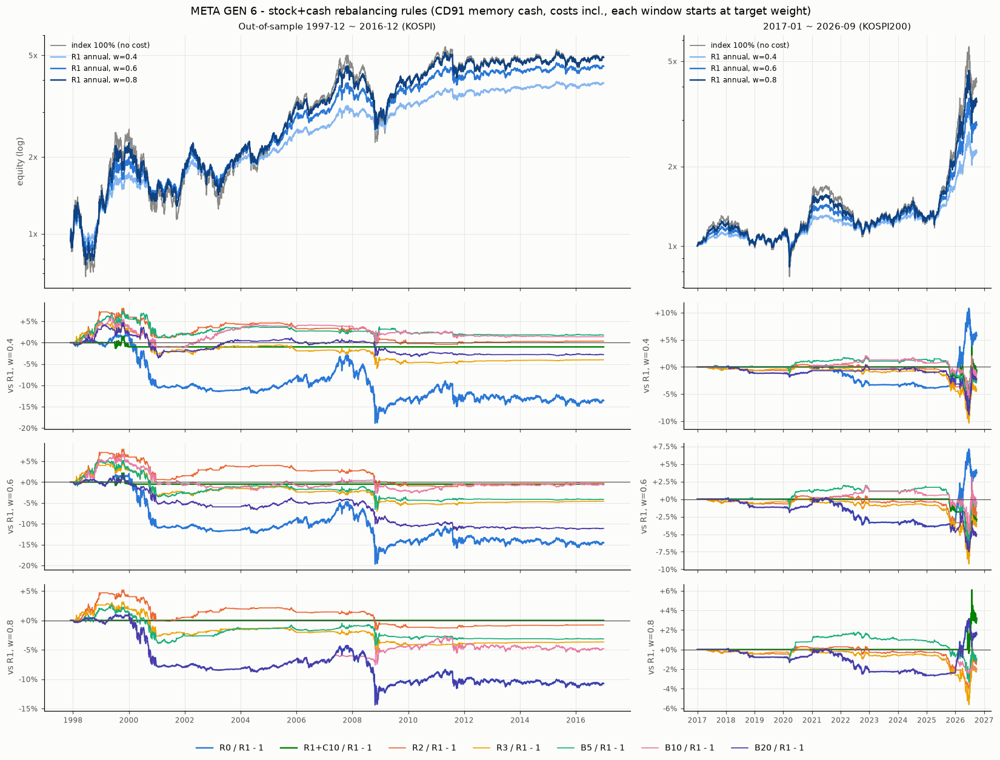

# 메타 세대 6 — 박스권 한국 시장의 리밸런싱 규칙 — 실행 결과 2026-10-10 (러너 자동 생성, 판정 아님)

> 공개: 러너가 설계 정정(c2924d8) 전에 원 설계로 한 번 실행해 결과를 봤다(그때도 통과 없음). 그 산출물은 지우고 정정판으로 다시 만들었다.

설계 `META_GEN6.md`(f5e71ba + 정정 c2924d8, 둘 다 결과 보기 전)를 계산한 숫자다. ✓/✗ 는 미리 적은 문턱과의 **산술 비교**이고 판정은 사람이 한다. 규칙 8 × 목표 비중 3 = 24 칸(원 설계 21 + 정정 현행 R1+C10 3)은 설계 그대로이고 이 세대에서 고른 것은 없다.

재현: `uv run python research/experiments/meta_gen6_run.py` · 실행 113초 · 무작위 리밸런스 날짜 널 1000벌/칸·세계 · 부트스트랩 2000벌 · 섞은 수익열 100벌 × 널 200벌/칸 · DB 접속 없음.

## 먼저 읽을 것

- **채택 산술은 두 벌이다.** 정정이 'R1+C10 이 R1 대신 현행 비교 기준' 이라 했으므로 **정식 = 조건 1~3 의 기준을 R1+C10 로**(후보 R1·R2·R3·B5·B10·B20), 원 설계 글자 그대로 기준 = R1 인 표(후보 R1+C10·R2·R3·B5·B10·B20)를 **참고**로 나란히 둔다. 조건 1 의 'vs R0' 는 두 벌 모두 같다.
- **현금 두 세계:** (i) 0% — Sharpe = 원 Sharpe, (ii) CD91 기억값(세대 5 러너 `CD91_MEM`, **기억값 · DB 밖**) — Sharpe = 월 복리 초과 Sharpe. 조건 1~3 은 두 세계 모두(조건 5), **조건 4 = (ii) 세계**(정정).
- **조건 4 의 널:** 표본 밖 창에서 X 가 실제로 한 리밸런스 횟수 k 와 **정확히 같은 수**의 날을 창 안 거래일(첫날 제외)에서 비복원 균등으로 뽑아, 그날 시가에 w 로 되돌리는 경로 1,000벌(같은 엔진·비용·현금). 한 세계 안 모든 칸이 같은 무작위 키를 쓴다(칸 상관 보존 → 아래 순열 기준선). **이 널은 밴드 쪽으로 기운다** — 날 단위로 섞은(구조 없는) 수익열에서의 기저 통과율을 아래에 함께 적는다(정정).
- **체결:** 모든 결정은 d 종가 → d+1 시가. 달력 규칙 = 기간 마지막 거래일 종가에 판단 → 기간 첫 거래일 시가. 밴드·상한 = 종가 비중이 경계 밖인 날 d → d+1 시가. 리밸런스 = 그 시가 NAV 로 정확히 w(비용 = 매매 금액 × 0.07%, NAV 에서).
- **창마다 목표 비중으로 새로 시작**(정정): 표본 밖·두 분리 창·2017~2026 모두 창 첫날 직전 종가에 w 를 들고 시작(진입 비용 없음). 분리 창은 표본 밖 계열을 자른 것이 아니라 따로 돌린 것이다.
- **퇴화 칸**(정정): 표본 밖 창에서 (어느 세계든) 한 번도 리밸런스하지 않은 칸은 R0 와 같은 경로라 판정에서 뺀다 → B20 · w 0.8. 규칙 채택은 남은 w 모두로 본다. 표본 밖에서는 리밸런스했지만 다른 창(새로 시작)에서 0회인 칸(그 창에서는 R0 와 같은 경로 — 비교는 그대로 씀): B10 w 0.8 h1 [cd91]; B10 w 0.8 h2 [cd91]; B10 w 0.8 h2 [zero]; B20 w 0.6 h2 [zero].
- **기준과 같은 경로인 칸**(표본 밖, 두 세계 모두 — 판정은 그대로 두고 조건 1 P = 0 으로 구조상 ✗): R1 w 0.8 = R1+C10; R1+C10 w 0.8 = R1.
- **가격 지수(배당 제외).** 배당은 모든 규칙에 거의 같은 비율(평균 주식 비중 × 배당률)로 더해진다 — 규칙 간 Sharpe 비교에는 2차 효과. R0 는 비중이 높아 CAGR 에서 배당만큼 손해(리뷰 MINOR).

## 채택 산술 (META_GEN6.md '판정 (미리)' + 정정)

칸마다: **1** 표본 밖 짝지은 3개월 블록 부트스트랩 P(Sharpe X > 기준) ≥ 0.8 **그리고** P(Sharpe X > R0) ≥ 0.8 · **2** 두 분리 창(각각 새로 시작) Sharpe X ≥ 기준 · **3** 2017~2026(코스피200) Sharpe X ≥ 기준 − 0.02 · **4** 표본 밖 Sharpe X > 무작위 리밸런스 날짜 널 Sharpe p95(CD91 세계) · **5** 1~3 은 현금 (i)·(ii) 두 세계 모두. 규칙 채택 = 퇴화 칸을 뺀 **나머지 w 모두** 1~5. 통과가 여럿이면 리밸런스 횟수가 가장 적은 것.

### 정식(정정) — 기준 = 현행 R1+C10

| 규칙 | w | 1 P(>R1+C10) · P(>R0) [0% / CD91] | 2 Sharpe 97-06 · R1+C10 / 07-16 · R1+C10 [0% ‖ CD91] | 3 Sharpe 17-26 · R1+C10 [0% / CD91] | 4 Sharpe · 널 p95 (백분위) [CD91 정식 / 0% 참고] | 칸 통과 |
|---|---|---|---|---|---|---|
| **R1** | 0.4 | 0.61 · 0.80 / 0.64 · 0.96 ✗ | 0.566 · 0.558 / 0.317 · 0.323 ‖ 0.393 · 0.389 / 0.149 · 0.149 ✗ | 0.612 · 0.676 / 0.546 · 0.604 ✗ | 0.290 · 0.297 (92%) ✗ / 0.451 · 0.459 (92%) ✗ | **✗** |
| **R1** | 0.6 | 0.65 · 0.80 / 0.55 · 0.96 ✗ | 0.563 · 0.559 / 0.306 · 0.306 ‖ 0.393 · 0.392 / 0.137 · 0.137 ✓ | 0.630 · 0.634 / 0.561 · 0.563 ✓ | 0.286 · 0.288 (94%) ✗ / 0.446 · 0.448 (93%) ✗ | **✗** |
| **R1** | 0.8 | 0.00 · 0.80 / 0.00 · 0.96 ✗ | 0.558 · 0.558 / 0.294 · 0.294 ‖ 0.389 · 0.389 / 0.125 · 0.125 ✓ | 0.641 · 0.658 / 0.570 · 0.587 ✓ | 0.280 · 0.279 (95%) ✓ / 0.438 · 0.439 (95%) ✗ | **✗** |
| **R2** | 0.4 | 0.46 · 0.80 / 0.53 · 0.97 ✗ | 0.580 · 0.558 / 0.277 · 0.323 ‖ 0.415 · 0.389 / 0.107 · 0.149 ✗ | 0.638 · 0.676 / 0.567 · 0.604 ✗ | 0.289 · 0.311 (72%) ✗ / 0.446 · 0.468 (69%) ✗ | **✗** |
| **R2** | 0.6 | 0.45 · 0.79 / 0.47 · 0.97 ✗ | 0.570 · 0.559 / 0.278 · 0.306 ‖ 0.405 · 0.392 / 0.108 · 0.137 ✗ | 0.643 · 0.634 / 0.571 · 0.563 ✓ | 0.283 · 0.298 (74%) ✗ / 0.441 · 0.455 (70%) ✗ | **✗** |
| **R2** | 0.8 | 0.37 · 0.78 / 0.43 · 0.97 ✗ | 0.560 · 0.558 / 0.280 · 0.294 ‖ 0.394 · 0.389 / 0.110 · 0.125 ✗ | 0.646 · 0.658 / 0.574 · 0.587 ✓ | 0.277 · 0.284 (75%) ✗ / 0.435 · 0.442 (70%) ✗ | **✗** |
| **R3** | 0.4 | 0.25 · 0.72 / 0.29 · 0.94 ✗ | 0.547 · 0.558 / 0.286 · 0.323 ‖ 0.380 · 0.389 / 0.116 · 0.149 ✗ | 0.648 · 0.676 / 0.574 · 0.604 ✗ | 0.270 · 0.294 (28%) ✗ / 0.429 · 0.453 (26%) ✗ | **✗** |
| **R3** | 0.6 | 0.23 · 0.70 / 0.24 · 0.93 ✗ | 0.548 · 0.559 / 0.284 · 0.306 ‖ 0.381 · 0.392 / 0.114 · 0.137 ✗ | 0.648 · 0.634 / 0.574 · 0.563 ✓ | 0.271 · 0.287 (28%) ✗ / 0.429 · 0.445 (25%) ✗ | **✗** |
| **R3** | 0.8 | 0.18 · 0.68 / 0.22 · 0.93 ✗ | 0.548 · 0.558 / 0.283 · 0.294 ‖ 0.382 · 0.389 / 0.113 · 0.125 ✗ | 0.648 · 0.658 / 0.575 · 0.587 ✓ | 0.271 · 0.279 (27%) ✗ / 0.429 · 0.437 (25%) ✗ | **✗** |
| **B5** | 0.4 | 0.81 · 0.89 / 0.71 · 0.98 ✗ | 0.583 · 0.558 / 0.286 · 0.323 ‖ 0.416 · 0.389 / 0.134 · 0.149 ✗ | 0.664 · 0.676 / 0.583 · 0.604 ✗ | 0.299 · 0.311 (89%) ✗ / 0.468 · 0.467 (95%) ✓ | **✗** |
| **B5** | 0.6 | 0.52 · 0.83 / 0.29 · 0.95 ✗ | 0.568 · 0.559 / 0.290 · 0.306 ‖ 0.384 · 0.392 / 0.114 · 0.137 ✗ | 0.646 · 0.634 / 0.591 · 0.563 ✓ | 0.273 · 0.293 (67%) ✗ / 0.443 · 0.455 (84%) ✗ | **✗** |
| **B5** | 0.8 | 0.29 · 0.76 / 0.22 · 0.94 ✗ | 0.552 · 0.558 / 0.295 · 0.294 ‖ 0.383 · 0.389 / 0.104 · 0.125 ✗ | 0.637 · 0.658 / 0.576 · 0.587 ✗ | 0.272 · 0.275 (92%) ✗ / 0.433 · 0.437 (89%) ✗ | **✗** |
| **B10** | 0.4 | 0.73 · 0.86 / 0.60 · 0.98 ✗ | 0.585 · 0.558 / 0.252 · 0.323 ‖ 0.421 · 0.389 / 0.126 · 0.149 ✗ | 0.676 · 0.676 / 0.575 · 0.604 ✗ | 0.293 · 0.279 (98%) ✓ / 0.458 · 0.446 (98%) ✓ | **✗** |
| **B10** | 0.6 | 0.23 · 0.70 / 0.45 · 0.96 ✗ | 0.539 · 0.559 / 0.287 · 0.306 ‖ 0.386 · 0.392 / 0.113 · 0.137 ✗ | 0.624 · 0.634 / 0.580 · 0.563 ✓ | 0.283 · 0.269 (98%) ✓ / 0.429 · 0.435 (92%) ✗ | **✗** |
| **B10** | 0.8 | 0.19 · 0.70 / 0.17 · 0.85 ✗ | 0.558 · 0.558 / 0.266 · 0.294 ‖ 0.362 · 0.389 / 0.093 · 0.125 ✗ | 0.648 · 0.658 / 0.560 · 0.587 ✗ | 0.267 · 0.260 (99%) ✓ / 0.430 · 0.427 (97%) ✓ | **✗** |
| **B20** | 0.4 | 0.62 · 0.86 / 0.39 · 0.95 ✗ | 0.572 · 0.558 / 0.323 · 0.323 ‖ 0.395 · 0.389 / 0.126 · 0.149 ✗ | 0.637 · 0.676 / 0.582 · 0.604 ✗ | 0.277 · 0.285 (92%) ✗ / 0.457 · 0.456 (95%) ✓ | **✗** |
| **B20** | 0.6 | 0.04 · 0.41 / 0.01 · 0.77 ✗ | 0.521 · 0.559 / 0.250 · 0.306 ‖ 0.367 · 0.392 / 0.137 · 0.137 ✗ | 0.632 · 0.634 / 0.548 · 0.563 ✓ | 0.248 · 0.255 (90%) ✗ / 0.406 · 0.425 (62%) ✗ | **✗** |
| **B20** | 0.8 · **퇴화(판정 제외)** | 0.20 · 0.00 / 0.04 · 0.00 ✗ | 0.541 · 0.558 / 0.266 · 0.294 ‖ 0.362 · 0.389 / 0.093 · 0.125 ✗ | 0.630 · 0.658 / 0.558 · 0.587 ✗ | 0.253 · 0.253 (50%) ✗ / 0.422 · 0.422 (50%) ✗ | **✗** |

**규칙 단위(퇴화 칸 뺀 나머지 w 모두):**

| 규칙 | 판정에 쓴 w | 리밸런스/년 (그 w 평균, 표본 밖 CD91) | 1 | 2 | 3 | 4 | **채택 조건 1~5** |
|---|---|---|---|---|---|---|---|
| R1 연 1회 | 0.4, 0.6, 0.8 | 1.02 | ✗ | ✗ | ✗ | ✗ | **✗** |
| R2 분기 1회 | 0.4, 0.6, 0.8 | 4.06 | ✗ | ✗ | ✗ | ✗ | **✗** |
| R3 월 1회 | 0.4, 0.6, 0.8 | 12.19 | ✗ | ✗ | ✗ | ✗ | **✗** |
| B5 ±5%p | 0.4, 0.6, 0.8 | 1.43 | ✗ | ✗ | ✗ | ✗ | **✗** |
| B10 ±10%p | 0.4, 0.6, 0.8 | 0.36 | ✗ | ✗ | ✗ | ✓ | **✗** |
| B20 ±20%(상대) | 0.4, 0.6 | 0.43 | ✗ | ✗ | ✗ | ✗ | **✗** |

**산술 결과:** 통과한 규칙 없음 → 설계 규칙상 **R1+C10 유지, '다른 규칙이 R1+C10 보다 낫다는 근거는 없음'** (리뷰 MAJOR-1: '연 1회가 낫다' 가 아니라 '어느 규칙도 낫다는 근거가 없다' — 1월 날짜는 편의).

### 참고(원 설계 글자) — 기준 = R1

| 규칙 | w | 1 P(>R1) · P(>R0) [0% / CD91] | 2 Sharpe 97-06 · R1 / 07-16 · R1 [0% ‖ CD91] | 3 Sharpe 17-26 · R1 [0% / CD91] | 4 Sharpe · 널 p95 (백분위) [CD91 정식 / 0% 참고] | 칸 통과 |
|---|---|---|---|---|---|---|
| **R1+C10** | 0.4 | 0.39 · 0.79 / 0.36 · 0.95 ✗ | 0.558 · 0.566 / 0.323 · 0.317 ‖ 0.389 · 0.393 / 0.149 · 0.149 ✗ | 0.676 · 0.612 / 0.604 · 0.546 ✓ | 0.287 · 0.297 (90%) ✗ / 0.448 · 0.463 (89%) ✗ | **✗** |
| **R1+C10** | 0.6 | 0.35 · 0.78 / 0.45 · 0.96 ✗ | 0.559 · 0.563 / 0.306 · 0.306 ‖ 0.392 · 0.393 / 0.137 · 0.137 ✗ | 0.634 · 0.630 / 0.563 · 0.561 ✓ | 0.285 · 0.288 (93%) ✗ / 0.443 · 0.449 (91%) ✗ | **✗** |
| **R1+C10** | 0.8 | 0.00 · 0.80 / 0.00 · 0.96 ✗ | 0.558 · 0.558 / 0.294 · 0.294 ‖ 0.389 · 0.389 / 0.125 · 0.125 ✓ | 0.658 · 0.641 / 0.587 · 0.570 ✓ | 0.280 · 0.279 (95%) ✓ / 0.438 · 0.439 (95%) ✗ | **✗** |
| **R2** | 0.4 | 0.41 · 0.80 / 0.49 · 0.97 ✗ | 0.580 · 0.566 / 0.277 · 0.317 ‖ 0.415 · 0.393 / 0.107 · 0.149 ✗ | 0.638 · 0.612 / 0.567 · 0.546 ✓ | 0.289 · 0.311 (72%) ✗ / 0.446 · 0.468 (69%) ✗ | **✗** |
| **R2** | 0.6 | 0.39 · 0.79 / 0.45 · 0.97 ✗ | 0.570 · 0.563 / 0.278 · 0.306 ‖ 0.405 · 0.393 / 0.108 · 0.137 ✗ | 0.643 · 0.630 / 0.571 · 0.561 ✓ | 0.283 · 0.298 (74%) ✗ / 0.441 · 0.455 (70%) ✗ | **✗** |
| **R2** | 0.8 | 0.37 · 0.78 / 0.43 · 0.97 ✗ | 0.560 · 0.558 / 0.280 · 0.294 ‖ 0.394 · 0.389 / 0.110 · 0.125 ✗ | 0.646 · 0.641 / 0.574 · 0.570 ✓ | 0.277 · 0.284 (75%) ✗ / 0.435 · 0.442 (70%) ✗ | **✗** |
| **R3** | 0.4 | 0.22 · 0.72 / 0.27 · 0.94 ✗ | 0.547 · 0.566 / 0.286 · 0.317 ‖ 0.380 · 0.393 / 0.116 · 0.149 ✗ | 0.648 · 0.612 / 0.574 · 0.546 ✓ | 0.270 · 0.294 (28%) ✗ / 0.429 · 0.453 (26%) ✗ | **✗** |
| **R3** | 0.6 | 0.20 · 0.70 / 0.24 · 0.93 ✗ | 0.548 · 0.563 / 0.284 · 0.306 ‖ 0.381 · 0.393 / 0.114 · 0.137 ✗ | 0.648 · 0.630 / 0.574 · 0.561 ✓ | 0.271 · 0.287 (28%) ✗ / 0.429 · 0.445 (25%) ✗ | **✗** |
| **R3** | 0.8 | 0.18 · 0.68 / 0.22 · 0.93 ✗ | 0.548 · 0.558 / 0.283 · 0.294 ‖ 0.382 · 0.389 / 0.113 · 0.125 ✗ | 0.648 · 0.641 / 0.575 · 0.570 ✓ | 0.271 · 0.279 (27%) ✗ / 0.429 · 0.437 (25%) ✗ | **✗** |
| **B5** | 0.4 | 0.76 · 0.89 / 0.66 · 0.98 ✗ | 0.583 · 0.566 / 0.286 · 0.317 ‖ 0.416 · 0.393 / 0.134 · 0.149 ✗ | 0.664 · 0.612 / 0.583 · 0.546 ✓ | 0.299 · 0.311 (89%) ✗ / 0.468 · 0.467 (95%) ✓ | **✗** |
| **B5** | 0.6 | 0.46 · 0.83 / 0.28 · 0.95 ✗ | 0.568 · 0.563 / 0.290 · 0.306 ‖ 0.384 · 0.393 / 0.114 · 0.137 ✗ | 0.646 · 0.630 / 0.591 · 0.561 ✓ | 0.273 · 0.293 (67%) ✗ / 0.443 · 0.455 (84%) ✗ | **✗** |
| **B5** | 0.8 | 0.29 · 0.76 / 0.22 · 0.94 ✗ | 0.552 · 0.558 / 0.295 · 0.294 ‖ 0.383 · 0.389 / 0.104 · 0.125 ✗ | 0.637 · 0.641 / 0.576 · 0.570 ✓ | 0.272 · 0.275 (92%) ✗ / 0.433 · 0.437 (89%) ✗ | **✗** |
| **B10** | 0.4 | 0.66 · 0.86 / 0.54 · 0.98 ✗ | 0.585 · 0.566 / 0.252 · 0.317 ‖ 0.421 · 0.393 / 0.126 · 0.149 ✗ | 0.676 · 0.612 / 0.575 · 0.546 ✓ | 0.293 · 0.279 (98%) ✓ / 0.458 · 0.446 (98%) ✓ | **✗** |
| **B10** | 0.6 | 0.21 · 0.70 / 0.44 · 0.96 ✗ | 0.539 · 0.563 / 0.287 · 0.306 ‖ 0.386 · 0.393 / 0.113 · 0.137 ✗ | 0.624 · 0.630 / 0.580 · 0.561 ✓ | 0.283 · 0.269 (98%) ✓ / 0.429 · 0.435 (92%) ✗ | **✗** |
| **B10** | 0.8 | 0.19 · 0.70 / 0.17 · 0.85 ✗ | 0.558 · 0.558 / 0.266 · 0.294 ‖ 0.362 · 0.389 / 0.093 · 0.125 ✗ | 0.648 · 0.641 / 0.560 · 0.570 ✓ | 0.267 · 0.260 (99%) ✓ / 0.430 · 0.427 (97%) ✓ | **✗** |
| **B20** | 0.4 | 0.58 · 0.86 / 0.36 · 0.95 ✗ | 0.572 · 0.566 / 0.323 · 0.317 ‖ 0.395 · 0.393 / 0.126 · 0.149 ✗ | 0.637 · 0.612 / 0.582 · 0.546 ✓ | 0.277 · 0.285 (92%) ✗ / 0.457 · 0.456 (95%) ✓ | **✗** |
| **B20** | 0.6 | 0.03 · 0.41 / 0.01 · 0.77 ✗ | 0.521 · 0.563 / 0.250 · 0.306 ‖ 0.367 · 0.393 / 0.137 · 0.137 ✗ | 0.632 · 0.630 / 0.548 · 0.561 ✓ | 0.248 · 0.255 (90%) ✗ / 0.406 · 0.425 (62%) ✗ | **✗** |
| **B20** | 0.8 · **퇴화(판정 제외)** | 0.20 · 0.00 / 0.04 · 0.00 ✗ | 0.541 · 0.558 / 0.266 · 0.294 ‖ 0.362 · 0.389 / 0.093 · 0.125 ✗ | 0.630 · 0.641 / 0.558 · 0.570 ✓ | 0.253 · 0.253 (50%) ✗ / 0.422 · 0.422 (50%) ✗ | **✗** |

**규칙 단위(퇴화 칸 뺀 나머지 w 모두):**

| 규칙 | 판정에 쓴 w | 리밸런스/년 (그 w 평균, 표본 밖 CD91) | 1 | 2 | 3 | 4 | **채택 조건 1~5** |
|---|---|---|---|---|---|---|---|
| R1+C10 연 1회 + 상한 +10%p(현행) | 0.4, 0.6, 0.8 | 1.05 | ✗ | ✗ | ✓ | ✗ | **✗** |
| R2 분기 1회 | 0.4, 0.6, 0.8 | 4.06 | ✗ | ✗ | ✓ | ✗ | **✗** |
| R3 월 1회 | 0.4, 0.6, 0.8 | 12.19 | ✗ | ✗ | ✓ | ✗ | **✗** |
| B5 ±5%p | 0.4, 0.6, 0.8 | 1.43 | ✗ | ✗ | ✓ | ✗ | **✗** |
| B10 ±10%p | 0.4, 0.6, 0.8 | 0.36 | ✗ | ✗ | ✓ | ✓ | **✗** |
| B20 ±20%(상대) | 0.4, 0.6 | 0.43 | ✗ | ✗ | ✓ | ✗ | **✗** |

**산술 결과:** 통과한 규칙 없음 → 설계 규칙상 **R1 유지, '다른 규칙이 R1 보다 낫다는 근거는 없음'** (리뷰 MAJOR-1: '연 1회가 낫다' 가 아니라 '어느 규칙도 낫다는 근거가 없다' — 1월 날짜는 편의).

### 다중검정

**Bonferroni:** 보정 확률 = 1 − k × (1 − P), k = 24 칸(정정 뒤 격자; 원 설계 21 칸이면 문턱 P ≥ 0.9905). 보정 뒤 ≥ 0.8 이려면 P ≥ 0.9917. 정식 후보 칸의 조건 1 두 확률 최솟값(세계별)과 보정값:

| 규칙 | w 0.4: min P [0% / CD91] → 보정 | w 0.6: min P [0% / CD91] → 보정 | w 0.8: min P [0% / CD91] → 보정 |
|---|---|---|---|
| R1 | 0.609 / 0.636 → 0.00 / 0.00 ✗ | 0.646 / 0.552 → 0.00 / 0.00 ✗ | 0.000 / 0.000 → 0.00 / 0.00 ✗ |
| R2 | 0.461 / 0.533 → 0.00 / 0.00 ✗ | 0.448 / 0.470 → 0.00 / 0.00 ✗ | 0.371 / 0.427 → 0.00 / 0.00 ✗ |
| R3 | 0.249 / 0.291 → 0.00 / 0.00 ✗ | 0.226 / 0.240 → 0.00 / 0.00 ✗ | 0.181 / 0.220 → 0.00 / 0.00 ✗ |
| B5 | 0.815 / 0.708 → 0.00 / 0.00 ✗ | 0.517 / 0.287 → 0.00 / 0.00 ✗ | 0.289 / 0.224 → 0.00 / 0.00 ✗ |
| B10 | 0.735 / 0.601 → 0.00 / 0.00 ✗ | 0.226 / 0.453 → 0.00 / 0.00 ✗ | 0.190 / 0.170 → 0.00 / 0.00 ✗ |
| B20 | 0.623 / 0.394 → 0.00 / 0.00 ✗ | 0.037 / 0.014 → 0.00 / 0.00 ✗ | 0.000 / 0.000 → 0.00 / 0.00 ✗ |

**칸 상관을 감안한 순열 기준선(조건 4, CD91 세계):** 정식 후보의 비퇴화 17 칸이 같은 무작위 키를 쓰므로, 널 표본마다 '칸들 가운데 자기 칸 널 분포 안 백분위 최대' 를 모으면 가족 단위 문턱이 된다(`family_max_pct`). 그 95 백분위 = **99.2%**(칸 하나의 명목 95% 대신). 이 문턱을 넘는 칸: 없음.

## 조건 4 의 기저 통과율 — 날 단위로 섞은 수익열 (정정, CD91 세계, 표본 밖)

표본 밖 (밤, 장중) 수익 쌍을 날 단위로 섞어 시계열 구조(추세·평균회귀)를 없앤 수익열 100벌(현금 금리는 달력 순서 그대로)마다, 규칙 X 를 돌리고 같은 횟수 무작위 날짜 널 200벌의 95 백분위를 넘었는지 센다. 명목 = 5%. 이 비율이 5% 보다 크면 조건 4 는 '언제를 잘 고른다' 가 아니라 '비중 이탈을 묶는다' 만으로도 통과한다.

| 규칙 | w 0.4: 기저 통과율 · 평균 백분위 · 평균 k (실제 백분위) | w 0.6: 기저 통과율 · 평균 백분위 · 평균 k (실제 백분위) | w 0.8: 기저 통과율 · 평균 백분위 · 평균 k (실제 백분위) |
|---|---|---|---|
| R1 | 8% (100) · 60% · 19.0 (92%) | 7% (100) · 58% · 19.0 (94%) | 7% (100) · 59% · 19.0 (95%) |
| R1+C10 | 8% (100) · 57% · 21.9 (90%) | 2% (100) · 55% · 21.5 (93%) | 3% (100) · 55% · 19.1 (95%) |
| R2 | 3% (100) · 52% · 76.0 (72%) | 6% (100) · 56% · 76.0 (74%) | 1% (100) · 56% · 76.0 (75%) |
| R3 | 2% (100) · 55% · 228.0 (28%) | 3% (100) · 49% · 228.0 (28%) | 1% (100) · 57% · 228.0 (27%) |
| B5 | 13% (100) · 65% · 29.6 (89%) | 11% (100) · 65% · 29.8 (67%) | 15% (100) · 64% · 13.7 (92%) |
| B10 | 12% (100) · 65% · 7.5 (98%) | 17% (100) · 73% · 7.6 (98%) | 27% (99) · 77% · 3.0 (99%) |
| B20 | 16% (100) · 68% · 12.1 (92%) | 20% (100) · 73% · 5.5 (90%) | 62% (29) · 91% · 0.4 (50%) |

괄호 (n) = k > 0 인 섞은 수익열 수(k = 0 이면 널이 정의되지 않아 뺀다).

## 연 1회 기준일 운 (정정) — 그해 k 번째 거래일 시가 리밸런스, k = 0..239

R1 = k 0(1월 첫 거래일). 같은 엔진·비용·창(새로 시작). 백분위 = 다른 239 기준일 가운데 R1 보다 Sharpe 가 낮은 비율(+ 같으면 ½). 높으면 '1월 첫날' 이 운 좋은 기준일이었다는 뜻 — 조건 1·2 의 기준선이 기준일 분포의 위쪽이다.

| 현금 | 창 | w 0.4: R1 Sharpe · **백분위** (기준일 p5 / p50 / p95) | w 0.6: R1 Sharpe · **백분위** (기준일 p5 / p50 / p95) | w 0.8: R1 Sharpe · **백분위** (기준일 p5 / p50 / p95) |
|---|---|---|---|---|
| zero | 표본 밖 1997-12 ~ 2016-12 (코스피) | 0.451 · **92%** (0.419 / 0.437 / 0.453) | 0.446 · **95%** (0.423 / 0.434 / 0.446) | 0.438 · **97%** (0.426 / 0.431 / 0.437) |
| zero | 분리 1997-12 ~ 2006-12 (새로 시작) | 0.566 · **63%** (0.526 / 0.558 / 0.594) | 0.563 · **68%** (0.536 / 0.555 / 0.577) | 0.558 · **79%** (0.543 / 0.552 / 0.562) |
| zero | 분리 2007-01 ~ 2016-12 (새로 시작) | 0.317 · **87%** (0.250 / 0.273 / 0.334) | 0.306 · **87%** (0.260 / 0.276 / 0.319) | 0.294 · **87%** (0.271 / 0.278 / 0.302) |
| zero | 2017-01 ~ 2026-09 (코스피200) | 0.612 · **49%** (0.566 / 0.615 / 0.656) | 0.630 · **48%** (0.603 / 0.630 / 0.656) | 0.641 · **51%** (0.629 / 0.641 / 0.653) |
| cd91 | 표본 밖 1997-12 ~ 2016-12 (코스피) | 0.290 · **86%** (0.257 / 0.277 / 0.298) | 0.286 · **90%** (0.261 / 0.275 / 0.288) | 0.280 · **93%** (0.266 / 0.273 / 0.280) |
| cd91 | 분리 1997-12 ~ 2006-12 (새로 시작) | 0.393 · **57%** (0.360 / 0.386 / 0.430) | 0.393 · **65%** (0.367 / 0.386 / 0.412) | 0.389 · **76%** (0.375 / 0.385 / 0.396) |
| cd91 | 분리 2007-01 ~ 2016-12 (새로 시작) | 0.149 · **87%** (0.077 / 0.101 / 0.170) | 0.137 · **87%** (0.088 / 0.104 / 0.154) | 0.125 · **87%** (0.099 / 0.107 / 0.134) |
| cd91 | 2017-01 ~ 2026-09 (코스피200) | 0.546 · **47%** (0.506 / 0.549 / 0.592) | 0.561 · **49%** (0.537 / 0.561 / 0.590) | 0.570 · **53%** (0.559 / 0.570 / 0.584) |

참고 — 기준일 중앙값(p50)과 후보의 Sharpe 를 견주면 'R1 이 아니라 연 1회 규칙의 기대값' 대비 위치가 된다(표본 밖 숫자는 아래 '숫자' 표).

## 비중 맞춘 R0 비교 (정정) — R0 의 실현 평균 비중 w̄ 로 돌린 R1

R0(표류)는 주식이 오르면 비중이 w 보다 커진다 → CAGR·MDD 비교에 비중 효과가 섞인다. 같은 창·세계에서 R0 의 평균 종가 비중 w̄ 를 목표로 R1 을 돌려 같은 위험 수준에서 잰다. 조건 1 의 'vs R0'(Sharpe)는 그대로 두고 이 줄은 옆에 둔다.

| 현금 | 창 | w | R0: w̄ · CAGR · MDD · Calmar · Sharpe | R1 @ w̄: CAGR · MDD · Calmar · Sharpe | ΔCAGR · ΔMDD (R1@w̄ − R0) |
|---|---|---|---|---|---|
| zero | 표본 밖 1997-12 ~ 2016-12 (코스피) | 0.4 | 0.65 · +5.13% · -41.95% · 0.12 · 0.397 | +6.90% · -37.55% · 0.18 · 0.444 | +1.77%p · +4.4%p |
| zero | 표본 밖 1997-12 ~ 2016-12 (코스피) | 0.6 | 0.80 · +6.63% · -48.13% · 0.14 · 0.412 | +7.90% · -45.42% · 0.17 · 0.438 | +1.27%p · +2.7%p |
| zero | 표본 밖 1997-12 ~ 2016-12 (코스피) | 0.8 | 0.91 · +7.83% · -51.95% · 0.15 · 0.422 | +8.48% · -51.24% · 0.17 · 0.433 | +0.65%p · +0.7%p |
| zero | 분리 1997-12 ~ 2006-12 (새로 시작) | 0.4 | 0.55 · +8.04% · -35.21% · 0.23 · 0.520 | +10.03% · -32.82% · 0.31 · 0.564 | +1.99%p · +2.4%p |
| zero | 분리 1997-12 ~ 2006-12 (새로 시작) | 0.6 | 0.73 · +10.78% · -44.28% · 0.24 · 0.532 | +12.42% · -41.51% · 0.30 · 0.560 | +1.64%p · +2.8%p |
| zero | 분리 1997-12 ~ 2006-12 (새로 시작) | 0.8 | 0.87 · +13.07% · -50.83% · 0.26 · 0.541 | +14.00% · -49.29% · 0.28 · 0.555 | +0.93%p · +1.5%p |
| zero | 분리 2007-01 ~ 2016-12 (새로 시작) | 0.4 | 0.46 · +1.54% · -26.71% · 0.06 · 0.232 | +2.31% · -26.54% · 0.09 · 0.314 | +0.77%p · +0.2%p |
| zero | 분리 2007-01 ~ 2016-12 (새로 시작) | 0.6 | 0.65 · +2.24% · -37.28% · 0.06 · 0.250 | +2.95% · -37.02% · 0.08 · 0.303 | +0.71%p · +0.3%p |
| zero | 분리 2007-01 ~ 2016-12 (새로 시작) | 0.8 | 0.83 · +2.90% · -46.48% · 0.06 · 0.266 | +3.35% · -46.26% · 0.07 · 0.292 | +0.45%p · +0.2%p |
| zero | 2017-01 ~ 2026-09 (코스피200) | 0.4 | 0.48 · +8.97% · -32.36% · 0.28 · 0.570 | +8.97% · -28.27% · 0.32 · 0.620 | +0.00%p · +4.1%p |
| zero | 2017-01 ~ 2026-09 (코스피200) | 0.6 | 0.67 · +11.83% · -36.62% · 0.32 · 0.605 | +11.89% · -34.04% · 0.35 · 0.634 | +0.06%p · +2.6%p |
| zero | 2017-01 ~ 2026-09 (코스피200) | 0.8 | 0.84 · +14.18% · -39.21% · 0.36 · 0.630 | +14.25% · -38.01% · 0.37 · 0.643 | +0.07%p · +1.2%p |
| cd91 | 표본 밖 1997-12 ~ 2016-12 (코스피) | 0.4 | 0.53 · +6.69% · -33.47% · 0.20 · 0.208 | +8.13% · -29.87% · 0.27 · 0.287 | +1.43%p · +3.6%p |
| cd91 | 표본 밖 1997-12 ~ 2016-12 (코스피) | 0.6 | 0.71 · +7.50% · -42.91% · 0.17 · 0.232 | +8.71% · -38.99% · 0.22 · 0.283 | +1.22%p · +3.9%p |
| cd91 | 표본 밖 1997-12 ~ 2016-12 (코스피) | 0.8 | 0.87 · +8.20% · -49.59% · 0.17 · 0.253 | +8.91% · -47.71% · 0.19 · 0.277 | +0.71%p · +1.9%p |
| cd91 | 분리 1997-12 ~ 2006-12 (새로 시작) | 0.4 | 0.46 · +10.50% · -27.82% · 0.38 · 0.316 | +12.21% · -26.48% · 0.46 · 0.393 | +1.70%p · +1.3%p |
| cd91 | 분리 1997-12 ~ 2006-12 (새로 시작) | 0.6 | 0.66 · +12.18% · -39.41% · 0.31 · 0.340 | +13.78% · -36.47% · 0.38 · 0.392 | +1.60%p · +2.9%p |
| cd91 | 분리 1997-12 ~ 2006-12 (새로 시작) | 0.8 | 0.83 · +13.68% · -48.53% · 0.28 · 0.362 | +14.71% · -45.83% · 0.32 · 0.389 | +1.03%p · +2.7%p |
| cd91 | 분리 2007-01 ~ 2016-12 (새로 시작) | 0.4 | 0.41 · +3.31% · -23.35% · 0.14 · 0.055 | +4.03% · -21.14% · 0.19 · 0.148 | +0.72%p · +2.2%p |
| cd91 | 분리 2007-01 ~ 2016-12 (새로 시작) | 0.6 | 0.61 · +3.38% · -35.04% · 0.10 · 0.074 | +4.11% · -32.93% · 0.12 · 0.137 | +0.72%p · +2.1%p |
| cd91 | 분리 2007-01 ~ 2016-12 (새로 시작) | 0.8 | 0.81 · +3.45% · -45.37% · 0.08 · 0.093 | +3.94% · -44.02% · 0.09 · 0.124 | +0.49%p · +1.3%p |
| cd91 | 2017-01 ~ 2026-09 (코스피200) | 0.4 | 0.46 · +9.64% · -30.87% · 0.31 · 0.503 | +9.85% · -27.35% · 0.36 · 0.551 | +0.20%p · +3.5%p |
| cd91 | 2017-01 ~ 2026-09 (코스피200) | 0.6 | 0.65 · +12.19% · -35.76% · 0.34 · 0.535 | +12.42% · -33.45% · 0.37 · 0.564 | +0.23%p · +2.3%p |
| cd91 | 2017-01 ~ 2026-09 (코스피200) | 0.8 | 0.83 · +14.33% · -38.83% · 0.37 · 0.558 | +14.49% · -37.74% · 0.38 · 0.571 | +0.16%p · +1.1%p |

## 현행 상한(C10)의 위험 줄 (정정) — MDD · 최대 표류 비중

상한은 수익원이 아니라 **위험 예산 유지 장치**라 Sharpe 판정과 별개로 적는다. 최대 비중 = 창 안 종가 주식 비중 최대(날). 급락 전날 = 2026-06-19(2026-06-22 ~ 07-30 급락 직전, 2017~2026 창만).

| 현금 | 창 | w | R0: MDD · 최대 비중 (날) | R1: MDD · 최대 비중 (날) · 급락 전날 | R1+C10: MDD · 최대 비중 (날) · 급락 전날 · 상한 촉발 수 |
|---|---|---|---|---|---|
| zero | 표본 밖 1997-12 ~ 2016-12 (코스피) | 0.4 | -41.95% · 78% (2011-05-02) | -25.42% · 54% (1999-07-09) | -25.42% · 50% (2009-09-22) · 3 |
| zero | 표본 밖 1997-12 ~ 2016-12 (코스피) | 0.6 | -48.13% · 89% (2011-05-02) | -35.31% · 73% (1999-07-09) | -35.31% · 70% (1999-06-28) · 1 |
| zero | 표본 밖 1997-12 ~ 2016-12 (코스피) | 0.8 | -51.95% · 96% (2011-05-02) | -45.44% · 88% (1999-07-09) | -45.44% · 88% (1999-07-09) · 0 |
| zero | 분리 1997-12 ~ 2006-12 (새로 시작) | 0.4 | -35.21% · 70% (2006-05-11) | -25.42% · 54% (1999-07-09) | -25.42% · 50% (2005-12-21) · 2 |
| zero | 분리 1997-12 ~ 2006-12 (새로 시작) | 0.6 | -44.28% · 84% (2006-05-11) | -35.31% · 73% (1999-07-09) | -35.31% · 70% (1999-06-28) · 1 |
| zero | 분리 1997-12 ~ 2006-12 (새로 시작) | 0.8 | -50.83% · 93% (2006-05-11) | -45.44% · 88% (1999-07-09) | -45.44% · 88% (1999-07-09) · 0 |
| zero | 분리 2007-01 ~ 2016-12 (새로 시작) | 0.4 | -26.71% · 51% (2011-05-02) | -23.44% · 50% (2009-09-22) | -23.44% · 50% (2009-09-22) · 1 |
| zero | 분리 2007-01 ~ 2016-12 (새로 시작) | 0.6 | -37.28% · 70% (2011-05-02) | -34.24% · 69% (2009-09-22) | -34.24% · 69% (2009-09-22) · 0 |
| zero | 분리 2007-01 ~ 2016-12 (새로 시작) | 0.8 | -46.48% · 86% (2011-05-02) | -44.59% · 86% (2009-09-22) | -44.59% · 86% (2009-09-22) · 0 |
| zero | 2017-01 ~ 2026-09 (코스피200) | 0.4 | -32.36% · 79% (2026-06-22) | -25.32% · 62% (2026-06-22) · 62% | -17.37% · 51% (2026-02-26) · 41% · 3 |
| zero | 2017-01 ~ 2026-09 (코스피200) | 0.6 | -36.62% · 89% (2026-06-22) | -32.13% · 78% (2026-06-22) · 78% | -28.55% · 71% (2025-10-10) · 69% · 2 |
| zero | 2017-01 ~ 2026-09 (코스피200) | 0.8 | -39.21% · 96% (2026-06-22) | -37.12% · 91% (2026-06-22) · 91% | -33.58% · 90% (2026-06-01) · 80% · 1 |
| cd91 | 표본 밖 1997-12 ~ 2016-12 (코스피) | 0.4 | -33.47% · 65% (2007-10-31) | -22.88% · 53% (1999-07-09) | -22.88% · 50% (1999-06-28) · 1 |
| cd91 | 표본 밖 1997-12 ~ 2016-12 (코스피) | 0.6 | -42.91% · 81% (2007-10-31) | -33.67% · 72% (1999-07-09) | -33.67% · 70% (1999-07-02) · 1 |
| cd91 | 표본 밖 1997-12 ~ 2016-12 (코스피) | 0.8 | -49.59% · 92% (2007-10-31) | -43.70% · 87% (1999-07-09) | -43.70% · 87% (1999-07-09) · 0 |
| cd91 | 분리 1997-12 ~ 2006-12 (새로 시작) | 0.4 | -27.82% · 58% (2006-05-11) | -22.88% · 53% (1999-07-09) | -22.88% · 50% (1999-06-28) · 1 |
| cd91 | 분리 1997-12 ~ 2006-12 (새로 시작) | 0.6 | -39.41% · 76% (2006-05-11) | -33.67% · 72% (1999-07-09) | -33.67% · 70% (1999-07-02) · 1 |
| cd91 | 분리 1997-12 ~ 2006-12 (새로 시작) | 0.8 | -48.53% · 89% (2006-05-11) | -43.70% · 87% (1999-07-09) | -43.70% · 87% (1999-07-09) · 0 |
| cd91 | 분리 2007-01 ~ 2016-12 (새로 시작) | 0.4 | -23.35% · 48% (2007-10-31) | -20.43% · 50% (2009-09-22) | -20.43% · 50% (2009-09-22) · 0 |
| cd91 | 분리 2007-01 ~ 2016-12 (새로 시작) | 0.6 | -35.04% · 67% (2007-10-31) | -32.30% · 69% (2009-09-22) | -32.30% · 69% (2009-09-22) · 0 |
| cd91 | 분리 2007-01 ~ 2016-12 (새로 시작) | 0.8 | -45.37% · 85% (2007-10-31) | -43.65% · 86% (2009-09-22) | -43.65% · 86% (2009-09-22) · 0 |
| cd91 | 2017-01 ~ 2026-09 (코스피200) | 0.4 | -30.87% · 76% (2026-06-22) | -25.10% · 62% (2026-06-22) · 61% | -16.59% · 51% (2026-02-26) · 41% · 3 |
| cd91 | 2017-01 ~ 2026-09 (코스피200) | 0.6 | -35.76% · 87% (2026-06-22) | -31.99% · 78% (2026-06-22) · 78% | -28.43% · 70% (2026-04-21) · 69% · 2 |
| cd91 | 2017-01 ~ 2026-09 (코스피200) | 0.8 | -38.83% · 95% (2026-06-22) | -37.05% · 91% (2026-06-22) · 90% | -33.06% · 90% (2026-06-01) · 80% · 1 |

상한 촉발 수 = R1+C10 의 리밸런스 가운데 1월 첫 거래일이 아닌 것(상한으로만 생긴 매매). 최대 비중이 w + 10%p 를 조금 넘는 것은 그날 종가에 넘고 다음 시가에 되돌렸기 때문이다.

## 숫자 (비용·보수 포함, 가격 지수)

CAGR = 252/T, MDD = 일별 경로(초기 1 을 첫 고점으로), Calmar = CAGR/|MDD|, Sharpe = 월 복리 (초과)수익 평균/표준편차 × √12(그 세계 현금 기준; 0% 면 원), 원 SR = 현금 0 기준. 리밸런스/년 = 실행한 리밸런스 수 / (거래일/252). 평균 비중 = 종가 주식 비중 평균(최소~최대). 회전율/년 = Σ 매매 금액/NAV / 년.

### 현금 (i) 0% — 원 Sharpe

**표본 밖 1997-12 ~ 2016-12 (코스피)**

| w | 규칙 | CAGR | MDD | Calmar | Sharpe | 원 SR | 리밸런스/년 (횟수) | 평균 비중 (최소~최대) | 회전율/년 | 기간 |
|---|---|---|---|---|---|---|---|---|---|---|
| 0.4 | R0 | +5.13% | -41.95% | 0.12 | 0.397 | 0.397 | 0.00 (0) | 65% (31~78%) | 0.0% | 1997-12-01 ~ 2016-12-29 |
| 0.4 | R1 | +4.73% | -25.42% | 0.19 | 0.451 | 0.451 | 1.02 (19) | 41% (24~54%) | 5.9% | 1997-12-01 ~ 2016-12-29 |
| 0.4 | R1+C10 | +4.63% | -25.42% | 0.18 | 0.448 | 0.448 | 1.18 (22) | 40% (24~50%) | 6.0% | 1997-12-01 ~ 2016-12-29 |
| 0.4 | R2 | +4.67% | -25.80% | 0.18 | 0.446 | 0.446 | 4.06 (76) | 40% (28~56%) | 10.4% | 1997-12-01 ~ 2016-12-29 |
| 0.4 | R3 | +4.40% | -25.95% | 0.17 | 0.429 | 0.429 | 12.19 (228) | 40% (30~49%) | 16.7% | 1997-12-01 ~ 2016-12-29 |
| 0.4 | B5 | +4.83% | -25.27% | 0.19 | 0.468 | 0.468 | 2.19 (41) | 41% (33~47%) | 11.8% | 1997-12-01 ~ 2016-12-29 |
| 0.4 | B10 | +4.72% | -25.23% | 0.19 | 0.458 | 0.458 | 0.53 (10) | 41% (29~51%) | 5.6% | 1997-12-01 ~ 2016-12-29 |
| 0.4 | B20 | +4.76% | -27.32% | 0.17 | 0.457 | 0.457 | 0.91 (17) | 42% (31~49%) | 7.4% | 1997-12-01 ~ 2016-12-29 |
| 0.6 | R0 | +6.63% | -48.13% | 0.14 | 0.412 | 0.412 | 0.00 (0) | 80% (50~89%) | 0.0% | 1997-12-01 ~ 2016-12-29 |
| 0.6 | R1 | +6.52% | -35.31% | 0.18 | 0.446 | 0.446 | 1.02 (19) | 61% (42~73%) | 5.8% | 1997-12-01 ~ 2016-12-29 |
| 0.6 | R1+C10 | +6.44% | -35.31% | 0.18 | 0.443 | 0.443 | 1.07 (20) | 60% (42~70%) | 5.9% | 1997-12-01 ~ 2016-12-29 |
| 0.6 | R2 | +6.44% | -36.91% | 0.17 | 0.441 | 0.441 | 4.06 (76) | 60% (47~74%) | 10.3% | 1997-12-01 ~ 2016-12-29 |
| 0.6 | R3 | +6.18% | -37.09% | 0.17 | 0.429 | 0.429 | 12.19 (228) | 60% (49~68%) | 16.7% | 1997-12-01 ~ 2016-12-29 |
| 0.6 | B5 | +6.40% | -36.74% | 0.17 | 0.443 | 0.443 | 1.92 (36) | 61% (54~66%) | 10.1% | 1997-12-01 ~ 2016-12-29 |
| 0.6 | B10 | +6.15% | -36.29% | 0.17 | 0.429 | 0.429 | 0.37 (7) | 62% (50~70%) | 3.9% | 1997-12-01 ~ 2016-12-29 |
| 0.6 | B20 | +5.79% | -38.93% | 0.15 | 0.406 | 0.406 | 0.16 (3) | 61% (49~72%) | 1.9% | 1997-12-01 ~ 2016-12-29 |
| 0.8 | R0 | +7.83% | -51.95% | 0.15 | 0.422 | 0.422 | 0.00 (0) | 91% (73~96%) | 0.0% | 1997-12-01 ~ 2016-12-29 |
| 0.8 | R1 | +7.90% | -45.44% | 0.17 | 0.438 | 0.438 | 1.02 (19) | 80% (66~88%) | 3.9% | 1997-12-01 ~ 2016-12-29 |
| 0.8 | R1+C10 | +7.90% | -45.44% | 0.17 | 0.438 | 0.438 | 1.02 (19) | 80% (66~88%) | 3.9% | 1997-12-01 ~ 2016-12-29 |
| 0.8 | R2 | +7.83% | -46.89% | 0.17 | 0.435 | 0.435 | 4.06 (76) | 80% (70~88%) | 6.8% | 1997-12-01 ~ 2016-12-29 |
| 0.8 | R3 | +7.66% | -47.02% | 0.16 | 0.429 | 0.429 | 12.19 (228) | 80% (72~85%) | 11.1% | 1997-12-01 ~ 2016-12-29 |
| 0.8 | B5 | +7.79% | -47.25% | 0.16 | 0.433 | 0.433 | 0.80 (15) | 82% (75~85%) | 4.2% | 1997-12-01 ~ 2016-12-29 |
| 0.8 | B10 | +7.76% | -47.25% | 0.16 | 0.430 | 0.430 | 0.16 (3) | 84% (70~90%) | 1.6% | 1997-12-01 ~ 2016-12-29 |
| 0.8 | B20 | +7.83% | -51.95% | 0.15 | 0.422 | 0.422 | 0.00 (0) | 91% (73~96%) | 0.0% | 1997-12-01 ~ 2016-12-29 |

**분리 1997-12 ~ 2006-12 (새로 시작)**

| w | 규칙 | CAGR | MDD | Calmar | Sharpe | 원 SR | 리밸런스/년 (횟수) | 평균 비중 (최소~최대) | 회전율/년 | 기간 |
|---|---|---|---|---|---|---|---|---|---|---|
| 0.4 | R0 | +8.04% | -35.21% | 0.23 | 0.520 | 0.520 | 0.00 (0) | 55% (31~70%) | 0.0% | 1997-12-01 ~ 2006-12-28 |
| 0.4 | R1 | +7.73% | -25.42% | 0.30 | 0.566 | 0.566 | 1.01 (9) | 41% (24~54%) | 7.9% | 1997-12-01 ~ 2006-12-28 |
| 0.4 | R1+C10 | +7.51% | -25.42% | 0.30 | 0.558 | 0.558 | 1.24 (11) | 41% (24~50%) | 7.9% | 1997-12-01 ~ 2006-12-28 |
| 0.4 | R2 | +7.96% | -25.80% | 0.31 | 0.580 | 0.580 | 4.06 (36) | 41% (28~56%) | 15.2% | 1997-12-01 ~ 2006-12-28 |
| 0.4 | R3 | +7.30% | -25.95% | 0.28 | 0.547 | 0.547 | 12.17 (108) | 40% (34~49%) | 22.6% | 1997-12-01 ~ 2006-12-28 |
| 0.4 | B5 | +7.81% | -24.82% | 0.31 | 0.583 | 0.583 | 3.16 (28) | 40% (33~47%) | 17.0% | 1997-12-01 ~ 2006-12-28 |
| 0.4 | B10 | +7.77% | -25.23% | 0.31 | 0.585 | 0.585 | 0.79 (7) | 41% (29~51%) | 8.3% | 1997-12-01 ~ 2006-12-28 |
| 0.4 | B20 | +7.73% | -27.32% | 0.28 | 0.572 | 0.572 | 1.35 (12) | 41% (31~49%) | 11.0% | 1997-12-01 ~ 2006-12-28 |
| 0.6 | R0 | +10.78% | -44.28% | 0.24 | 0.532 | 0.532 | 0.00 (0) | 73% (50~84%) | 0.0% | 1997-12-01 ~ 2006-12-28 |
| 0.6 | R1 | +10.79% | -35.31% | 0.31 | 0.563 | 0.563 | 1.01 (9) | 61% (42~73%) | 7.7% | 1997-12-01 ~ 2006-12-28 |
| 0.6 | R1+C10 | +10.63% | -35.31% | 0.30 | 0.559 | 0.559 | 1.13 (10) | 60% (42~70%) | 7.8% | 1997-12-01 ~ 2006-12-28 |
| 0.6 | R2 | +10.99% | -36.91% | 0.30 | 0.570 | 0.570 | 4.06 (36) | 61% (47~74%) | 14.9% | 1997-12-01 ~ 2006-12-28 |
| 0.6 | R3 | +10.33% | -37.09% | 0.28 | 0.548 | 0.548 | 12.17 (108) | 60% (54~68%) | 22.4% | 1997-12-01 ~ 2006-12-28 |
| 0.6 | B5 | +10.75% | -36.74% | 0.29 | 0.568 | 0.568 | 3.04 (27) | 61% (54~66%) | 16.1% | 1997-12-01 ~ 2006-12-28 |
| 0.6 | B10 | +10.00% | -36.29% | 0.28 | 0.539 | 0.539 | 0.45 (4) | 61% (50~70%) | 4.6% | 1997-12-01 ~ 2006-12-28 |
| 0.6 | B20 | +9.65% | -38.36% | 0.25 | 0.521 | 0.521 | 0.23 (2) | 61% (49~72%) | 2.8% | 1997-12-01 ~ 2006-12-28 |
| 0.8 | R0 | +13.07% | -50.83% | 0.26 | 0.541 | 0.541 | 0.00 (0) | 87% (73~93%) | 0.0% | 1997-12-01 ~ 2006-12-28 |
| 0.8 | R1 | +13.26% | -45.44% | 0.29 | 0.558 | 0.558 | 1.01 (9) | 80% (66~88%) | 5.1% | 1997-12-01 ~ 2006-12-28 |
| 0.8 | R1+C10 | +13.26% | -45.44% | 0.29 | 0.558 | 0.558 | 1.01 (9) | 80% (66~88%) | 5.1% | 1997-12-01 ~ 2006-12-28 |
| 0.8 | R2 | +13.36% | -46.89% | 0.28 | 0.560 | 0.560 | 4.06 (36) | 80% (70~88%) | 9.9% | 1997-12-01 ~ 2006-12-28 |
| 0.8 | R3 | +12.92% | -47.02% | 0.27 | 0.548 | 0.548 | 12.17 (108) | 80% (76~85%) | 14.9% | 1997-12-01 ~ 2006-12-28 |
| 0.8 | B5 | +13.08% | -47.25% | 0.28 | 0.552 | 0.552 | 1.13 (10) | 81% (75~85%) | 5.9% | 1997-12-01 ~ 2006-12-28 |
| 0.8 | B10 | +13.34% | -46.57% | 0.29 | 0.558 | 0.558 | 0.34 (3) | 82% (70~90%) | 3.4% | 1997-12-01 ~ 2006-12-28 |
| 0.8 | B20 | +13.07% | -50.83% | 0.26 | 0.541 | 0.541 | 0.00 (0) | 87% (73~93%) | 0.0% | 1997-12-01 ~ 2006-12-28 |

**분리 2007-01 ~ 2016-12 (새로 시작)**

| w | 규칙 | CAGR | MDD | Calmar | Sharpe | 원 SR | 리밸런스/년 (횟수) | 평균 비중 (최소~최대) | 회전율/년 | 기간 |
|---|---|---|---|---|---|---|---|---|---|---|
| 0.4 | R0 | +1.54% | -26.71% | 0.06 | 0.232 | 0.232 | 0.00 (0) | 46% (30~51%) | 0.0% | 2007-01-02 ~ 2016-12-29 |
| 0.4 | R1 | +2.08% | -23.44% | 0.09 | 0.317 | 0.317 | 0.92 (9) | 41% (25~50%) | 4.0% | 2007-01-02 ~ 2016-12-29 |
| 0.4 | R1+C10 | +2.11% | -23.44% | 0.09 | 0.323 | 0.323 | 1.02 (10) | 40% (25~50%) | 4.2% | 2007-01-02 ~ 2016-12-29 |
| 0.4 | R2 | +1.78% | -25.17% | 0.07 | 0.277 | 0.277 | 3.97 (39) | 40% (30~45%) | 6.0% | 2007-01-02 ~ 2016-12-29 |
| 0.4 | R3 | +1.85% | -25.43% | 0.07 | 0.286 | 0.286 | 12.10 (119) | 40% (30~44%) | 11.5% | 2007-01-02 ~ 2016-12-29 |
| 0.4 | B5 | +1.88% | -26.04% | 0.07 | 0.286 | 0.286 | 0.81 (8) | 41% (34~45%) | 4.3% | 2007-01-02 ~ 2016-12-29 |
| 0.4 | B10 | +1.63% | -26.71% | 0.06 | 0.252 | 0.252 | 0.10 (1) | 40% (30~50%) | 1.1% | 2007-01-02 ~ 2016-12-29 |
| 0.4 | B20 | +2.16% | -24.58% | 0.09 | 0.323 | 0.323 | 0.51 (5) | 42% (31~48%) | 4.2% | 2007-01-02 ~ 2016-12-29 |
| 0.6 | R0 | +2.24% | -37.28% | 0.06 | 0.250 | 0.250 | 0.00 (0) | 65% (50~70%) | 0.0% | 2007-01-02 ~ 2016-12-29 |
| 0.6 | R1 | +2.80% | -34.24% | 0.08 | 0.306 | 0.306 | 0.92 (9) | 61% (43~69%) | 4.0% | 2007-01-02 ~ 2016-12-29 |
| 0.6 | R1+C10 | +2.80% | -34.24% | 0.08 | 0.306 | 0.306 | 0.92 (9) | 61% (43~69%) | 4.0% | 2007-01-02 ~ 2016-12-29 |
| 0.6 | R2 | +2.49% | -36.00% | 0.07 | 0.278 | 0.278 | 3.97 (39) | 60% (49~65%) | 6.0% | 2007-01-02 ~ 2016-12-29 |
| 0.6 | R3 | +2.56% | -36.15% | 0.07 | 0.284 | 0.284 | 12.10 (119) | 60% (49~64%) | 11.5% | 2007-01-02 ~ 2016-12-29 |
| 0.6 | B5 | +2.62% | -36.72% | 0.07 | 0.290 | 0.290 | 0.92 (9) | 61% (54~65%) | 4.7% | 2007-01-02 ~ 2016-12-29 |
| 0.6 | B10 | +2.70% | -37.28% | 0.07 | 0.287 | 0.287 | 0.20 (2) | 65% (50~70%) | 2.1% | 2007-01-02 ~ 2016-12-29 |
| 0.6 | B20 | +2.24% | -37.28% | 0.06 | 0.250 | 0.250 | 0.00 (0) | 65% (50~70%) | 0.0% | 2007-01-02 ~ 2016-12-29 |
| 0.8 | R0 | +2.90% | -46.48% | 0.06 | 0.266 | 0.266 | 0.00 (0) | 83% (72~86%) | 0.0% | 2007-01-02 ~ 2016-12-29 |
| 0.8 | R1 | +3.29% | -44.59% | 0.07 | 0.294 | 0.294 | 0.92 (9) | 80% (66~86%) | 2.7% | 2007-01-02 ~ 2016-12-29 |
| 0.8 | R1+C10 | +3.29% | -44.59% | 0.07 | 0.294 | 0.294 | 0.92 (9) | 80% (66~86%) | 2.7% | 2007-01-02 ~ 2016-12-29 |
| 0.8 | R2 | +3.07% | -45.77% | 0.07 | 0.280 | 0.280 | 3.97 (39) | 80% (72~83%) | 4.0% | 2007-01-02 ~ 2016-12-29 |
| 0.8 | R3 | +3.12% | -45.67% | 0.07 | 0.283 | 0.283 | 12.10 (119) | 80% (72~83%) | 7.7% | 2007-01-02 ~ 2016-12-29 |
| 0.8 | B5 | +3.30% | -45.73% | 0.07 | 0.295 | 0.295 | 0.51 (5) | 80% (74~85%) | 2.7% | 2007-01-02 ~ 2016-12-29 |
| 0.8 | B10 | +2.90% | -46.48% | 0.06 | 0.266 | 0.266 | 0.00 (0) | 83% (72~86%) | 0.0% | 2007-01-02 ~ 2016-12-29 |
| 0.8 | B20 | +2.90% | -46.48% | 0.06 | 0.266 | 0.266 | 0.00 (0) | 83% (72~86%) | 0.0% | 2007-01-02 ~ 2016-12-29 |

**2017-01 ~ 2026-09 (코스피200)**

| w | 규칙 | CAGR | MDD | Calmar | Sharpe | 원 SR | 리밸런스/년 (횟수) | 평균 비중 (최소~최대) | 회전율/년 | 기간 |
|---|---|---|---|---|---|---|---|---|---|---|
| 0.4 | R0 | +8.97% | -32.36% | 0.28 | 0.570 | 0.570 | 0.00 (0) | 48% (34~79%) | 0.0% | 2017-01-02 ~ 2026-09-30 |
| 0.4 | R1 | +7.67% | -25.32% | 0.30 | 0.612 | 0.612 | 0.95 (9) | 42% (31~62%) | 5.4% | 2017-01-02 ~ 2026-09-30 |
| 0.4 | R1+C10 | +7.53% | -17.37% | 0.43 | 0.676 | 0.676 | 1.27 (12) | 41% (29~51%) | 7.6% | 2017-01-02 ~ 2026-09-30 |
| 0.4 | R2 | +7.37% | -17.71% | 0.42 | 0.638 | 0.638 | 4.01 (38) | 41% (30~56%) | 10.1% | 2017-01-02 ~ 2026-09-30 |
| 0.4 | R3 | +7.14% | -17.68% | 0.40 | 0.648 | 0.648 | 12.24 (116) | 40% (30~47%) | 15.8% | 2017-01-02 ~ 2026-09-30 |
| 0.4 | B5 | +7.32% | -18.62% | 0.39 | 0.664 | 0.664 | 1.90 (18) | 41% (34~45%) | 9.8% | 2017-01-02 ~ 2026-09-30 |
| 0.4 | B10 | +7.50% | -19.17% | 0.39 | 0.676 | 0.676 | 0.53 (5) | 40% (29~51%) | 5.5% | 2017-01-02 ~ 2026-09-30 |
| 0.4 | B20 | +7.19% | -19.17% | 0.38 | 0.637 | 0.637 | 0.63 (6) | 41% (31~49%) | 5.3% | 2017-01-02 ~ 2026-09-30 |
| 0.6 | R0 | +11.83% | -36.62% | 0.32 | 0.605 | 0.605 | 0.00 (0) | 67% (53~89%) | 0.0% | 2017-01-02 ~ 2026-09-30 |
| 0.6 | R1 | +10.86% | -32.13% | 0.34 | 0.630 | 0.630 | 0.95 (9) | 62% (50~78%) | 5.2% | 2017-01-02 ~ 2026-09-30 |
| 0.6 | R1+C10 | +10.49% | -28.55% | 0.37 | 0.634 | 0.634 | 1.16 (11) | 61% (50~71%) | 6.3% | 2017-01-02 ~ 2026-09-30 |
| 0.6 | R2 | +10.60% | -25.74% | 0.41 | 0.643 | 0.643 | 4.01 (38) | 60% (49~74%) | 9.8% | 2017-01-02 ~ 2026-09-30 |
| 0.6 | R3 | +10.39% | -25.95% | 0.40 | 0.648 | 0.648 | 12.24 (116) | 60% (49~66%) | 15.7% | 2017-01-02 ~ 2026-09-30 |
| 0.6 | B5 | +10.39% | -26.73% | 0.39 | 0.646 | 0.646 | 1.48 (14) | 61% (53~65%) | 7.8% | 2017-01-02 ~ 2026-09-30 |
| 0.6 | B10 | +10.24% | -28.08% | 0.36 | 0.624 | 0.624 | 0.32 (3) | 60% (51~70%) | 3.2% | 2017-01-02 ~ 2026-09-30 |
| 0.6 | B20 | +10.67% | -27.29% | 0.39 | 0.632 | 0.632 | 0.32 (3) | 65% (49~72%) | 3.8% | 2017-01-02 ~ 2026-09-30 |
| 0.8 | R0 | +14.18% | -39.21% | 0.36 | 0.630 | 0.630 | 0.00 (0) | 84% (75~96%) | 0.0% | 2017-01-02 ~ 2026-09-30 |
| 0.8 | R1 | +13.69% | -37.12% | 0.37 | 0.641 | 0.641 | 0.95 (9) | 81% (73~91%) | 3.3% | 2017-01-02 ~ 2026-09-30 |
| 0.8 | R1+C10 | +14.06% | -33.58% | 0.42 | 0.658 | 0.658 | 1.06 (10) | 81% (71~90%) | 4.4% | 2017-01-02 ~ 2026-09-30 |
| 0.8 | R2 | +13.54% | -33.65% | 0.40 | 0.646 | 0.646 | 4.01 (38) | 80% (72~88%) | 6.4% | 2017-01-02 ~ 2026-09-30 |
| 0.8 | R3 | +13.41% | -33.82% | 0.40 | 0.648 | 0.648 | 12.24 (116) | 80% (72~84%) | 10.4% | 2017-01-02 ~ 2026-09-30 |
| 0.8 | B5 | +13.23% | -34.61% | 0.38 | 0.637 | 0.637 | 0.42 (4) | 81% (75~85%) | 2.2% | 2017-01-02 ~ 2026-09-30 |
| 0.8 | B10 | +13.97% | -34.61% | 0.40 | 0.648 | 0.648 | 0.21 (2) | 83% (71~90%) | 2.2% | 2017-01-02 ~ 2026-09-30 |
| 0.8 | B20 | +14.18% | -39.21% | 0.36 | 0.630 | 0.630 | 0.00 (0) | 84% (75~96%) | 0.0% | 2017-01-02 ~ 2026-09-30 |

### 현금 (ii) CD91 기억값 — 초과 Sharpe

**표본 밖 1997-12 ~ 2016-12 (코스피)**

| w | 규칙 | CAGR | MDD | Calmar | Sharpe | 원 SR | 리밸런스/년 (횟수) | 평균 비중 (최소~최대) | 회전율/년 | 기간 |
|---|---|---|---|---|---|---|---|---|---|---|
| 0.4 | R0 | +6.69% | -33.47% | 0.20 | 0.208 | 0.550 | 0.00 (0) | 53% (30~65%) | 0.0% | 1997-12-01 ~ 2016-12-29 |
| 0.4 | R1 | +7.53% | -22.88% | 0.33 | 0.290 | 0.686 | 1.02 (19) | 40% (23~53%) | 5.5% | 1997-12-01 ~ 2016-12-29 |
| 0.4 | R1+C10 | +7.47% | -22.88% | 0.33 | 0.287 | 0.687 | 1.07 (20) | 40% (23~50%) | 5.5% | 1997-12-01 ~ 2016-12-29 |
| 0.4 | R2 | +7.55% | -22.68% | 0.33 | 0.289 | 0.678 | 4.06 (76) | 40% (27~55%) | 10.2% | 1997-12-01 ~ 2016-12-29 |
| 0.4 | R3 | +7.30% | -22.80% | 0.32 | 0.270 | 0.665 | 12.19 (228) | 40% (30~49%) | 16.7% | 1997-12-01 ~ 2016-12-29 |
| 0.4 | B5 | +7.63% | -23.05% | 0.33 | 0.299 | 0.696 | 2.03 (38) | 40% (33~47%) | 10.9% | 1997-12-01 ~ 2016-12-29 |
| 0.4 | B10 | +7.61% | -23.69% | 0.32 | 0.293 | 0.680 | 0.53 (10) | 42% (30~50%) | 5.5% | 1997-12-01 ~ 2016-12-29 |
| 0.4 | B20 | +7.37% | -22.92% | 0.32 | 0.277 | 0.673 | 0.69 (13) | 40% (31~48%) | 5.7% | 1997-12-01 ~ 2016-12-29 |
| 0.6 | R0 | +7.50% | -42.91% | 0.17 | 0.232 | 0.475 | 0.00 (0) | 71% (49~81%) | 0.0% | 1997-12-01 ~ 2016-12-29 |
| 0.6 | R1 | +8.40% | -33.67% | 0.25 | 0.286 | 0.551 | 1.02 (19) | 60% (41~72%) | 5.5% | 1997-12-01 ~ 2016-12-29 |
| 0.6 | R1+C10 | +8.38% | -33.67% | 0.25 | 0.285 | 0.552 | 1.07 (20) | 60% (41~70%) | 5.5% | 1997-12-01 ~ 2016-12-29 |
| 0.6 | R2 | +8.39% | -34.56% | 0.24 | 0.283 | 0.545 | 4.06 (76) | 60% (46~73%) | 10.2% | 1997-12-01 ~ 2016-12-29 |
| 0.6 | R3 | +8.13% | -34.64% | 0.23 | 0.271 | 0.534 | 12.19 (228) | 60% (49~68%) | 16.7% | 1997-12-01 ~ 2016-12-29 |
| 0.6 | B5 | +8.16% | -35.24% | 0.23 | 0.273 | 0.537 | 1.55 (29) | 60% (53~66%) | 8.3% | 1997-12-01 ~ 2016-12-29 |
| 0.6 | B10 | +8.37% | -34.07% | 0.25 | 0.283 | 0.544 | 0.43 (8) | 60% (48~72%) | 4.6% | 1997-12-01 ~ 2016-12-29 |
| 0.6 | B20 | +7.72% | -36.51% | 0.21 | 0.248 | 0.510 | 0.16 (3) | 63% (47~72%) | 1.9% | 1997-12-01 ~ 2016-12-29 |
| 0.8 | R0 | +8.20% | -49.59% | 0.17 | 0.253 | 0.443 | 0.00 (0) | 87% (72~92%) | 0.0% | 1997-12-01 ~ 2016-12-29 |
| 0.8 | R1 | +8.86% | -43.70% | 0.20 | 0.280 | 0.478 | 1.02 (19) | 80% (65~87%) | 3.8% | 1997-12-01 ~ 2016-12-29 |
| 0.8 | R1+C10 | +8.86% | -43.70% | 0.20 | 0.280 | 0.478 | 1.02 (19) | 80% (65~87%) | 3.8% | 1997-12-01 ~ 2016-12-29 |
| 0.8 | R2 | +8.82% | -45.64% | 0.19 | 0.277 | 0.474 | 4.06 (76) | 80% (69~88%) | 6.8% | 1997-12-01 ~ 2016-12-29 |
| 0.8 | R3 | +8.65% | -45.86% | 0.19 | 0.271 | 0.468 | 12.19 (228) | 80% (72~85%) | 11.1% | 1997-12-01 ~ 2016-12-29 |
| 0.8 | B5 | +8.68% | -46.17% | 0.19 | 0.272 | 0.469 | 0.69 (13) | 80% (74~86%) | 3.7% | 1997-12-01 ~ 2016-12-29 |
| 0.8 | B10 | +8.57% | -48.53% | 0.18 | 0.267 | 0.461 | 0.11 (2) | 85% (68~90%) | 1.2% | 1997-12-01 ~ 2016-12-29 |
| 0.8 | B20 | +8.20% | -49.59% | 0.17 | 0.253 | 0.443 | 0.00 (0) | 87% (72~92%) | 0.0% | 1997-12-01 ~ 2016-12-29 |

**분리 1997-12 ~ 2006-12 (새로 시작)**

| w | 규칙 | CAGR | MDD | Calmar | Sharpe | 원 SR | 리밸런스/년 (횟수) | 평균 비중 (최소~최대) | 회전율/년 | 기간 |
|---|---|---|---|---|---|---|---|---|---|---|
| 0.4 | R0 | +10.50% | -27.82% | 0.38 | 0.316 | 0.705 | 0.00 (0) | 46% (30~58%) | 0.0% | 1997-12-01 ~ 2006-12-28 |
| 0.4 | R1 | +11.57% | -22.88% | 0.51 | 0.393 | 0.810 | 1.01 (9) | 41% (23~53%) | 7.1% | 1997-12-01 ~ 2006-12-28 |
| 0.4 | R1+C10 | +11.45% | -22.88% | 0.50 | 0.389 | 0.811 | 1.13 (10) | 40% (23~50%) | 7.1% | 1997-12-01 ~ 2006-12-28 |
| 0.4 | R2 | +11.99% | -21.43% | 0.56 | 0.415 | 0.824 | 4.06 (36) | 41% (27~55%) | 14.9% | 1997-12-01 ~ 2006-12-28 |
| 0.4 | R3 | +11.35% | -21.85% | 0.52 | 0.380 | 0.796 | 12.17 (108) | 40% (34~49%) | 22.6% | 1997-12-01 ~ 2006-12-28 |
| 0.4 | B5 | +11.91% | -21.57% | 0.55 | 0.416 | 0.835 | 3.27 (29) | 40% (34~47%) | 17.4% | 1997-12-01 ~ 2006-12-28 |
| 0.4 | B10 | +12.07% | -21.95% | 0.55 | 0.421 | 0.832 | 0.90 (8) | 41% (30~50%) | 9.4% | 1997-12-01 ~ 2006-12-28 |
| 0.4 | B20 | +11.57% | -22.45% | 0.52 | 0.395 | 0.814 | 1.13 (10) | 41% (31~48%) | 9.3% | 1997-12-01 ~ 2006-12-28 |
| 0.6 | R0 | +12.18% | -39.41% | 0.31 | 0.340 | 0.607 | 0.00 (0) | 66% (49~76%) | 0.0% | 1997-12-01 ~ 2006-12-28 |
| 0.6 | R1 | +13.38% | -33.67% | 0.40 | 0.393 | 0.672 | 1.01 (9) | 60% (41~72%) | 7.1% | 1997-12-01 ~ 2006-12-28 |
| 0.6 | R1+C10 | +13.31% | -33.67% | 0.40 | 0.392 | 0.673 | 1.13 (10) | 60% (41~70%) | 7.2% | 1997-12-01 ~ 2006-12-28 |
| 0.6 | R2 | +13.73% | -34.00% | 0.40 | 0.405 | 0.680 | 4.06 (36) | 61% (46~73%) | 14.7% | 1997-12-01 ~ 2006-12-28 |
| 0.6 | R3 | +13.09% | -34.33% | 0.38 | 0.381 | 0.658 | 12.17 (108) | 60% (54~68%) | 22.5% | 1997-12-01 ~ 2006-12-28 |
| 0.6 | B5 | +13.15% | -35.03% | 0.38 | 0.384 | 0.663 | 2.37 (21) | 60% (53~66%) | 12.8% | 1997-12-01 ~ 2006-12-28 |
| 0.6 | B10 | +13.27% | -33.91% | 0.39 | 0.386 | 0.661 | 0.56 (5) | 62% (48~72%) | 6.3% | 1997-12-01 ~ 2006-12-28 |
| 0.6 | B20 | +12.74% | -33.93% | 0.38 | 0.367 | 0.647 | 0.34 (3) | 62% (47~72%) | 4.1% | 1997-12-01 ~ 2006-12-28 |
| 0.8 | R0 | +13.68% | -48.53% | 0.28 | 0.362 | 0.567 | 0.00 (0) | 83% (72~89%) | 0.0% | 1997-12-01 ~ 2006-12-28 |
| 0.8 | R1 | +14.58% | -43.70% | 0.33 | 0.389 | 0.598 | 1.01 (9) | 80% (65~87%) | 4.9% | 1997-12-01 ~ 2006-12-28 |
| 0.8 | R1+C10 | +14.58% | -43.70% | 0.33 | 0.389 | 0.598 | 1.01 (9) | 80% (65~87%) | 4.9% | 1997-12-01 ~ 2006-12-28 |
| 0.8 | R2 | +14.76% | -45.64% | 0.32 | 0.394 | 0.601 | 4.06 (36) | 80% (69~88%) | 9.8% | 1997-12-01 ~ 2006-12-28 |
| 0.8 | R3 | +14.32% | -45.86% | 0.31 | 0.382 | 0.590 | 12.17 (108) | 80% (75~85%) | 14.9% | 1997-12-01 ~ 2006-12-28 |
| 0.8 | B5 | +14.37% | -46.17% | 0.31 | 0.383 | 0.591 | 1.01 (9) | 81% (74~86%) | 5.5% | 1997-12-01 ~ 2006-12-28 |
| 0.8 | B10 | +13.68% | -48.53% | 0.28 | 0.362 | 0.567 | 0.00 (0) | 83% (72~89%) | 0.0% | 1997-12-01 ~ 2006-12-28 |
| 0.8 | B20 | +13.68% | -48.53% | 0.28 | 0.362 | 0.567 | 0.00 (0) | 83% (72~89%) | 0.0% | 1997-12-01 ~ 2006-12-28 |

**분리 2007-01 ~ 2016-12 (새로 시작)**

| w | 규칙 | CAGR | MDD | Calmar | Sharpe | 원 SR | 리밸런스/년 (횟수) | 평균 비중 (최소~최대) | 회전율/년 | 기간 |
|---|---|---|---|---|---|---|---|---|---|---|
| 0.4 | R0 | +3.31% | -23.35% | 0.14 | 0.055 | 0.477 | 0.00 (0) | 41% (28~48%) | 0.0% | 2007-01-02 ~ 2016-12-29 |
| 0.4 | R1 | +4.01% | -20.43% | 0.20 | 0.149 | 0.580 | 0.92 (9) | 40% (24~50%) | 4.0% | 2007-01-02 ~ 2016-12-29 |
| 0.4 | R1+C10 | +4.01% | -20.43% | 0.20 | 0.149 | 0.580 | 0.92 (9) | 40% (24~50%) | 4.0% | 2007-01-02 ~ 2016-12-29 |
| 0.4 | R2 | +3.70% | -22.68% | 0.16 | 0.107 | 0.534 | 3.97 (39) | 40% (30~45%) | 6.0% | 2007-01-02 ~ 2016-12-29 |
| 0.4 | R3 | +3.77% | -22.80% | 0.17 | 0.116 | 0.542 | 12.10 (119) | 40% (30~44%) | 11.4% | 2007-01-02 ~ 2016-12-29 |
| 0.4 | B5 | +3.90% | -23.21% | 0.17 | 0.134 | 0.564 | 0.92 (9) | 40% (33~45%) | 5.0% | 2007-01-02 ~ 2016-12-29 |
| 0.4 | B10 | +3.87% | -23.35% | 0.17 | 0.126 | 0.531 | 0.20 (2) | 44% (28~50%) | 2.2% | 2007-01-02 ~ 2016-12-29 |
| 0.4 | B20 | +3.85% | -24.14% | 0.16 | 0.126 | 0.546 | 0.31 (3) | 39% (31~48%) | 2.6% | 2007-01-02 ~ 2016-12-29 |
| 0.6 | R0 | +3.38% | -35.04% | 0.10 | 0.074 | 0.357 | 0.00 (0) | 61% (47~67%) | 0.0% | 2007-01-02 ~ 2016-12-29 |
| 0.6 | R1 | +4.11% | -32.30% | 0.13 | 0.137 | 0.424 | 0.92 (9) | 60% (42~69%) | 4.0% | 2007-01-02 ~ 2016-12-29 |
| 0.6 | R1+C10 | +4.11% | -32.30% | 0.13 | 0.137 | 0.424 | 0.92 (9) | 60% (42~69%) | 4.0% | 2007-01-02 ~ 2016-12-29 |
| 0.6 | R2 | +3.78% | -34.56% | 0.11 | 0.108 | 0.393 | 3.97 (39) | 60% (49~65%) | 6.0% | 2007-01-02 ~ 2016-12-29 |
| 0.6 | R3 | +3.85% | -34.64% | 0.11 | 0.114 | 0.398 | 12.10 (119) | 60% (49~64%) | 11.4% | 2007-01-02 ~ 2016-12-29 |
| 0.6 | B5 | +3.84% | -35.34% | 0.11 | 0.114 | 0.397 | 0.81 (8) | 60% (55~65%) | 4.1% | 2007-01-02 ~ 2016-12-29 |
| 0.6 | B10 | +3.83% | -35.78% | 0.11 | 0.113 | 0.391 | 0.20 (2) | 61% (50~70%) | 2.0% | 2007-01-02 ~ 2016-12-29 |
| 0.6 | B20 | +4.12% | -35.04% | 0.12 | 0.137 | 0.417 | 0.20 (2) | 61% (47~72%) | 2.6% | 2007-01-02 ~ 2016-12-29 |
| 0.8 | R0 | +3.45% | -45.37% | 0.08 | 0.093 | 0.305 | 0.00 (0) | 81% (70~85%) | 0.0% | 2007-01-02 ~ 2016-12-29 |
| 0.8 | R1 | +3.95% | -43.65% | 0.09 | 0.125 | 0.339 | 0.92 (9) | 80% (66~86%) | 2.8% | 2007-01-02 ~ 2016-12-29 |
| 0.8 | R1+C10 | +3.95% | -43.65% | 0.09 | 0.125 | 0.339 | 0.92 (9) | 80% (66~86%) | 2.8% | 2007-01-02 ~ 2016-12-29 |
| 0.8 | R2 | +3.72% | -45.15% | 0.08 | 0.110 | 0.323 | 3.97 (39) | 80% (72~83%) | 4.0% | 2007-01-02 ~ 2016-12-29 |
| 0.8 | R3 | +3.76% | -45.06% | 0.08 | 0.113 | 0.326 | 12.10 (119) | 80% (72~83%) | 7.6% | 2007-01-02 ~ 2016-12-29 |
| 0.8 | B5 | +3.62% | -46.04% | 0.08 | 0.104 | 0.314 | 0.20 (2) | 81% (75~85%) | 1.0% | 2007-01-02 ~ 2016-12-29 |
| 0.8 | B10 | +3.45% | -45.37% | 0.08 | 0.093 | 0.305 | 0.00 (0) | 81% (70~85%) | 0.0% | 2007-01-02 ~ 2016-12-29 |
| 0.8 | B20 | +3.45% | -45.37% | 0.08 | 0.093 | 0.305 | 0.00 (0) | 81% (70~85%) | 0.0% | 2007-01-02 ~ 2016-12-29 |

**2017-01 ~ 2026-09 (코스피200)**

| w | 규칙 | CAGR | MDD | Calmar | Sharpe | 원 SR | 리밸런스/년 (횟수) | 평균 비중 (최소~최대) | 회전율/년 | 기간 |
|---|---|---|---|---|---|---|---|---|---|---|
| 0.4 | R0 | +9.64% | -30.87% | 0.31 | 0.503 | 0.633 | 0.00 (0) | 46% (33~76%) | 0.0% | 2017-01-02 ~ 2026-09-30 |
| 0.4 | R1 | +9.00% | -25.10% | 0.36 | 0.546 | 0.706 | 0.95 (9) | 42% (31~62%) | 5.3% | 2017-01-02 ~ 2026-09-30 |
| 0.4 | R1+C10 | +8.93% | -16.59% | 0.54 | 0.604 | 0.787 | 1.27 (12) | 40% (29~51%) | 7.5% | 2017-01-02 ~ 2026-09-30 |
| 0.4 | R2 | +8.75% | -17.55% | 0.50 | 0.567 | 0.742 | 4.01 (38) | 40% (29~55%) | 9.9% | 2017-01-02 ~ 2026-09-30 |
| 0.4 | R3 | +8.53% | -16.87% | 0.51 | 0.574 | 0.759 | 12.24 (116) | 40% (29~47%) | 15.7% | 2017-01-02 ~ 2026-09-30 |
| 0.4 | B5 | +8.70% | -18.45% | 0.47 | 0.583 | 0.765 | 1.79 (17) | 41% (34~46%) | 9.5% | 2017-01-02 ~ 2026-09-30 |
| 0.4 | B10 | +8.86% | -18.70% | 0.47 | 0.575 | 0.750 | 0.53 (5) | 42% (30~51%) | 5.5% | 2017-01-02 ~ 2026-09-30 |
| 0.4 | B20 | +8.76% | -17.99% | 0.49 | 0.582 | 0.764 | 0.74 (7) | 42% (32~49%) | 6.1% | 2017-01-02 ~ 2026-09-30 |
| 0.6 | R0 | +12.19% | -35.76% | 0.34 | 0.535 | 0.635 | 0.00 (0) | 65% (52~87%) | 0.0% | 2017-01-02 ~ 2026-09-30 |
| 0.6 | R1 | +11.76% | -31.99% | 0.37 | 0.561 | 0.673 | 0.95 (9) | 61% (50~78%) | 5.1% | 2017-01-02 ~ 2026-09-30 |
| 0.6 | R1+C10 | +11.42% | -28.43% | 0.40 | 0.563 | 0.681 | 1.16 (11) | 61% (50~70%) | 6.3% | 2017-01-02 ~ 2026-09-30 |
| 0.6 | R2 | +11.54% | -25.64% | 0.45 | 0.571 | 0.690 | 4.01 (38) | 60% (48~74%) | 9.7% | 2017-01-02 ~ 2026-09-30 |
| 0.6 | R3 | +11.34% | -25.10% | 0.45 | 0.574 | 0.697 | 12.24 (116) | 60% (48~66%) | 15.6% | 2017-01-02 ~ 2026-09-30 |
| 0.6 | B5 | +11.70% | -26.24% | 0.45 | 0.591 | 0.714 | 2.01 (19) | 61% (54~66%) | 10.7% | 2017-01-02 ~ 2026-09-30 |
| 0.6 | B10 | +11.72% | -26.17% | 0.45 | 0.580 | 0.700 | 0.53 (5) | 61% (49~70%) | 5.4% | 2017-01-02 ~ 2026-09-30 |
| 0.6 | B20 | +11.16% | -28.74% | 0.39 | 0.548 | 0.665 | 0.21 (2) | 64% (52~72%) | 2.5% | 2017-01-02 ~ 2026-09-30 |
| 0.8 | R0 | +14.33% | -38.83% | 0.37 | 0.558 | 0.642 | 0.00 (0) | 83% (74~95%) | 0.0% | 2017-01-02 ~ 2026-09-30 |
| 0.8 | R1 | +14.15% | -37.05% | 0.38 | 0.570 | 0.659 | 0.95 (9) | 81% (73~91%) | 3.3% | 2017-01-02 ~ 2026-09-30 |
| 0.8 | R1+C10 | +14.53% | -33.06% | 0.44 | 0.587 | 0.676 | 1.06 (10) | 80% (71~90%) | 4.4% | 2017-01-02 ~ 2026-09-30 |
| 0.8 | R2 | +14.02% | -33.41% | 0.42 | 0.574 | 0.664 | 4.01 (38) | 80% (71~88%) | 6.3% | 2017-01-02 ~ 2026-09-30 |
| 0.8 | R3 | +13.90% | -33.32% | 0.42 | 0.575 | 0.667 | 12.24 (116) | 80% (71~84%) | 10.4% | 2017-01-02 ~ 2026-09-30 |
| 0.8 | B5 | +14.04% | -34.21% | 0.41 | 0.576 | 0.667 | 0.74 (7) | 80% (74~85%) | 3.9% | 2017-01-02 ~ 2026-09-30 |
| 0.8 | B10 | +13.91% | -36.46% | 0.38 | 0.560 | 0.648 | 0.11 (1) | 83% (74~90%) | 1.1% | 2017-01-02 ~ 2026-09-30 |
| 0.8 | B20 | +14.33% | -38.83% | 0.37 | 0.558 | 0.642 | 0.00 (0) | 83% (74~95%) | 0.0% | 2017-01-02 ~ 2026-09-30 |

## 참고: 이론 변동성 수확 항 ½·w(1 − w)·σ² (창별)

σ² = 그 창 지수 종가 일 수익 분산 × 252. 이 항은 고정 비중이 **구성 자산 가중 기하평균**보다 더 버는 몫의 근사이고 **표류(R0)보다 나은 몫이 아니다** (그 차이는 추세·평균회귀 모양이 정한다 — 리뷰 MAJOR-6). 오른쪽 = 현금 0% 세계 실제 CAGR − R0 CAGR(비중 효과 섞임 — 위 '비중 맞춘 R0' 참고).

| 창 | 지수 연 변동성 · 지수 CAGR | w | ½w(1−w)σ² | ΔCAGR R1 | ΔCAGR R1+C10 | ΔCAGR R2 | ΔCAGR R3 | ΔCAGR B5 | ΔCAGR B10 | ΔCAGR B20 |
|---|---|---|---|---|---|---|---|---|---|---|
| 표본 밖 1997-12 ~ 2016-12 (코스피) | 28.4% · +8.89% | 0.4 | 0.97%p | -0.40%p | -0.50%p | -0.46%p | -0.73%p | -0.30%p | -0.41%p | -0.37%p |
| 표본 밖 1997-12 ~ 2016-12 (코스피) | 28.4% · +8.89% | 0.6 | 0.97%p | -0.12%p | -0.19%p | -0.20%p | -0.46%p | -0.23%p | -0.48%p | -0.84%p |
| 표본 밖 1997-12 ~ 2016-12 (코스피) | 28.4% · +8.89% | 0.8 | 0.65%p | +0.07%p | +0.07%p | -0.00%p | -0.18%p | -0.04%p | -0.07%p | +0.00%p |
| 분리 1997-12 ~ 2006-12 (새로 시작) | 34.8% · +15.10% | 0.4 | 1.46%p | -0.31%p | -0.54%p | -0.08%p | -0.74%p | -0.24%p | -0.27%p | -0.31%p |
| 분리 1997-12 ~ 2006-12 (새로 시작) | 34.8% · +15.10% | 0.6 | 1.46%p | +0.01%p | -0.15%p | +0.21%p | -0.45%p | -0.03%p | -0.78%p | -1.13%p |
| 분리 1997-12 ~ 2006-12 (새로 시작) | 34.8% · +15.10% | 0.8 | 0.97%p | +0.19%p | +0.19%p | +0.29%p | -0.15%p | +0.01%p | +0.27%p | +0.00%p |
| 분리 2007-01 ~ 2016-12 (새로 시작) | 21.0% · +3.58% | 0.4 | 0.53%p | +0.54%p | +0.57%p | +0.24%p | +0.31%p | +0.34%p | +0.09%p | +0.62%p |
| 분리 2007-01 ~ 2016-12 (새로 시작) | 21.0% · +3.58% | 0.6 | 0.53%p | +0.56%p | +0.56%p | +0.25%p | +0.32%p | +0.38%p | +0.46%p | +0.00%p |
| 분리 2007-01 ~ 2016-12 (새로 시작) | 21.0% · +3.58% | 0.8 | 0.35%p | +0.39%p | +0.39%p | +0.17%p | +0.22%p | +0.40%p | +0.00%p | +0.00%p |
| 2017-01 ~ 2026-09 (코스피200) | 25.9% · +16.24% | 0.4 | 0.81%p | -1.30%p | -1.44%p | -1.59%p | -1.83%p | -1.64%p | -1.47%p | -1.78%p |
| 2017-01 ~ 2026-09 (코스피200) | 25.9% · +16.24% | 0.6 | 0.81%p | -0.96%p | -1.33%p | -1.22%p | -1.43%p | -1.43%p | -1.59%p | -1.16%p |
| 2017-01 ~ 2026-09 (코스피200) | 25.9% · +16.24% | 0.8 | 0.54%p | -0.49%p | -0.12%p | -0.64%p | -0.76%p | -0.94%p | -0.21%p | +0.00%p |

## 무작위 리밸런스 날짜 널 (표본 밖, 1000벌/칸·세계)

| 현금 | w | 규칙 | k(실제 리밸런스 수) | 널 리밸런스/년 | Sharpe · 널 p50 · p95 (백분위) | Calmar · 널 p95 |
|---|---|---|---|---|---|---|
| zero | 0.4 | R0 | 0 | 0.00 | 0.397 · 0.397 · 0.397 (50%) | 0.12 · 0.12 |
| zero | 0.4 | R1 | 19 | 1.02 | 0.451 · 0.412 · 0.459 (92%) | 0.19 · 0.19 |
| zero | 0.4 | R1+C10 | 22 | 1.18 | 0.448 · 0.416 · 0.463 (89%) | 0.18 · 0.19 |
| zero | 0.4 | R2 | 76 | 4.06 | 0.446 · 0.437 · 0.468 (69%) | 0.18 · 0.19 |
| zero | 0.4 | R3 | 228 | 12.19 | 0.429 · 0.435 · 0.453 (26%) | 0.17 · 0.18 |
| zero | 0.4 | B5 | 41 | 2.19 | 0.468 · 0.430 · 0.467 (95%) | 0.19 · 0.19 |
| zero | 0.4 | B10 | 10 | 0.53 | 0.458 · 0.394 · 0.446 (98%) | 0.19 · 0.18 |
| zero | 0.4 | B20 | 17 | 0.91 | 0.457 · 0.408 · 0.456 (95%) | 0.17 · 0.19 |
| zero | 0.6 | R0 | 0 | 0.00 | 0.412 · 0.412 · 0.412 (50%) | 0.14 · 0.14 |
| zero | 0.6 | R1 | 19 | 1.02 | 0.446 · 0.419 · 0.448 (93%) | 0.18 · 0.18 |
| zero | 0.6 | R1+C10 | 20 | 1.07 | 0.443 · 0.420 · 0.449 (91%) | 0.18 · 0.18 |
| zero | 0.6 | R2 | 76 | 4.06 | 0.441 · 0.434 · 0.455 (70%) | 0.17 · 0.18 |
| zero | 0.6 | R3 | 228 | 12.19 | 0.429 · 0.433 · 0.445 (25%) | 0.17 · 0.18 |
| zero | 0.6 | B5 | 36 | 1.92 | 0.443 · 0.428 · 0.455 (84%) | 0.17 · 0.18 |
| zero | 0.6 | B10 | 7 | 0.37 | 0.429 · 0.402 · 0.435 (92%) | 0.17 · 0.17 |
| zero | 0.6 | B20 | 3 | 0.16 | 0.406 · 0.401 · 0.425 (62%) | 0.15 · 0.15 |
| zero | 0.8 | R0 | 0 | 0.00 | 0.422 · 0.422 · 0.422 (50%) | 0.15 · 0.15 |
| zero | 0.8 | R1 | 19 | 1.02 | 0.438 · 0.424 · 0.439 (95%) | 0.17 · 0.17 |
| zero | 0.8 | R1+C10 | 19 | 1.02 | 0.438 · 0.424 · 0.439 (95%) | 0.17 · 0.17 |
| zero | 0.8 | R2 | 76 | 4.06 | 0.435 · 0.432 · 0.442 (70%) | 0.17 · 0.17 |
| zero | 0.8 | R3 | 228 | 12.19 | 0.429 · 0.431 · 0.437 (25%) | 0.16 · 0.17 |
| zero | 0.8 | B5 | 15 | 0.80 | 0.433 · 0.422 · 0.437 (89%) | 0.16 · 0.17 |
| zero | 0.8 | B10 | 3 | 0.16 | 0.430 · 0.416 · 0.427 (97%) | 0.16 · 0.16 |
| zero | 0.8 | B20 | 0 | 0.00 | 0.422 · 0.422 · 0.422 (50%) | 0.15 · 0.15 |
| cd91 | 0.4 | R0 | 0 | 0.00 | 0.208 · 0.208 · 0.208 (50%) | 0.20 · 0.20 |
| cd91 | 0.4 | R1 | 19 | 1.02 | 0.290 · 0.249 · 0.297 (92%) | 0.33 · 0.34 |
| cd91 | 0.4 | R1+C10 | 20 | 1.07 | 0.287 · 0.250 · 0.297 (90%) | 0.33 · 0.35 |
| cd91 | 0.4 | R2 | 76 | 4.06 | 0.289 · 0.278 · 0.311 (72%) | 0.33 · 0.36 |
| cd91 | 0.4 | R3 | 228 | 12.19 | 0.270 · 0.276 · 0.294 (28%) | 0.32 · 0.34 |
| cd91 | 0.4 | B5 | 38 | 2.03 | 0.299 · 0.269 · 0.311 (89%) | 0.33 · 0.36 |
| cd91 | 0.4 | B10 | 10 | 0.53 | 0.293 · 0.230 · 0.279 (98%) | 0.32 · 0.33 |
| cd91 | 0.4 | B20 | 13 | 0.69 | 0.277 · 0.239 · 0.285 (92%) | 0.32 · 0.33 |
| cd91 | 0.6 | R0 | 0 | 0.00 | 0.232 · 0.232 · 0.232 (50%) | 0.17 · 0.17 |
| cd91 | 0.6 | R1 | 19 | 1.02 | 0.286 · 0.257 · 0.288 (94%) | 0.25 · 0.25 |
| cd91 | 0.6 | R1+C10 | 20 | 1.07 | 0.285 · 0.257 · 0.288 (93%) | 0.25 · 0.25 |
| cd91 | 0.6 | R2 | 76 | 4.06 | 0.283 · 0.276 · 0.298 (74%) | 0.24 · 0.25 |
| cd91 | 0.6 | R3 | 228 | 12.19 | 0.271 · 0.274 · 0.287 (28%) | 0.23 · 0.24 |
| cd91 | 0.6 | B5 | 29 | 1.55 | 0.273 · 0.265 · 0.293 (67%) | 0.23 · 0.25 |
| cd91 | 0.6 | B10 | 8 | 0.43 | 0.283 · 0.240 · 0.269 (98%) | 0.25 · 0.23 |
| cd91 | 0.6 | B20 | 3 | 0.16 | 0.248 · 0.233 · 0.255 (90%) | 0.21 · 0.21 |
| cd91 | 0.8 | R0 | 0 | 0.00 | 0.253 · 0.253 · 0.253 (50%) | 0.17 · 0.17 |
| cd91 | 0.8 | R1 | 19 | 1.02 | 0.280 · 0.264 · 0.279 (95%) | 0.20 · 0.20 |
| cd91 | 0.8 | R1+C10 | 19 | 1.02 | 0.280 · 0.264 · 0.279 (95%) | 0.20 · 0.20 |
| cd91 | 0.8 | R2 | 76 | 4.06 | 0.277 · 0.273 · 0.284 (75%) | 0.19 · 0.20 |
| cd91 | 0.8 | R3 | 228 | 12.19 | 0.271 · 0.273 · 0.279 (27%) | 0.19 · 0.19 |
| cd91 | 0.8 | B5 | 13 | 0.69 | 0.272 · 0.260 · 0.275 (92%) | 0.19 · 0.19 |
| cd91 | 0.8 | B10 | 2 | 0.11 | 0.267 · 0.252 · 0.260 (99%) | 0.18 · 0.18 |
| cd91 | 0.8 | B20 | 0 | 0.00 | 0.253 · 0.253 · 0.253 (50%) | 0.17 · 0.17 |

## 부트스트랩 상세 (표본 밖, 짝지은 월 블록 — 같은 세계 안 모든 비교에 같은 달 표본)

| 현금 | w | 규칙 | vs | P(SR) 3개월 · 12개월 | ΔSR 5·50·95% (3개월) |
|---|---|---|---|---|---|
| zero | 0.4 | R0 | R1 | 0.198 · 0.067 | -0.153 · -0.054 · +0.047 |
| zero | 0.4 | R0 | R1+C10 | 0.214 · 0.068 | -0.150 · -0.052 · +0.050 |
| zero | 0.4 | R1 | R0 | 0.802 · 0.933 | -0.047 · +0.054 · +0.153 |
| zero | 0.4 | R1 | R1+C10 | 0.609 · 0.594 | -0.014 · +0.003 · +0.020 |
| zero | 0.4 | R1+C10 | R0 | 0.785 · 0.932 | -0.050 · +0.052 · +0.150 |
| zero | 0.4 | R1+C10 | R1 | 0.392 · 0.406 | -0.020 · -0.003 · +0.014 |
| zero | 0.4 | R2 | R0 | 0.797 · 0.916 | -0.043 · +0.046 · +0.142 |
| zero | 0.4 | R2 | R1 | 0.414 · 0.362 | -0.052 · -0.006 · +0.038 |
| zero | 0.4 | R2 | R1+C10 | 0.461 · 0.375 | -0.047 · -0.002 · +0.040 |
| zero | 0.4 | R3 | R0 | 0.718 · 0.861 | -0.056 · +0.032 · +0.117 |
| zero | 0.4 | R3 | R1 | 0.220 · 0.174 | -0.070 · -0.021 · +0.022 |
| zero | 0.4 | R3 | R1+C10 | 0.249 · 0.169 | -0.065 · -0.018 · +0.023 |
| zero | 0.4 | B5 | R0 | 0.894 · 0.970 | -0.022 · +0.072 · +0.168 |
| zero | 0.4 | B5 | R1 | 0.763 · 0.726 | -0.027 · +0.020 · +0.062 |
| zero | 0.4 | B5 | R1+C10 | 0.815 · 0.754 | -0.021 · +0.022 · +0.061 |
| zero | 0.4 | B10 | R0 | 0.859 · 0.970 | -0.030 · +0.062 · +0.152 |
| zero | 0.4 | B10 | R1 | 0.663 · 0.633 | -0.029 · +0.010 · +0.047 |
| zero | 0.4 | B10 | R1+C10 | 0.735 · 0.660 | -0.023 · +0.012 · +0.044 |
| zero | 0.4 | B20 | R0 | 0.857 · 0.931 | -0.029 · +0.058 · +0.152 |
| zero | 0.4 | B20 | R1 | 0.578 · 0.446 | -0.042 · +0.005 · +0.052 |
| zero | 0.4 | B20 | R1+C10 | 0.623 · 0.455 | -0.037 · +0.009 · +0.054 |
| zero | 0.6 | R0 | R1 | 0.205 · 0.076 | -0.095 · -0.033 · +0.029 |
| zero | 0.6 | R0 | R1+C10 | 0.218 · 0.075 | -0.093 · -0.031 · +0.032 |
| zero | 0.6 | R1 | R0 | 0.795 · 0.924 | -0.029 · +0.033 · +0.095 |
| zero | 0.6 | R1 | R1+C10 | 0.646 · 0.707 | -0.007 · +0.002 · +0.012 |
| zero | 0.6 | R1+C10 | R0 | 0.781 · 0.924 | -0.032 · +0.031 · +0.093 |
| zero | 0.6 | R1+C10 | R1 | 0.353 · 0.291 | -0.012 · -0.002 · +0.007 |
| zero | 0.6 | R2 | R0 | 0.789 · 0.914 | -0.026 · +0.027 · +0.085 |
| zero | 0.6 | R2 | R1 | 0.395 · 0.333 | -0.038 · -0.005 · +0.025 |
| zero | 0.6 | R2 | R1+C10 | 0.448 · 0.354 | -0.034 · -0.003 · +0.027 |
| zero | 0.6 | R3 | R0 | 0.696 · 0.849 | -0.036 · +0.017 · +0.068 |
| zero | 0.6 | R3 | R1 | 0.200 · 0.154 | -0.049 · -0.015 · +0.014 |
| zero | 0.6 | R3 | R1+C10 | 0.226 · 0.159 | -0.045 · -0.014 · +0.015 |
| zero | 0.6 | B5 | R0 | 0.829 · 0.937 | -0.023 · +0.030 · +0.085 |
| zero | 0.6 | B5 | R1 | 0.462 · 0.389 | -0.035 · -0.001 · +0.028 |
| zero | 0.6 | B5 | R1+C10 | 0.517 · 0.429 | -0.031 · +0.001 · +0.029 |
| zero | 0.6 | B10 | R0 | 0.703 · 0.856 | -0.034 · +0.017 · +0.070 |
| zero | 0.6 | B10 | R1 | 0.210 · 0.153 | -0.047 · -0.015 · +0.015 |
| zero | 0.6 | B10 | R1+C10 | 0.226 · 0.153 | -0.041 · -0.013 · +0.014 |
| zero | 0.6 | B20 | R0 | 0.410 · 0.531 | -0.052 · -0.006 · +0.037 |
| zero | 0.6 | B20 | R1 | 0.032 · 0.039 | -0.076 · -0.039 · -0.004 |
| zero | 0.6 | B20 | R1+C10 | 0.037 · 0.037 | -0.073 · -0.037 · -0.003 |
| zero | 0.8 | R0 | R1 | 0.200 · 0.081 | -0.046 · -0.016 · +0.014 |
| zero | 0.8 | R0 | R1+C10 | 0.200 · 0.081 | -0.046 · -0.016 · +0.014 |
| zero | 0.8 | R1 | R0 | 0.800 · 0.919 | -0.014 · +0.016 · +0.046 |
| zero | 0.8 | R1 | R1+C10 | 0.000 · 0.000 | +0.000 · +0.000 · +0.000 |
| zero | 0.8 | R1+C10 | R0 | 0.800 · 0.919 | -0.014 · +0.016 · +0.046 |
| zero | 0.8 | R1+C10 | R1 | 0.000 · 0.000 | +0.000 · +0.000 · +0.000 |
| zero | 0.8 | R2 | R0 | 0.781 · 0.914 | -0.012 · +0.012 · +0.039 |
| zero | 0.8 | R2 | R1 | 0.371 · 0.311 | -0.020 · -0.003 · +0.012 |
| zero | 0.8 | R2 | R1+C10 | 0.371 · 0.311 | -0.020 · -0.003 · +0.012 |
| zero | 0.8 | R3 | R0 | 0.677 · 0.837 | -0.017 · +0.007 · +0.030 |
| zero | 0.8 | R3 | R1 | 0.181 · 0.141 | -0.027 · -0.009 · +0.006 |
| zero | 0.8 | R3 | R1+C10 | 0.181 · 0.141 | -0.027 · -0.009 · +0.006 |
| zero | 0.8 | B5 | R0 | 0.756 · 0.933 | -0.013 · +0.011 · +0.036 |
| zero | 0.8 | B5 | R1 | 0.289 · 0.276 | -0.020 · -0.005 · +0.009 |
| zero | 0.8 | B5 | R1+C10 | 0.289 · 0.276 | -0.020 · -0.005 · +0.009 |
| zero | 0.8 | B10 | R0 | 0.704 · 0.821 | -0.014 · +0.007 · +0.028 |
| zero | 0.8 | B10 | R1 | 0.190 · 0.083 | -0.025 · -0.009 · +0.007 |
| zero | 0.8 | B10 | R1+C10 | 0.190 · 0.083 | -0.025 · -0.009 · +0.007 |
| zero | 0.8 | B20 | R0 | 0.000 · 0.000 | +0.000 · +0.000 · +0.000 |
| zero | 0.8 | B20 | R1 | 0.200 · 0.081 | -0.046 · -0.016 · +0.014 |
| zero | 0.8 | B20 | R1+C10 | 0.200 · 0.081 | -0.046 · -0.016 · +0.014 |
| cd91 | 0.4 | R0 | R1 | 0.037 · 0.015 | -0.158 · -0.081 · -0.006 |
| cd91 | 0.4 | R0 | R1+C10 | 0.049 · 0.015 | -0.155 · -0.078 · -0.001 |
| cd91 | 0.4 | R1 | R0 | 0.963 · 0.985 | +0.006 · +0.081 · +0.158 |
| cd91 | 0.4 | R1 | R1+C10 | 0.636 · 0.727 | -0.011 · +0.002 · +0.019 |
| cd91 | 0.4 | R1+C10 | R0 | 0.952 · 0.986 | +0.001 · +0.078 · +0.155 |
| cd91 | 0.4 | R1+C10 | R1 | 0.364 · 0.273 | -0.019 · -0.002 · +0.011 |
| cd91 | 0.4 | R2 | R0 | 0.970 · 0.993 | +0.010 · +0.079 · +0.154 |
| cd91 | 0.4 | R2 | R1 | 0.489 · 0.416 | -0.051 · -0.001 · +0.047 |
| cd91 | 0.4 | R2 | R1+C10 | 0.533 · 0.442 | -0.047 · +0.002 · +0.050 |
| cd91 | 0.4 | R3 | R0 | 0.935 · 0.986 | -0.005 · +0.061 · +0.131 |
| cd91 | 0.4 | R3 | R1 | 0.267 · 0.217 | -0.070 · -0.018 · +0.028 |
| cd91 | 0.4 | R3 | R1+C10 | 0.291 · 0.214 | -0.063 · -0.015 · +0.028 |
| cd91 | 0.4 | B5 | R0 | 0.983 · 0.992 | +0.019 · +0.090 · +0.168 |
| cd91 | 0.4 | B5 | R1 | 0.664 · 0.570 | -0.039 · +0.013 · +0.058 |
| cd91 | 0.4 | B5 | R1+C10 | 0.708 · 0.603 | -0.033 · +0.016 · +0.057 |
| cd91 | 0.4 | B10 | R0 | 0.984 · 0.997 | +0.020 · +0.084 · +0.155 |
| cd91 | 0.4 | B10 | R1 | 0.536 · 0.484 | -0.036 · +0.003 · +0.043 |
| cd91 | 0.4 | B10 | R1+C10 | 0.601 · 0.503 | -0.030 · +0.006 · +0.045 |
| cd91 | 0.4 | B20 | R0 | 0.948 · 0.994 | -0.000 · +0.068 · +0.144 |
| cd91 | 0.4 | B20 | R1 | 0.361 · 0.332 | -0.061 · -0.011 · +0.033 |
| cd91 | 0.4 | B20 | R1+C10 | 0.394 · 0.347 | -0.053 · -0.008 · +0.032 |
| cd91 | 0.6 | R0 | R1 | 0.038 · 0.017 | -0.104 · -0.053 · -0.003 |
| cd91 | 0.6 | R0 | R1+C10 | 0.044 · 0.015 | -0.104 · -0.053 · -0.001 |
| cd91 | 0.6 | R1 | R0 | 0.962 · 0.983 | +0.003 · +0.053 · +0.104 |
| cd91 | 0.6 | R1 | R1+C10 | 0.552 · 0.568 | -0.011 · +0.000 · +0.013 |
| cd91 | 0.6 | R1+C10 | R0 | 0.956 · 0.985 | +0.001 · +0.053 · +0.104 |
| cd91 | 0.6 | R1+C10 | R1 | 0.448 · 0.431 | -0.013 · -0.000 · +0.011 |
| cd91 | 0.6 | R2 | R0 | 0.972 · 0.993 | +0.007 · +0.050 · +0.099 |
| cd91 | 0.6 | R2 | R1 | 0.455 · 0.390 | -0.037 · -0.002 · +0.031 |
| cd91 | 0.6 | R2 | R1+C10 | 0.470 · 0.388 | -0.036 · -0.001 · +0.032 |
| cd91 | 0.6 | R3 | R0 | 0.931 · 0.985 | -0.004 · +0.038 · +0.082 |
| cd91 | 0.6 | R3 | R1 | 0.236 · 0.200 | -0.050 · -0.014 · +0.018 |
| cd91 | 0.6 | R3 | R1+C10 | 0.240 · 0.180 | -0.047 · -0.014 · +0.017 |
| cd91 | 0.6 | B5 | R0 | 0.952 · 0.985 | +0.001 · +0.040 · +0.084 |
| cd91 | 0.6 | B5 | R1 | 0.280 · 0.232 | -0.048 · -0.012 · +0.019 |
| cd91 | 0.6 | B5 | R1+C10 | 0.287 · 0.219 | -0.045 · -0.011 · +0.019 |
| cd91 | 0.6 | B10 | R0 | 0.959 · 0.993 | +0.004 · +0.049 · +0.100 |
| cd91 | 0.6 | B10 | R1 | 0.438 · 0.366 | -0.034 · -0.003 · +0.028 |
| cd91 | 0.6 | B10 | R1+C10 | 0.453 · 0.348 | -0.033 · -0.002 · +0.028 |
| cd91 | 0.6 | B20 | R0 | 0.771 · 0.870 | -0.018 · +0.016 · +0.048 |
| cd91 | 0.6 | B20 | R1 | 0.013 · 0.007 | -0.068 · -0.038 · -0.009 |
| cd91 | 0.6 | B20 | R1+C10 | 0.014 · 0.005 | -0.066 · -0.038 · -0.009 |
| cd91 | 0.8 | R0 | R1 | 0.037 · 0.018 | -0.052 · -0.027 · -0.002 |
| cd91 | 0.8 | R0 | R1+C10 | 0.037 · 0.018 | -0.052 · -0.027 · -0.002 |
| cd91 | 0.8 | R1 | R0 | 0.963 · 0.983 | +0.002 · +0.027 · +0.052 |
| cd91 | 0.8 | R1 | R1+C10 | 0.000 · 0.000 | +0.000 · +0.000 · +0.000 |
| cd91 | 0.8 | R1+C10 | R0 | 0.963 · 0.983 | +0.002 · +0.027 · +0.052 |
| cd91 | 0.8 | R1+C10 | R1 | 0.000 · 0.000 | +0.000 · +0.000 · +0.000 |
| cd91 | 0.8 | R2 | R0 | 0.973 · 0.995 | +0.003 · +0.024 · +0.048 |
| cd91 | 0.8 | R2 | R1 | 0.427 · 0.364 | -0.021 · -0.002 · +0.015 |
| cd91 | 0.8 | R2 | R1+C10 | 0.427 · 0.364 | -0.021 · -0.002 · +0.015 |
| cd91 | 0.8 | R3 | R0 | 0.926 · 0.985 | -0.002 · +0.018 · +0.039 |
| cd91 | 0.8 | R3 | R1 | 0.220 · 0.182 | -0.027 · -0.008 · +0.008 |
| cd91 | 0.8 | R3 | R1+C10 | 0.220 · 0.182 | -0.027 · -0.008 · +0.008 |
| cd91 | 0.8 | B5 | R0 | 0.935 · 0.990 | -0.002 · +0.019 · +0.041 |
| cd91 | 0.8 | B5 | R1 | 0.224 · 0.242 | -0.024 · -0.007 · +0.008 |
| cd91 | 0.8 | B5 | R1+C10 | 0.224 · 0.242 | -0.024 · -0.007 · +0.008 |
| cd91 | 0.8 | B10 | R0 | 0.853 · 0.821 | -0.005 · +0.014 · +0.039 |
| cd91 | 0.8 | B10 | R1 | 0.170 · 0.180 | -0.034 · -0.012 · +0.009 |
| cd91 | 0.8 | B10 | R1+C10 | 0.170 · 0.180 | -0.034 · -0.012 · +0.009 |
| cd91 | 0.8 | B20 | R0 | 0.000 · 0.000 | +0.000 · +0.000 · +0.000 |
| cd91 | 0.8 | B20 | R1 | 0.037 · 0.018 | -0.052 · -0.027 · -0.002 |
| cd91 | 0.8 | B20 | R1+C10 | 0.037 · 0.018 | -0.052 · -0.027 · -0.002 |

## 기술: 세후(현금 이자 15.4%, CD91 세계) CAGR

ETF 매매차익 비과세 가정 — 현금 조각 이자에만 15.4%. 가격 지수(분배금 없음).

| w | 규칙 | 표본 밖 CAGR → 세후 | 2017~2026 CAGR → 세후 |
|---|---|---|---|
| 0.4 | R0 | +6.69% → +6.39% | +9.64% → +9.53% |
| 0.4 | R1 | +7.53% → +7.09% | +9.00% → +8.79% |
| 0.4 | R1+C10 | +7.47% → +7.03% | +8.93% → +8.72% |
| 0.4 | R2 | +7.55% → +7.10% | +8.75% → +8.54% |
| 0.4 | R3 | +7.30% → +6.85% | +8.53% → +8.31% |
| 0.4 | B5 | +7.63% → +7.10% | +8.70% → +8.49% |
| 0.4 | B10 | +7.61% → +7.14% | +8.86% → +8.17% |
| 0.4 | B20 | +7.37% → +6.92% | +8.76% → +8.23% |
| 0.6 | R0 | +7.50% → +7.32% | +12.19% → +12.13% |
| 0.6 | R1 | +8.40% → +8.11% | +11.76% → +11.62% |
| 0.6 | R1+C10 | +8.38% → +8.08% | +11.42% → +11.28% |
| 0.6 | R2 | +8.39% → +8.08% | +11.54% → +11.40% |
| 0.6 | R3 | +8.13% → +7.83% | +11.34% → +11.20% |
| 0.6 | B5 | +8.16% → +7.84% | +11.70% → +11.55% |
| 0.6 | B10 | +8.37% → +8.03% | +11.72% → +11.60% |
| 0.6 | B20 | +7.72% → +7.46% | +11.16% → +11.04% |
| 0.8 | R0 | +8.20% → +8.12% | +14.33% → +14.31% |
| 0.8 | R1 | +8.86% → +8.71% | +14.15% → +14.08% |
| 0.8 | R1+C10 | +8.86% → +8.71% | +14.53% → +14.45% |
| 0.8 | R2 | +8.82% → +8.66% | +14.02% → +13.94% |
| 0.8 | R3 | +8.65% → +8.49% | +13.90% → +13.83% |
| 0.8 | B5 | +8.68% → +8.52% | +14.04% → +13.96% |
| 0.8 | B10 | +8.57% → +8.39% | +13.91% → +13.86% |
| 0.8 | B20 | +8.20% → +8.12% | +14.33% → +14.31% |

## 자료 · 가정

- **지수:** `research/data/krx_index_daily_yahoo.csv` 의 `KOSPI`(1996-12-11 ~ 2026-10-08, 7340일) — 표본 밖·분리 창. `research/data/krx_index_daily_naver.csv` 의 `KPI200`(2015-10-05 ~ 2026-10-08, 2700일) — 2017~2026 창. 체결 = 지수 시가(ETF 시가 대용).
- **현금:** (i) 0%. (ii) CD91 연평균 근사 1997 13.24% · 1998 14.98% · 1999 6.84% · 2000 7.08% · 2001 5.32% · 2002 4.81% · 2003 4.31% · 2004 3.79% · 2005 3.65% · 2006 4.48% · 2007 5.16% · 2008 5.49% · 2009 2.63% · 2010 2.67% · 2011 3.44% · 2012 3.30% · 2013 2.72% · 2014 2.49% · 2015 1.77% · 2016 1.49% · 2017 1.44% · 2018 1.68% · 2019 1.69% · 2020 0.92% · 2021 0.85% · 2022 2.58% · 2023 3.72% · 2024 3.48% · 2025 2.75% · 2026 2.60% — **기억값(DB 밖)**, 세대 5 러너 `CD91_MEM` import. 날 금리 = 연 / 252, 현금 조각에 매일.
- **비용:** 리밸런스 매매 금액 × 편도 0.07%(NAV 에서), 주식 조각에 보수 연 0.05%/252 매일. 창 시작은 w 보유(진입 비용 없음).
- **밴드:** B5 = |비중 − w| > 5%p, B10 > 10%p, B20 = 비중 > 1.2w 또는 < 0.8w(w 0.4 → 32~48%, 0.6 → 48~72%, 0.8 → 64~96%), R1+C10 = 매년 첫 거래일 + 비중 > w + 10%p(아래 없음). 경계 위 정확히 = 안.
- **부트스트랩:** 표본 밖 일별 수익을 달 블록(비원형 이동 3개월 · 참고 12개월)으로 재표본, 2000벌(`meta_gen4_run.MonthBoot`·`paired_boot`). 세계마다 하나의 표본 집합을 모든 (규칙, w, 기준) 비교에 공통으로 쓴다.
- **연 1회 기준일:** 그해 거래일 순번(전체 일봉 기준, 0 = 첫 거래일) = k 인 날 시가. 해에 k 번째 날이 없으면 그해는 건너뜀. 창 첫날은 리밸런스 안 함.
- **원장:** `meta_gen6/TRIALS.jsonl` 새 줄 24개(24 칸). 산출: `meta_gen6/` summary·decision·bootstrap·null_random·null_base_rate·anchors·weight_matched_r0·harvest·after_tax·nav_{oos,h1,h2,g4}.csv, `equity.png`.

## 그림

왼쪽 = 표본 밖 1997-12 ~ 2016-12(코스피), 오른쪽 = 2017-01 ~ 2026-09(코스피200). 맨 위 = 지수 100%(비용 없음)와 R1 의 세 w 자산(로그), 아래 세 줄 = w 별 각 규칙 자산 / R1 자산 − 1. 현금 = CD91 기억값.

